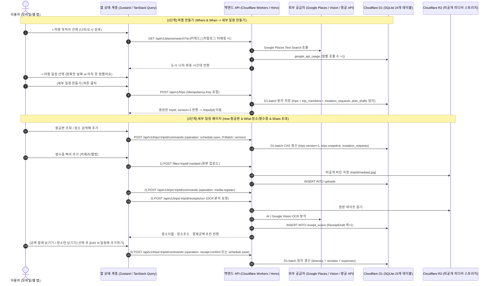

# MVP 최종 작업 기획서 (여행 만들기 · 세부 일정 · 데이터 통신 · DB 아키텍처)

이 문서는 **여행 만들기(`Where·When`) → 세부 일정(`How·What·영수증·친구 초대`)**의 **UI/UX 화면 분리 규격**, **API 데이터 통신 명세**, **Cloudflare D1·R2 데이터베이스 참조 및 저장 구조**를 하나로 통합한 **최종 작업 기획서**입니다.

- **시각화 와이어프레임**:
  - 1단계 (여행 만들기 · 목적지 선택 · 기간 선택): [wireframe-new-trip.png](<../../02. 디자인/01. 화면설계/wireframe-new-trip.png>)
  - 2단계 (세부 일정 · 영수증 추가 · 장소 검색 & 친구 초대): [wireframe-trip-schedule.png](<../../02. 디자인/01. 화면설계/wireframe-trip-schedule.png>)
- **연관 개발·디자인 문서**: [여행일정_화면규격.md](<../../02. 디자인/01. 화면설계/여행일정_화면규격.md>), [앱서버_API계약.md](<../../03. 개발/01. API계약/앱서버_API계약.md>), [DB_객체사전.txt](<../../03. 개발/02. 데이터정의/DB_객체사전.txt>)

---

## 1. 핵심 UX 및 화면 구성 원칙

1. **단일 목적 화면 분리 (스크롤 없는 깔끔한 UX)**:
   - 한 화면에 검색 결과·도시 리스트·달력을 한꺼번에 늘어놓지 않습니다.
   - **`< 여행 만들기`** 진입 시에는 **`나의 여행 목적지는?` 박스**, **`내 여행 기간` 박스**, **`추천 여행지` 가로 카드**, 하단 **`[세부 일정 만들기]` 버튼** 4가지만 한 화면에 고정 배치합니다.
   - **목적지 박스 터치 시** ➔ **`< 여행 목적지 선택`** 전용 페이지로 이동합니다.
   - **기간 박스 터치 시** ➔ **`< 여행 일정`** 전용 페이지로 이동합니다.
2. **100% 이용자(사용자) 관점의 텍스트(Copywriting)**:
   - 화면에 시스템 내부 용어(`Google 연동`, `OCR 자동 추출`, `가계부 연동 ON`, `바이럴 딥링크`)를 절대 노출하지 않습니다.
   - 모든 문구는 사용자 행동 중심(`"나의 여행 목적지는?"`, `"어디로 떠나시나요?"`, `"언제 떠나시나요?"`, `"세부 일정 만들기"`, `"일정에 사용 금액도 함께 남길까요?"`, `"함께 갈 친구 초대하기"`)으로만 표기합니다.

---

## 2. 전체 데이터 통신 및 DB 저장 아키텍처 개요



---

## 3. 단계별 화면 동작 · API 통신 · DB 참조 및 저장 상세 명세

### 3.1 [화면 1 ~ 3] 여행 만들기 플로우 (`/new-trip`)

#### ① `< 여행 만들기` 초기 진입 및 추천 여행지 로드

- **진입 경로**:
  - **홈 → 만들기 버튼**: 빈 상태로 시작.
  - **홈 → 나라/도시 선택**: `country`, `city`, `timezone`, `defaultCurrency`가 채워진 상태로 시작.
- **데이터 참조**:
  - 추천 여행지 카드 및 기본 대도시 카탈로그는 `@wherego/domain`의 내장 카탈로그(`discoveryDestinations` / 대표 도시 목록)와 로컬 에셋(`apps/mobile/assets/destinations/`)을 참조하여 **네트워크 지연 없이(0ms)** 즉시 렌더링합니다.
  - 회원이 작성 중이던 임시 초안이 있는 경우 `GET /api/v1/plan-drafts` 및 `PUT /api/v1/plan-drafts/:id`를 통해 **D1 `plan_drafts` 테이블**(계정당 최대 5개, `owner_id`, `id`, `payload`, `revision`, `saved_at`)에 임시 저장·복원합니다.

#### ② `< 여행 목적지 선택` (Where — 나라·도시 선정)

- **양방향 선택 규칙**:
  - **나라 선택 시**: 해당 나라의 주요 대도시(오사카·도쿄·후쿠오카·삿포로, 호치민·다낭, 베이징·칭다오, 파리, 런던, 뉴욕·샌프란시스코 등)를 필터링하여 노출합니다.
  - **도시 선택/검색 시**: 해당 도시의 소속 나라(`country`), 시간대(`timezone`), 기본 통화(`defaultCurrency`)를 자동 매칭합니다.
- **API 통신 (`카탈로그 외 도시 검색 시`)**:
  - **요청**: `GET /api/v1/places/search?q={검색어}` (Authorization Bearer 토큰 포함, 타임아웃 15초)
  - **서버 처리 (`apps/api/src/features/places/places.ts`)**:
    1. **DB 참조/갱신**: D1 `google_api_usage` 테이블(`month`, `operation='text-search'`, `hits`)에서 월별 할당량을 확인하고 호출 수를 `+1` 기록합니다.
    2. 외부 `https://places.googleapis.com/v1/places:searchText`를 호출하여 `id`(`googlePlaceId`), `title`(도시/장소명), `address`(소속 국가·지역 주소)를 반환합니다.

#### ③ `< 여행 일정` (When — 정확한 일정 vs 아직 일정을 못 정했어요)

- **옵션 A (`정확한 일정이 있어요`)**:
  - 달력에서 `startDate`(`YYYY-MM-DD`)와 `endDate`(`YYYY-MM-DD`)를 선택합니다(1일 당일치기 ~ 최대 90일).
- **옵션 B (`아직 일정을 못 정했어요` — 일정 미정)**:
  - 날짜를 확정하지 않은 사용자를 위해 예정 일수(기본 `2박 3일 / 3일`, `1~15일` 조절)만 선택합니다.
  - **DB 저장 방식**:
    - `PersistedTrip`(`trips.snapshot.trip`)에 `datesUndecided?: boolean` 플래그(또는 미정 상태 표식)를 두고, `days` 배열(`DAY 1 ~ DAY N`)을 생성합니다.
    - 화면에서는 날짜(`YYYY-MM-DD`) 대신 `DAY 1`, `DAY 2`, `DAY 3`만 노출하며, 추후 세부 일정 페이지에서 출발일을 확정하면 `trip.period` 명령으로 기존 `DAY 1~N`의 일정(`itinerary`)을 유지한 채 날짜만 일괄 매핑합니다.

#### ④ 하단 `[세부 일정 만들기]` 버튼 클릭 시 (여행 생성 통신 & DB 저장)

- **API 요청**:
  - **엔드포인트**: `POST /api/v1/trips`
  - **헤더**: `Idempotency-Key: <UUID>` (네트워크 재시도 시 중복 생성 방지)
  - **Body (`PersistedTripInput`)**:
    ```json
    {
      "title": "오사카 3박 4일",
      "country": "일본",
      "city": "오사카",
      "startDate": "2026-11-10",
      "endDate": "2026-11-13",
      "timezone": "Asia/Tokyo",
      "defaultCurrency": "JPY"
    }
    ```
- **DB 저장 (`apps/api/src/infrastructure/storage/cloudStore.ts` — `insertTrip`)**:
  - Cloudflare D1에서 **`D1.batch` 단일 원자적 트랜잭션**으로 아래 4개 테이블을 동시에 처리합니다:
    1. **`mutation_requests` (`INSERT`)**: `(actor_id, request_key, input_hash, result, created_at)` 기록 — 동일 버튼 연타나 재시도 시 중복 생성 원천 차단.
    2. **`trips` (`INSERT`)**:
       - `id`: 생성된 여행 UUID (PK)
       - `owner_id`: 현재 사용자 ID (`user.id` FK)
       - `version`: `1` (초기 버전)
       - `snapshot`: 초기 `WorkspaceSnapshot` JSON (`trip`, `days: [DAY 1..N]`, `itinerary: []`, `expenses: []`, `receipts: []`, `members: [owner]`, `media: []`, `invites: []`)
       - `last_key`: `"{userId}:{requestKey}"`
    3. **`trip_members` (`INSERT`)**: `(trip_id, user_id, role='owner')` 권한 인덱스 생성 (이후 `GET /api/v1/trips` 목록 조회 및 접근 권한 검사에 참조).
    4. **`plan_drafts` (`DELETE`)**: 생성에 사용된 임시 초안 자동 정리.
  - **게스트 모드인 경우**: 서버 호출 대신 기기 로컬 저장소(`tripprint-guest-<guestUUID>`)에 동일한 `WorkspaceSnapshot` 구조로 즉시 저장하며, 이후 로그인 시 `POST /api/v1/guest-import/:id`로 서버 D1에 이관합니다.

---

### 3.2 [화면 4 ~ 6] 세부 일정 페이지 플로우 (`/trips/[id]`)

세부 일정 페이지 진입 시 **`GET /api/v1/trips/:tripId/workspace`**를 호출하며, 서버는 **`trips` JOIN `trip_members`** 쿼리로 사용자의 멤버십(`owner` / `editor` / `viewer`)을 검증한 뒤 `WorkspaceSnapshot`을 반환합니다. 이후 모든 수정은 **`POST /api/v1/trips/:tripId/commands`** 단일 명령 파이프라인을 통해 처리됩니다.

#### ① [How] 항공편 조회 및 등록

1. **편명 자동 조회 API**:
   - **요청**: `GET /api/v1/flights/lookup?number=KE723&date=2026-11-10`
   - **서버 처리 (`apps/api/src/features/flights/flights.ts`)**: 사용자별 Rate Limiter(`FLIGHT_LOOKUP_LIMITER`) 검사 후 한국공항공사(KAC) 또는 항공 데이터 공급자에서 출발/도착 공항 IATA 코드(`ICN`, `KIX`), 터미널, 현지 출발·도착 시각, 비행 소요시간(`durationMinutes`)을 조회해 반환합니다.
2. **항공편 저장 API 및 DB 반영**:
   - **요청**: `POST /api/v1/trips/:tripId/commands`
   - **헤더**: `Idempotency-Key: <UUID>`, `If-Match: "trip:<tripId>:<version>"`
   - **Body**:
     ```json
     {
       "operation": "schedule.save",
       "input": {
         "id": "<scheduleUUID>",
         "dayId": "<해당 탑승일 DAY UUID>",
         "title": "대한항공 KE723 · 인천 → 간사이",
         "type": "TRANSPORT",
         "timeSlot": "09:35",
         "sortOrder": 1,
         "flight": {
           "number": "KE723",
           "departure": "ICN",
           "arrival": "KIX",
           "departureTerminal": "T2",
           "arrivalTerminal": "T1",
           "arrivalTime": "11:20"
         }
       }
     }
     ```
   - **DB 저장**: `trips.version`이 일치할 때만 `trips.snapshot.itinerary` 배열에 항공편 일정을 추가하고 `version`을 `+1` 증가시킵니다.

#### ② [What - 방식 A] 장소 검색해 추가 (구글 지도 연동)

1. **장소 검색 API**:
   - **요청**: `GET /api/v1/places/search?q={여행도시 + 검색어}` (예: `"오사카 이치란"`, `"오사카 성"`)
   - **DB 참조**: D1 `google_api_usage` 테이블 호출 수 집계 후 Google Places 결과를 반환합니다(Google 정책 준수를 위해 검색 결과 원문은 DB에 영구 캐시하지 않고, 사용자가 선택한 장소만 일정에 저장).
2. **일정 추가 API 및 DB 반영**:
   - 사용자가 검색 결과에서 `[선택]`을 누르면 `POST /api/v1/trips/:tripId/commands` (`operation: "schedule.save"`)를 호출합니다.
   - **저장 필드 (`WorkspaceSchedule`)**: `id`, `dayId`, `title`(장소 이름), `address`(장소 주소), `googlePlaceId`, `location: { latitude, longitude }`, `type: "PLACE"`, `timeSlot`, `memo`, `sortOrder`.
   - **동선 미니맵 반영**: 저장된 `location` 좌표와 `googlePlaceId`를 기반으로 해당 `DAY`의 미니맵에 순서 핀(`1`, `2`, `3`)과 이동 경로(`schedule.route` / `POST /api/v1/planning/routes`)를 표시합니다.

#### ③ [What - 방식 B (핵심)] 영수증 찍어 추가 (장소 이름 · 장소 주소 · 사용 금액 여부)

영수증 촬영 추가는 **파일 업로드(R2) → OCR 분석(Vision/AI) → 사용자 3대 항목 확인 → 일정·지출 반영(D1)**의 4단계 파이프라인으로 동작합니다.

1. **Step 1 — 비공개 영수증 이미지 업로드 (`R2` + `D1 uploads`)**:
   - **요청**: `POST /files/:tripId/:mediaId` (Binary JPEG/PNG, 최대 4MB)
   - **서버 처리 (`cloudMedia.ts`)**:
     - 파일 시그니처(매직 바이트)와 멤버 권한(`owner` 또는 `editor`) 검증.
     - **Cloudflare R2 (`MEDIA` 버킷)**에 `{tripId}/{mediaId}.jpg` 경로로 비공개 저장.
     - **D1 `uploads` 테이블**에 `(path, trip_id, actor_id, mime, size, created_at)` 메타데이터 INSERT.
   - 이어서 `POST /api/v1/trips/:tripId/commands` (`operation: "media.register"`, `purpose: "receipt"`)로 여행 스냅샷의 `media` 배열에 등록합니다.
2. **Step 2 — 영수증 OCR 분석 및 주소 매칭 (`D1 receipt_scans`)**:
   - **요청**: `POST /api/v1/trips/:tripId/receipts/ocr` (Body: `{ "mediaId": "<mediaUUID>" }`, 클라이언트 제한 시간 **75초**)
   - **서버 처리 (`ocr.ts`)**:
     - **DB 참조**: 먼저 D1 `receipt_scans` 테이블(`trip_id`, `media_id`)에 이미 분석된 캐시가 있는지 확인하고, 없으면 D1 `receipt_scan_limits` 테이블에서 계정별 호출 한도를 확인합니다.
     - R2에서 원본 바이트를 읽어 AI / Google Vision `DOCUMENT_TEXT_DETECTION`을 수행하여 **상호명(`merchant`)**, **주소(`address`)**, **결제 금액(`amount`)**, **통화(`currency`)**, **결제일시(`transactionDate`, `transactionTime`)**를 추출합니다.
     - 추출된 초안(`ReceiptDraft`)을 **D1 `receipt_scans` 테이블**에 캐시하고 앱으로 반환합니다.
3. **Step 3 — 화면 5(`영수증으로 일정 추가`) 사용자 확인 및 DB 최종 반영**:
   - 화면에는 **① 장소 이름**, **② 장소 주소**, **③ 사용 금액(`금액 함께 남기기` vs `장소만 남기기`)**, **④ 추가할 일차(`DAY 1~N`)**를 표시합니다.
   - **선택 케이스별 저장 분기**:
     - **케이스 1: `[금액 함께 남기기]` 선택 시**:
       - `operation: "receipt.confirm"` (또는 금액 포함 일정·영수증 확정 명령) 전송.
       - **D1 `trips.snapshot` 원자적 갱신**:
         1. `itinerary` 배열에 신규 방문 일정(`title: 장소이름`, `address: 장소주소`, `timeSlot`) 추가.
         2. `receipts` 배열에 확정 영수증(`merchant`, `address`, `amount`, `currency`, `scheduleId`, `mediaId`) 추가.
         3. `expenses` 배열에 실제 지출(`isActual: true`, `source: 'receipt'`, `amount`, `currency`, `scheduleId`) 자동 추가.
     - **케이스 2: `[장소만 남기기]` (금액 미포함) 선택 시**:
       - 영수증에서 읽은 **장소 이름(`title`)**과 **장소 주소(`address`)**만 사용하여 `operation: "schedule.save"`로 해당 `DAY`의 `itinerary`에 일정을 추가합니다 (`expenses`에는 금액을 합산하지 않아 깔끔하게 방문 기록만 남김).
       - 원본 영수증 사진을 보관하지 않는 경우(`keepPhoto: false`), **D1 `receipt_cleanup_jobs` 테이블**에 삭제 작업이 등록되어 R2 원본 이미지를 안전하게 정리합니다.

#### ④ [Invite & Share] 함께 갈 친구 초대하기 및 공동 편집

1. **초대 링크 생성 (`operation: "invite.create"`)**:
   - 소유자(`owner`)가 `[친구 초대]` 화면에서 권한(`일정 함께 추가·편집 [editor]` 또는 `일정 보기만 [viewer]`)을 선택하고 카카오톡·메시지·링크 복사를 누릅니다.
   - **API 요청**: `POST /api/v1/trips/:tripId/commands` (`{ "operation": "invite.create", "input": { "role": "editor" } }`)
   - **보안 및 DB 저장 (`D1 invites`)**:
     - 서버는 64자리 난수 `token`을 생성하여 클라이언트에만 1회 반환하고, DB에는 SHA-256 해시값(`token_hash`)만 저장합니다.
     - **D1 `invites` 테이블**에 `(id, trip_id, token_hash, role='editor', expires_at)` 레코드를 INSERT하고, `trips.snapshot.invites`에 메타데이터를 기록합니다.
2. **카카오톡 / 메시지 공유 및 앱 이동 (Deep Link & Handoff)**:
   - 생성된 초대 URL(`https://<도메인>/invite?token=<64자리토큰>` 또는 앱 스킴 `tripprint://invite?token=...`)을 카카오톡 공유, SMS 메시지, 클립보드로 전달합니다.
   - 친구가 링크를 클릭하면 앱의 `/invite` 화면이 열립니다(미설치자는 웹 랜딩 안내 후 앱 설치·로그인 완료 시 `oauth_handoffs` / 로컬 토큰 보관으로 `/invite`에 자동 복귀).
3. **초대 수락 및 공동 편집 합류 (`POST /api/v1/invites/accept`)**:
   - **API 요청**: `POST /api/v1/invites/accept` (Body: `{ "token": "<64자리토큰>" }`, `Idempotency-Key: <UUID>`)
   - **DB 참조 및 저장**:
     1. 수신한 `token`을 SHA-256 해시하여 **D1 `invites` 테이블**에서 `token_hash` 일치 여부, 만료 시각(`expires_at > now`), 미사용(`used_at IS NULL`), 미철회(`revoked_at IS NULL`) 상태를 검증합니다.
     2. 검증 통과 시 **`D1.batch` 원자 트랜잭션**으로:
        - `invites` 테이블: `used_at = now`, `used_by = 친구 userId` 업데이트.
        - `trip_members` 테이블: `(trip_id, user_id, role='editor')` INSERT.
        - `trips` 테이블: `snapshot.members` 배열에 친구 프로필(`memberId`, `userId`, `nickname`, `role: 'editor'`) 추가 및 `version + 1`.
     3. 응답으로 받은 `tripId`를 통해 즉시 `/trips/[id]` 세부 일정 페이지로 이동하며, 초대받은 친구도 **장소 추가, 영수증 찍어 추가, 항공편 입력, 순서 변경**을 함께 수행할 수 있습니다.

---

## 4. 화면 · API · DB 테이블 매핑 요약표

| 화면 단계                   | 사용자 액션                         | 호출 API 엔드포인트                                    | 참조 및 저장 DB 테이블 (Cloudflare D1 / R2)                       |
| --------------------------- | ----------------------------------- | ------------------------------------------------------ | ----------------------------------------------------------------- |
| **화면 1: `< 여행 만들기`** | 진입 / 추천 여행지 선택 / 초안 저장 | `GET / PUT /api/v1/plan-drafts/:id`                    | D1 `plan_drafts` (계정당 최대 5개 초안)                           |
| **화면 2: `< 목적지 선택`** | 나라·도시 검색 및 선택              | `GET /api/v1/places/search?q=...`                      | 내장 카탈로그 + D1 `google_api_usage`                             |
| **화면 3: `< 여행 일정`**   | 날짜 선택 또는 `일정 미정` 선택     | 클라이언트 상태 확정 후 화면 1 복귀                    | `PlanForm` 상태 (`startDate`, `endDate`, `datesUndecided`)        |
| **화면 1 하단 CTA**         | **`[세부 일정 만들기]`** 클릭       | `POST /api/v1/trips`                                   | D1 `trips`, `trip_members`, `mutation_requests`, `plan_drafts`    |
| **화면 4: `< 세부 일정`**   | 여행 상세 및 DAY별 일정 조회        | `GET /api/v1/trips/:tripId/workspace`                  | D1 `trips` JOIN `trip_members`                                    |
| **화면 4: `항공편`**        | 편명 조회 및 항공편 일정 등록       | `GET /api/v1/flights/lookup`<br/>`POST .../commands`   | `FLIGHT_LOOKUP_LIMITER` + D1 `trips.snapshot.itinerary`           |
| **화면 5: `< 영수증 추가`** | 영수증 촬영 → OCR → 일정/금액 추가  | `POST /files/:tripId/:mediaId`<br/>`POST .../ocr`      | R2 `MEDIA` 버킷 + D1 `uploads`, `receipt_scans`, `trips.snapshot` |
| **화면 6: `< 장소 추가`**   | 맛집·관광지·숙소 검색 후 DAY에 추가 | `GET /api/v1/places/search`<br/>`POST .../commands`    | D1 `google_api_usage` + D1 `trips.snapshot.itinerary`             |
| **화면 6: `< 친구 초대`**   | 카톡·메시지 초대 링크 생성 및 수락  | `POST .../commands` (`invite.create`)<br/>`.../accept` | D1 `invites` (`token_hash`), `trip_members`, `trips.snapshot`     |

---

## 5. 구현 작업 순서 (Action Plan)

위 기획서와 기술 명세를 바탕으로 다음 순서로 코드 작업을 진행합니다.

1. **Step 1 — 도메인·검증 스키마 확장 (`packages/domain`, `packages/validation`)**:
   - `아직 일정을 못 정했어요(일정 미정)` 상태(`datesUndecided` 및 기본 `DAY 1~N` 생성)와 영수증 일정 추가 시 `장소만 남기기(금액 미포함)` 분기를 도메인·검증 스키마에 반영합니다.
2. **Step 2 — `[1단계] 여행 만들기` 3개 단일 목적 화면 구현 (`apps/mobile/src/features/workspace/planning/`)**:
   - **화면 1 (`< 여행 만들기`)**: 스크롤 없이 `나의 여행 목적지는?`, `내 여행 기간`, `추천 여행지` 가로 스와이프, 하단 `[세부 일정 만들기]` 버튼만 배치.
   - **화면 2 (`< 여행 목적지 선택`)**: 목적지 박스 클릭 시 열리는 전용 화면(나라 칩 + 도시 그리드 + 검색 + `[선택 완료]`).
   - **화면 3 (`< 여행 일정`)**: 기간 박스 클릭 시 열리는 전용 화면(`정확한 일정이 있어요` 달력 탭 / `아직 일정을 못 정했어요` 일수 선택 탭 + `[일정 선택 완료]`).
   - 기존 생성 단계에 섞여 있던 항공권 단계(`step === 'flights'`)는 여행 만들기에서 완전히 분리합니다.
3. **Step 3 — `[2단계] 세부 일정 페이지` 및 전용 추가·초대 화면 구현 (`apps/mobile/src/features/workspace/`)**:
   - **화면 4 (`세부 일정 메인`)**: 상단 `[친구 초대]`, 항공편 카드, `DAY` 탭 + 동선 미니맵 + 타임라인, 하단 고정 **`[장소 검색해 추가]` + `[영수증 찍어 추가]`** 2대 버튼 배치.
   - **화면 5 (`< 영수증으로 일정 추가`)**: `장소 이름`, `장소 주소`, `사용 금액([금액 함께 남기기] / [장소만 남기기])`, `어느 날 일정에 넣을까요?` 4개 사용자 친화적 입력 구성.
   - **화면 6 (`< 장소 추가 · 친구 초대`)**: 구글 지도 장소 검색 시트 및 카카오톡·메시지·링크 복사 초대 시트(`일정 함께 추가·편집` 기본 선택) 연결.
4. **Step 4 — 전체 품질·문서·타입·테스트 검증**:
   - `npm run check:design`, `check:resources`, `check:architecture`, `check:navigation`, `typecheck`, `lint`, `test:auth` 및 `check-docs.mjs` 무결성 검증.
