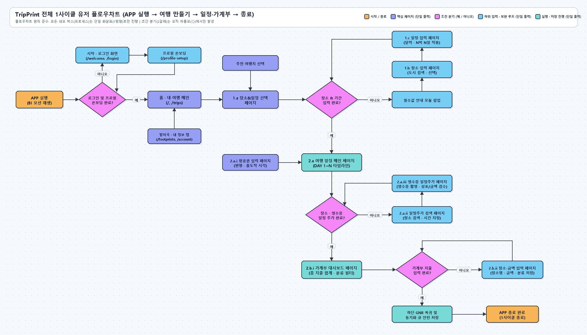
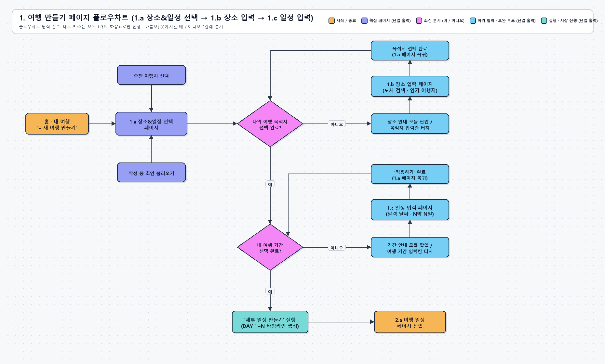
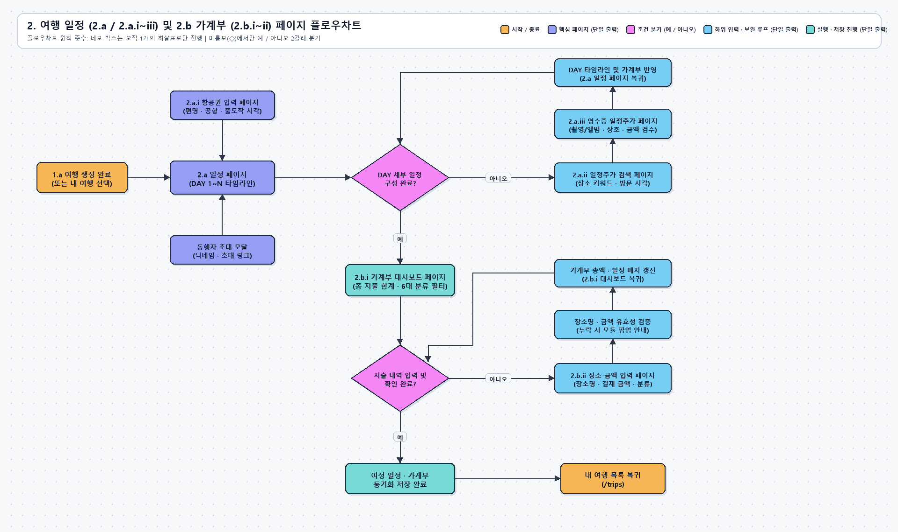
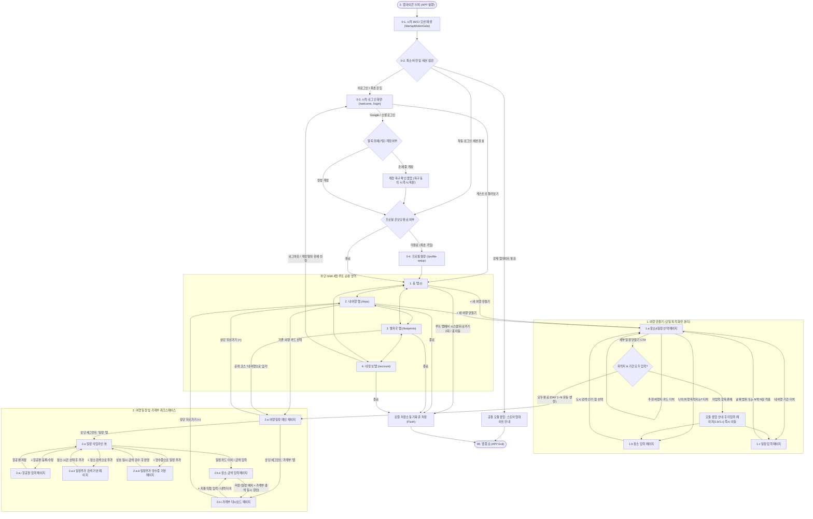
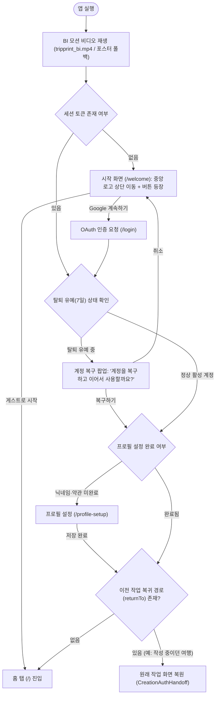
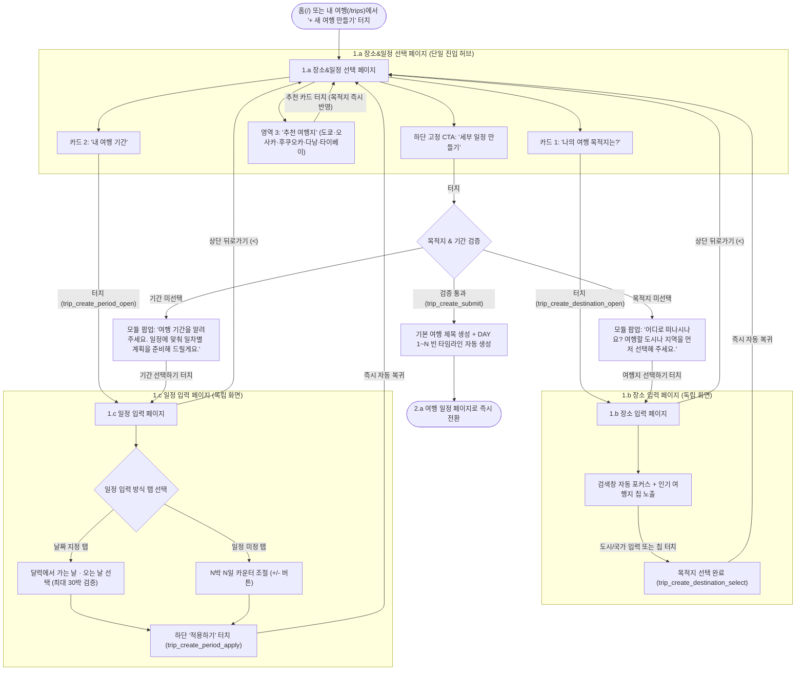
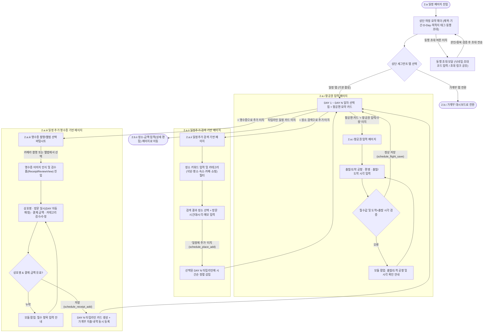
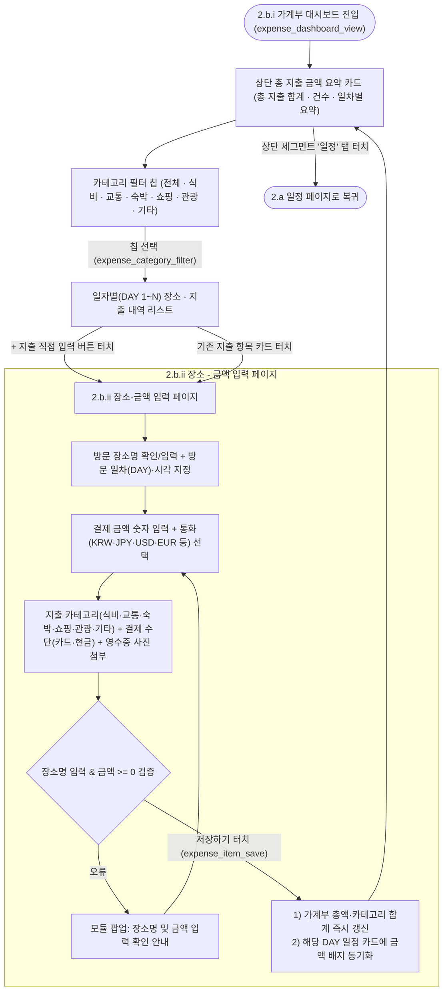
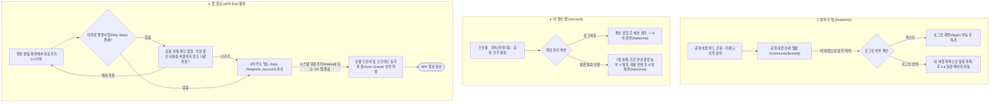

# 사용자 탐색 흐름 (앱 실행 ~ 종료 1사이클 및 페이지별 유저 플로우)

이 문서는 TripPrint 앱의 **최초 실행(App Launch)부터 핵심 기능 수행(여행 만들기 · 여행 일정 · 가계부 · 발자국 · 내 정보) 후 앱 종료(App Exit)까지의 전체 1사이클 유저 플로우**와 **각 페이지별 상세 유저 플로우차트**를 정의합니다.

---

## 1. 전체 1사이클 마스터 유저 플로우 (APP 실행 → 핵심 여정 → 종료)

- **도식화 이미지**: [전체 1사이클 플로우차트](userflow-full-cycle.png) · [1. 여행 만들기 플로우차트](userflow-1-trip-create.png) · [2. 여행 일정 및 가계부 플로우차트](userflow-2-schedule-expense.png)

---

## 2. 단계별·페이지별 상세 유저 플로우차트

### 2.1 [0단계] 앱 실행 · 시작 모션 · 인증 · 온보딩 플로우

관련 코드: [`StartupPolicyGate.tsx`](../../../apps/mobile/src/features/startup/ui/StartupPolicyGate.tsx), [`WelcomeScreen.tsx`](../../../apps/mobile/src/features/auth/ui/WelcomeScreen.tsx), [`useLoginController.ts`](../../../apps/mobile/src/features/auth/manager/useLoginController.ts)

---

### 2.2 [1단계] `1. 여행 만들기` (`1.a` / `1.b` / `1.c`) 페이지별 플로우

관련 코드: [`TripPlanningFlowView.tsx`](../../../apps/mobile/src/features/workspace/planning/ui/TripPlanningFlowView.tsx), [`TripPlanningBasics.tsx`](../../../apps/mobile/src/features/workspace/planning/ui/TripPlanningBasics.tsx), [`TripFields.tsx`](../../../apps/mobile/src/features/workspace/planning/ui/TripFields.tsx), [`TripPeriodPicker.tsx`](../../../apps/mobile/src/features/workspace/planning/ui/TripPeriodPicker.tsx)

---

### 2.3 [2단계-A] `2.a 여행 일정 페이지` 및 하위 입력 (`2.a.i` / `2.a.ii` / `2.a.iii`) 플로우

관련 코드: [`WorkspaceHeadingView.tsx`](../../../apps/mobile/src/features/workspace/hub/ui/WorkspaceHeadingView.tsx), [`WorkspaceDialogs.tsx`](../../../apps/mobile/src/features/workspace/hub/ui/WorkspaceDialogs.tsx), [`PlaceSearch.tsx`](../../../apps/mobile/src/features/workspace/schedule/ui/PlaceSearch.tsx), [`ReceiptReviewView.tsx`](../../../apps/mobile/src/features/workspace/receipt/ui/ReceiptReviewView.tsx)

---

### 2.4 [2단계-B] `2.b 가계부 페이지` (`2.b.i` 대시보드 / `2.b.ii` 장소-금액 입력) 플로우

관련 코드: [`WorkspaceExpenseView.tsx`](../../../apps/mobile/src/features/workspace/hub/ui/WorkspaceExpenseView.tsx), [`PlanEditorView.tsx`](../../../apps/mobile/src/features/workspace/my-trips/ui/PlanEditorView.tsx), [`PlanEditorOptions.tsx`](../../../apps/mobile/src/features/workspace/my-trips/ui/PlanEditorOptions.tsx)

---

### 2.5 [3단계] 발자국 (`/footprints`) · 내 정보 (`/account`) · 앱 종료 (APP Exit) 플로우

관련 코드: [`PublicFootprintsScreen.tsx`](../../../apps/mobile/src/features/workspace/community/ui/PublicFootprintsScreen.tsx), [`AccountScreenView.tsx`](../../../apps/mobile/src/features/profile/ui/AccountScreenView.tsx)

---

## 3. 공통 화면 전환 및 제약사항 보호 규칙

1. **단일 목적 화면 전환 원칙**:
   - 한 화면에 여러 입력 폼을 나열해 긴 스크롤을 유발하지 않고, 목적지 선택(`1.b`)·기간 선택(`1.c`)·항공권(`2.a.i`)·장소 검색(`2.a.ii`)·영수증(`2.a.iii`)·장소-금액 입력(`2.b.ii`)을 각각 독립된 목적 화면으로 분리하여 진입·복귀합니다.
2. **하단 GNB 노출 제어**:
   - 루트 4탭(`/`, `/trips`, `/footprints`, `/account`)에서만 하단 GNB를 노출하고, 하위 작업 화면(`1.a~1.c`, `2.a.i~2.a.iii`, `2.b.ii`, `/login`, `/profile-setup`)에서는 하단 GNB를 숨겨 작업 집중도를 유지합니다.
3. **모듈 팝업(`DialogModal`) 단일 예외 처리**:
   - 필수값 누락, 날짜 역전, 미저장 이탈 시 개발자 용어 없는 사용자 중심 안내 팝업을 띄우고 다음 행동을 바로 이어갈 수 있는 주요 버튼(CTA)을 제공합니다.
