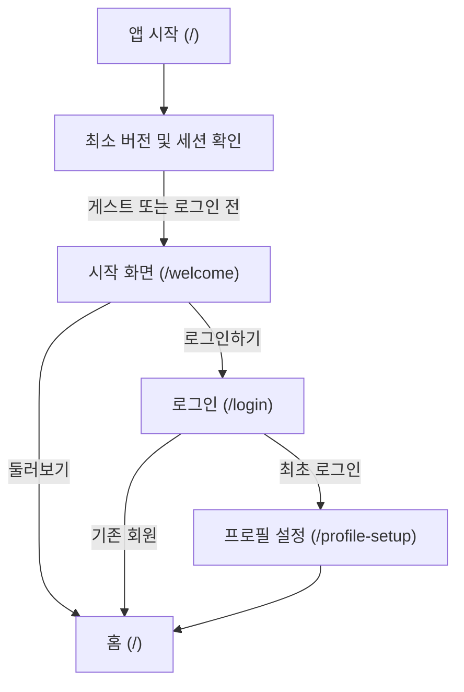

# 사용자 탐색 흐름

이 문서는 TripPrint 앱의 진입부터 주요 탭 이동, 상세 화면 진입 및 복귀 규칙을 정의합니다.

---

## 1. 앱 진입 및 온보딩 흐름

- 로그인 화면(`/login`)으로 진입하기 직전의 목적지 경로(`returnTo`)와 작성 중이던 여행 생성 입력(`CreationAuthHandoff`)을 보존하여, 인증 완료 후 원래 작업 화면으로 복귀합니다.

---

## 2. 하단 GNB 4탭 탐색 구조

| 탭 순서 | 탭 이름 | 경로          | 주요 역할                                                                                        |
| ------- | ------- | ------------- | ------------------------------------------------------------------------------------------------ |
| 1       | 홈      | `/`           | 진행·예정 여행 컨시어지, 새 여행 빠른 시작, 검증 코스 탐색                                       |
| 2       | 내 여행 | `/trips`      | 진행 중·예정·완료 여행 목록 관리, 새 여행 만들기, 여행 상세 진입                                 |
| 3       | 발자국  | `/footprints` | 공개 여행 피드 검색·필터, 공개 여행 상세 열람 및 내 여행으로 담기                                |
| 4       | 내 정보 | `/account`    | 프로필 편집, 로그인·게스트 상태 관리, 언어 설정(`ko`/`en`/`ja`), 글자 크기 접근성, 로그아웃·탈퇴 |

---

## 3. 상세 화면 진입 및 이탈 보호 규칙

1. **하단 GNB 숨김 경로**:
   - 여행 생성 및 상세 편집 워크스페이스, 로그인·프로필 설정, 공개 여행 상세(`/community/[postId]`) 등 집중 작업 화면에서는 하단 GNB를 숨기고 상단 `ScreenHeader`의 뒤로가기 버튼을 제공합니다.
2. **작성 중 이탈 보호**:
   - 새 여행 생성, 일정 편집, 영수증 확인, 프로필 설정 화면에서 저장하지 않은 변경 사항이 있을 때 뒤로가기를 누르면 공통 확인 팝업(`AppPopup`)으로 계속 작성할지 여부를 먼저 확인합니다.
