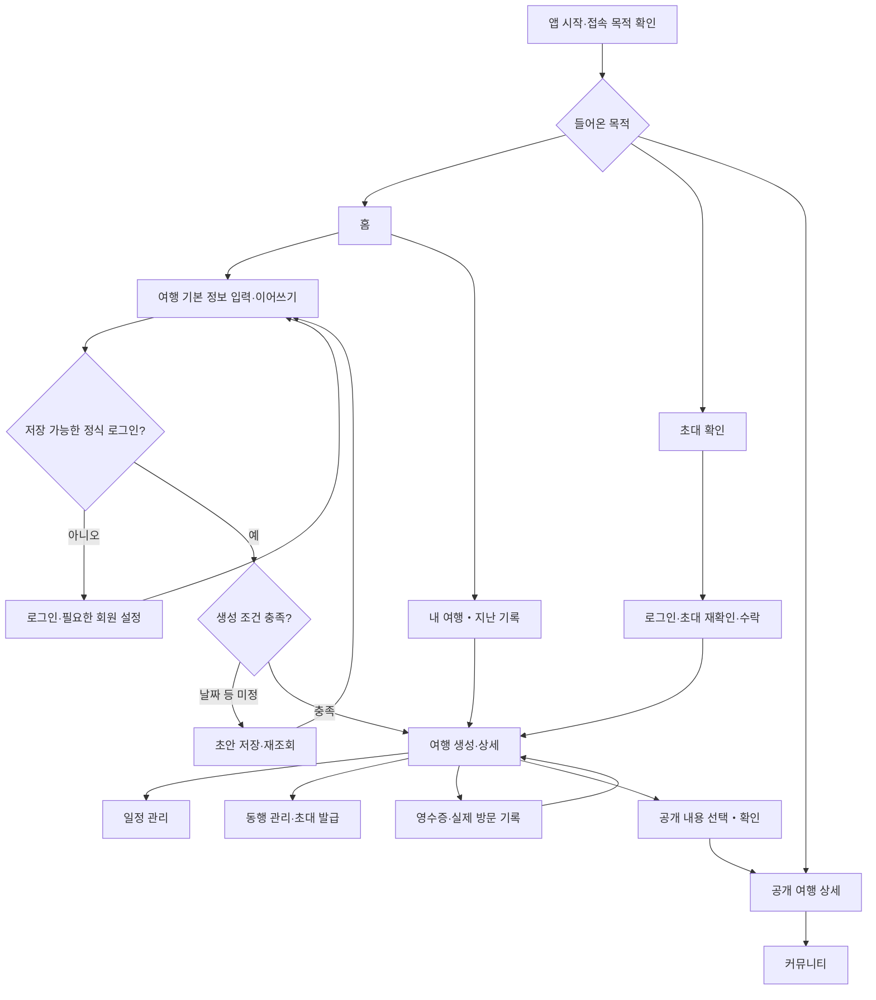

# 전체 사용자 흐름과 페이지 역할

작성일: 2026-10-27 / 버전: v0.1 / 상태: 확정 정책을 반영한 이동 구조 검토안

기준: [핵심 정책 확정 사항](<../01. 기능정의/핵심정책_확정사항.md>). 서비스 목적은 내 여행 준비 → 실제 경험 기록 → 보관·공유입니다. 이 문서는 페이지의 책임과 연결을 정의하며 새 URL, 버튼 배치, 색상, 상세 입력 양식을 확정하지 않습니다. 기존 Page01~21 번호를 유지합니다. 세부 단계는 별도 페이지인지 내부 단계인지 후속 설계에서 정합니다.

## 1. 전체 구조

공개 열람에는 정식 로그인을 강제하지 않습니다. 저장·참여·공개 변경은 정식 로그인과 해당 권한을 확인합니다. 초대 수락과 공개 발행은 로그인만 끝났다고 자동 수행하지 않고 대상을 다시 확인합니다.

## 2. 주요 목적지

공통 하단 탐색은 현행 헤더·GNB 규격의 홈·내 여행·커뮤니티·MY를 유지합니다. 생성은 + 행동으로 진입하며 새 탭을 추가하지 않습니다. 작성·상세에서 GNB를 보여줄지와 뒤로가기 모양은 기존 공통 규격을 따릅니다.

| 페이지                          | 역할                                        | 들어오는 곳                       | 다음 이동·돌아갈 곳                                                                                            |
| ------------------------------- | ------------------------------------------- | --------------------------------- | -------------------------------------------------------------------------------------------------------------- |
| Page01 앱 시작                  | 세션과 일반 진입·초대·공개 링크 목적 확인   | 앱 실행·외부 링크                 | 일반 진입은 Page05, 초대는 Page19, 공개는 Page12. 오류는 재시도하며 목적을 잃지 않음                           |
| Page02 로그인                   | 정식 계정으로 인증                          | 저장·초대 수락·권한 있는 행동, MY | 인증 복귀 Page03 또는 필요한 설정 Page04를 거쳐 원래 요청으로 복귀. 취소는 원래 페이지로                       |
| Page03 인증 복귀                | 인증 결과를 확인하고 목적을 복원            | 외부 인증                         | 설정 필요 시 Page04, 아니면 원래 페이지. 실패는 Page02                                                         |
| Page04 회원 설정                | 필요한 회원 설정 완료                       | 신규 회원 인증                    | 원래 목적지로. 홈으로 일괄 보내지 않음                                                                         |
| Page05 홈                       | 내 여행 상태에 맞는 다음 행동 제시          | 일반 앱 진입·공통 탐색            | 새 여행 Page08, 내 여행 Page07, 선택 여행 Page09, 기록 Page14/15                                               |
| Page06 여행지 안내              | 제공 가능한 여행지 정보 확인                | 기존 여행지 진입                  | 선택 정보를 가지고 Page08 또는 원래 위치. 신규 계획의 필수 경유지가 아님                                       |
| Page07 내 여행                  | 서버 여행과 본인 초안을 구분해 찾기         | 홈·공통 탐색                      | 여행 Page09, 초안 Page08, 새 계획 Page08. 비회원은 서버 조회 대신 로그인 목적 안내                             |
| Page08 여행 만들기              | 기본 정보 입력, 초안 복원, 생성 의도 확인   | 홈·내 여행·여행지 안내            | 미인증 저장은 Page02 후 복귀. 초안 저장 후 유지 또는 Page07. 정식 생성 성공 후 Page09                          |
| Page09 여행 상세 작업 공간      | 일정·기록·비용·동행·공개 작업의 공통 출발점 | 내 여행·초대 수락·생성 성공       | 내부 작업 후 같은 여행으로 복귀. 기록은 Page14/15, 공개 결과는 Page12. 뒤로는 원래 목록/홈                     |
| Page10 공개 여행 피드           | 공개된 계획·기록 발견                       | 공통 커뮤니티                     | Page12 상세. 공개 자료가 없어도 내 여행 기능 이용 가능                                                         |
| Page11 공개 여행 검색·기존 진입 | 기존 검색·링크 진입을 피드 흐름에 연결      | 기존 커뮤니티 진입                | Page12. Page10과 별도 신규 커뮤니티를 만들지 않음                                                              |
| Page12 공개 여행 상세           | 공개 사본만 열람                            | 피드·공유 링크·발행 성공          | 피드 진입이면 해당 목록, 외부 진입이면 커뮤니티/홈. 소유자 관리 행동은 인증·권한 확인 후 원본 여행의 공개 관리 |
| Page13 나의 발자국              | 내 기록을 모아 찾기                         | MY·기존 기록 진입                 | Page14 또는 해당 여행 Page09                                                                                   |
| Page14 여행 기록 열람           | 저장된 여행 경험 확인                       | 홈·내 기록·여행 상세              | 권한 있으면 Page15, 해당 여행 Page09, 공개 작업 후 Page12                                                      |
| Page15 여행 기록 편집           | 실제 경험 보완                              | 기록 열람·여행 상세               | 저장 후 재조회한 Page14 또는 호출한 여행. 영수증 처리 후 같은 기록으로 복귀                                    |
| Page16 MY                       | 계정·언어·개인 자료 진입                    | 공통 탐색                         | Page17, Page13, Page18, 필요 시 Page02                                                                         |
| Page17 계정 관리                | 본인 계정 관리                              | MY                                | MY. 인증 변경 시 기존 계정 자료를 남겨 보이지 않음                                                             |
| Page18 이 기기의 이전 기록      | 기존 게스트 자료 복구·명시적 가져오기       | MY의 이전 기록 진입               | 로그인 후 가져오기 결과 확인, 성공한 대상 여행/목록. 원본 자동 삭제 없음                                       |
| Page19 여행 초대                | 링크 유효성·참여 대상·역할 확인             | 외부 초대 링크                    | 미인증은 Page02 후 이곳으로 복귀. 새 수락 성공 또는 기존 멤버는 Page09. 실패·취소는 안전한 홈/목록             |
| Page20 장소 가져오기            | 기존 외부 장소 가져오기 흐름 보존           | 외부 공유·기존 진입               | 변경 전 정식 로그인·여행 권한 확인, 선택한 Page09로 복귀. 이번 기획에서 새 가져오기 기능 확장 없음             |
| Page21 페이지 없음              | 잘못된 진입에서 복귀                        | 없는 경로·잘못된 링크             | 홈 또는 이전의 유효한 위치. 비공개 자료 존재 여부를 노출하지 않음                                              |

비회원에게 내 여행 목록이 없는 상태와 서버 조회 실패는 다릅니다. 기존 게스트 자료는 Page18에서 다루며 새 서버 여행과 자동 병합하지 않습니다.

## 3. 네 가지 흐름의 내부 단계

아래는 Page09 등에서 수행할 작업 단위입니다. 별도 화면 개수나 새 경로를 정한 것이 아닙니다.

| 흐름                | 작업 단계와 책임                                                                                   | 이동 완료 조건                                                                         |
| ------------------- | -------------------------------------------------------------------------------------------------- | -------------------------------------------------------------------------------------- |
| 신규 계획           | Page08 기본 정보 → 로그인 필요 시 왕복 → 미정 초안 저장 또는 조건 검증 → 선택 항공편 → 생성        | 서버 성공 확인 후 Page09. 일정 첫 저장·재조회까지 전체 흐름 검증                       |
| 동행 초대 발급      | Page09 동행 관리 → 소유자 확인 → 역할 선택 → 링크 발급·공유                                        | 발급 결과와 만료 정보 확인 후 같은 여행. 공유 창 종료를 상대 참여 완료로 취급하지 않음 |
| 동행 초대 수락      | Page19 대상 확인 → 로그인·설정 → 링크 재검증 → 참여 확인                                           | 새 멤버는 한 번만 추가, 기존 멤버는 역할 유지·링크 미소비 후 Page09                    |
| 여행 기록           | Page09/15 → 여행·권한 확인 → 촬영/선택 → 인식 → 사용자 수정 → 방문 연결·메뉴·지출·보관 확인 → 저장 | 같은 여행의 기록 재조회. 인식 실패는 직접 입력으로 이어짐. 원래 계획 보존              |
| 공개 발행·갱신      | 소유자의 Page09/14 → 계획/기록과 상태 확인 → 공개 항목 확인 → 발행·갱신                            | 공개 사본 재조회 후 Page12. 원본 변경만으로 이 흐름을 자동 실행하지 않음               |
| 공개 중단·사진 영향 | 원본 여행의 공개 관리 또는 사진 삭제 → 영향 확인 → 필요한 중단/사본 갱신                           | 처리 결과 확인 후 원래 위치. 공개되지 않은 사진 삭제는 공개글 유지                     |

영수증 원본 보기·메뉴 편집은 진행하던 입력 단계로 돌아옵니다. 미저장 입력이 있으면 이탈 시 계속 작성하거나 버릴지 확인합니다. 저장 응답이 불확실하면 같은 작업의 결과부터 조회하며 새 여행·기록을 또 만들지 않습니다.

## 4. 이동할 때 보존할 것

| 상황                        | 보존할 내용                     | 다시 확인할 내용                                                          |
| --------------------------- | ------------------------------- | ------------------------------------------------------------------------- |
| 기본 정보 입력 중 로그인    | 기본 입력·작성 단계·돌아갈 목적 | 정식 로그인 여부, 계정, 저장 조건. 앱 종료 후 복원은 별도 보장하지 않음   |
| 초대 링크에서 로그인        | 해당 초대 목적                  | 로그인 후 만료·철회·소비·기존 참여 여부. 링크를 로그나 문서에 남기지 않음 |
| 다른 페이지에서 여행 선택   | 호출 목적과 선택한 여행         | 여행 접근·편집 권한과 현재 상태                                           |
| 공개 링크 직접 진입         | 공개글 식별과 열람 목적         | 공개 중단·삭제 여부. 원본 자료로 대신 표시하지 않음                       |
| 저장 중 계정 전환·권한 상실 | 기존 입력 보호 가능 범위        | 새 계정으로 자동 저장하지 않음. 이전 계정 응답 표시 차단                  |

뒤로가기는 호출한 위치로 돌아갑니다. 직접 링크로 들어와 이전 위치가 없으면 유효한 홈·목록을 제공합니다. 오류 때문에 사용자를 무조건 홈으로 보내거나 작성 내용을 지우지 않습니다. 로딩·빈 상태·오류·저장 중은 각 페이지의 상태이며 불필요하게 독립 페이지를 늘리지 않습니다.

## 5. 다음 설계에서 확인할 것

1. 기존 경로와 위 역할을 대조해 이동 누락과 인증 복귀를 확인합니다.
2. 내부 단계를 독립 화면·시트·현재 화면의 영역 중 무엇으로 만들지 정합니다.
3. 페이지별 데이터·CTA·예외·접근성 명세를 작성합니다. 날짜 일부만 입력된 초안의 표시와 공개 사진 삭제 처리 순서도 이 단계에서 정합니다.
4. 승인된 개발 범위에서 구현하고 [상위 기획의 완료 기준](<../03. 검토안/서비스_상위기획_및_핵심흐름_검토안.md>)의 PLAN/INV/REC/PUB 시나리오로 검증합니다.

참조 디자인: `docs/02. 디자인/00. 공통규격/디자인시스템.md`, `design-tokens.json`, `헤더GNB_규격.md`. 이번에는 색·폰트·여백·헤더·GNB의 값이나 표시 정책을 바꾸지 않았습니다. 실제 화면 캡처와 실기기 검증은 미실행이며, 새 이동 구조를 구현 완료로 보고하지 않습니다.
