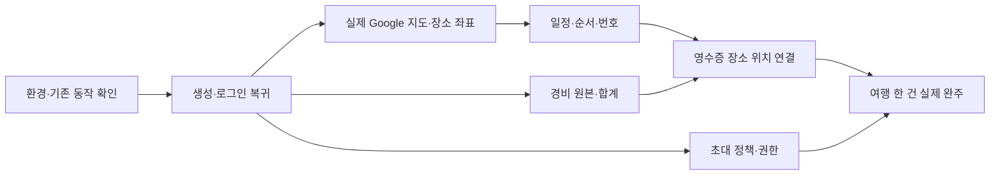

# MVP 구현 대조와 개발 우선순위

> 2026-10-27 개발 시작: DEV-00~02의 로그인 복귀·여행 생성·저장·재조회 흐름을 구현했습니다. 아래 표는 개발 전 대조 기록입니다. 현재 검증 결과와 미완료 항목은 [DEV-00~02 개발·검수 기록](<../../05. 검수/02. 검수보고/2026-10-27_DEV00-02_신규계획_개발검수.md>)을 확인합니다.

검토일: 2026-10-27 / 버전: v0.1 / 상태: 코드·기존 검수 기록 대조, 개발 전 작업 계획

목표는 [여행 한 건 완주 MVP](MVP_여행한건완주_상세명세.md)입니다. 이번에는 코드와 문서를 읽고 개발 작업을 정리했습니다. 앱 실행·테스트·외부 공급자 호출·배포는 수행하지 않았습니다. 이전 검수 결과를 현재 버전의 새 합격 결과로 표시하지 않습니다.

## 1. 판단 기준

| 구분      | 의미                                                                                    |
| --------- | --------------------------------------------------------------------------------------- |
| 재사용    | 기존 기능과 검사 근거가 있어 새로 만들 필요가 적음. 현재 대상 환경에서 회귀 확인은 필요 |
| 수정      | 기능은 있지만 확정 정책 또는 전체 연결이 다름                                           |
| 추가      | 요구를 만족하는 연결·플랫폼 구현이 부족함                                               |
| 환경 검증 | 코드 존재만으로 확인할 수 없고 실제 인증·지도·OCR·기기 확인 필요                        |

‘바로 쓸 수 있음’은 두 의미를 구분합니다. 개발에 바로 활용할 기존 기능은 있습니다. 그러나 이번 조사로 **현재 배포 앱에서 모두 바로 쓸 수 있다고 확인한 기능은 없습니다.** 원격 적용 이력·실계정·실기기를 이번에 확인하지 않았기 때문입니다.

## 2. 기능별 대조

| 기능                                | 판정             | 확인한 구현·근거                                                                               | 남은 일                                                                        |
| ----------------------------------- | ---------------- | ---------------------------------------------------------------------------------------------- | ------------------------------------------------------------------------------ |
| 회원 여행 생성·재조회               | 재사용           | `tripCreation.ts`, `foundation.ts`의 생성 계약. R1에 실제 로컬 Worker/D1 저장·재조회 통과 기록 | 새 인증 복귀와 초안 연결 후 현재 버전 회귀                                     |
| 서버 초안 저장·수정·복원            | 재사용+수정      | `homeData.ts`, 초안 revision·최대 5개·계정 분리. R3에 로컬 D1 21개 통과 기록                   | 정식 회원과 익명 계정 제한 일치, 기본 입력 인증 왕복                           |
| 날짜 미정은 초안, 날짜 확정 후 생성 | 재사용           | 초안 values와 정식 생성의 날짜 필수 검증 분리                                                  | 한쪽 날짜 누락·초안 전환·중복 표시 회귀                                        |
| 로그인 전 입력·저장 전 인증·복귀    | 수정             | `authReturn.ts`는 new-trip 목적지 복귀, `destination.ts`는 회원 설정·대기 목적 처리            | 전체 입력·단계 보존, 취소·계정 전환·다른 초대 우선 처리 정합화                 |
| 날짜별 일정 추가·수정·삭제·순서     | 재사용           | R1에 일정 관리·DAY 이동·순서·재조회 근거. `schedule.reorder` 계약·통합 검사 존재               | 지도 번호와 같은 저장 순서 사용하는지 통합 회귀                                |
| Google 장소 검색                    | 수정             | `places.ts`의 실제 Places 검색 연결. `PlaceSearchResults.tsx`는 장소 ID와 검색어 전달          | 검색어와 실제 상호 구분, 선택 결과→확인 위치→일정 연결                         |
| 검색 장소의 지도 좌표               | 추가 연결        | 현재 검색 필드에 좌표 없음                                                                     | 허용된 상세 정보 조회 또는 지도 선택으로 실제 좌표 보완. 공급자 저장 조건 확인 |
| Android Google 지도·번호 핀         | 재사용+환경 검증 | `TripMapCanvas.native.tsx:108` Google 공급자, `:147` Marker                                    | 실제 기기 타일·키 설정·핀 선택·순서 동기화 확인                                |
| 웹 Google 지도                      | 추가             | `TripMapCanvas.tsx`는 SVG 개략도                                                               | 실제 Google 지도 구현. 개략도는 요구 충족 증거가 아님                          |
| iOS Google 지도                     | 수정/환경 검증   | 같은 native 코드에서 Google 공급자를 지정하지 않음                                             | Google 사용을 위한 플랫폼 연결·설정과 실기기 확인                              |
| 지도 선택 장소 저장                 | 수정             | native POI·길게 누르기 좌표 전달                                                               | 이름·주소·장소 식별 확인, 실제 일정 저장·재조회 연결                           |
| 목록 순서·지도 번호 계산            | 재사용           | `tripMapModel.ts`가 선택 DAY와 sortOrder로 번호 계산                                           | 저장 실패·날짜 이동·좌표 없음·핀 겹침·다른 멤버 수정 회귀                      |
| 실제 도로 안내·최적 경로            | 이번 범위 제외   | `planningRoutes.ts` 거리·시간 응답과 순서 연결선은 별개                                        | 번호·방문 순서를 실제 도로 경로나 최적화로 표현하지 않음                       |
| 수동 예상·실제 비용                 | 재사용           | `workspace.ts` 비용 계약, `TripDetailParts.tsx` 통화별 예상·실제 합계, 통합 테스트 존재        | 일정·영수증과 한 여행에서 합계·수정·삭제 재조회 검증                           |
| 영수증 인식·확인·메뉴·지출          | 재사용+환경 검증 | R2의 로컬·합성 OCR·웹 검사 기록, `workspaceModel.ts` 실제 방문·지출 연결                       | 실제 영수증 OCR·카메라·앨범·지원 통화 인수                                     |
| 영수증 장소를 지도에 표시           | 추가 연결        | 새 실제 PLACE 생성 시 location·googlePlaceId가 채워지지 않음                                   | 기존 방문 ID를 유지한 장소 후보 확인·좌표 저장·핀 연결                         |
| 동행 발급·수락                      | 수정             | 발급·철회·수락 코드 존재, 현재 24시간·기존 멤버 소비 경로                                      | 확정된 7일·새 참여자 1명·기존 멤버 미소비로 변경                               |

재사용 판정은 모든 세부 동작이 현 버전에서 통과했다는 뜻이 아닙니다. 예전 기기 게스트 저장 검수는 새 정책의 비회원 서버 저장 허용 근거로 쓰지 않습니다.

## 3. 왜 이 순서로 개발하나요?

여행 원본과 로그인 연결이 먼저 안정돼야 합니다. 그다음 장소에 실제 위치를 넣어야 지도 핀이 생깁니다. 같은 일정의 순서가 저장돼야 지도 번호와 목록이 맞습니다. 영수증도 장소·비용을 새로 만드는 별도 앱처럼 구현하지 않고 이 흐름에 연결합니다.

아래 P0-A는 혼자 한 여행을 계획할 때 막히는 작업, P0-B는 영수증·협업까지 포함한 이번 범위를 완성하는 작업입니다. P0-B도 필수이며 선택 기능으로 제외하지 않습니다. 비용 검증은 지도 작업과 병행할 수 있습니다.

## 4. 작업별 범위와 완료 기준

| ID·우선순위      | 작업 범위·주요 대상                                                                             | 선행 조건                    | 완료 기준·검증                                                                                                                                        |
| ---------------- | ----------------------------------------------------------------------------------------------- | ---------------------------- | ----------------------------------------------------------------------------------------------------------------------------------------------------- |
| DEV-00 / P0-A    | 시험 환경과 현재 기준선 확인. 기존 검사·실행 경로·대상 DB 이력 확인                             | 코드 변경 전                 | 시험 계정과 격리 환경 준비, 신규 초안·영수증 정리 관련 마이그레이션 적용 여부 확인. 기존 생성→재조회 재현과 실패 지점 기록. 운영 DB 무단 변경 없음    |
| DEV-01 / P0-A    | 로그인 전 기본 입력·회원 제한·인증 복귀. authReturn/destination, 생성 진입, 서버 세션·쓰기 검사 | DEV-00                       | 입력→로그인/회원 설정→동일 단계 복귀. 자동 생성 없음. 익명 서버 쓰기 차단, 취소·다른 계정·늦은 응답 보호. NEW-A01~04·10~12 통과                       |
| DEV-02 / P0-A    | 초안→정식 여행 전환 및 재조회. homeData·tripCreation·cloudStore                                 | DEV-01                       | 날짜 미정·한쪽 날짜는 초안, 유효 기간은 여행 한 건 생성. 버전 충돌·초안 5개 한도·응답 유실·생성 후 조회 실패 처리. NEW-A05~09 통과                    |
| DEV-03 / P0-A    | 실제 Google 지도와 장소 정보 연결. places·PlaceSearchResults·지도 선택·플랫폼 Canvas            | DEV-00, 저장 인계는 DEV-02   | 검색/지도 선택한 실제 장소 3개가 확인한 좌표로 저장·재조회·Google 지도 표시. 원문 저장·출처 조건 확인. Android/웹/iOS 각각 결과 기록. MVP-02·05·11·16 |
| DEV-04 / P0-A    | 날짜별 세부 일정과 순서·지도 동기화. 일정 편집·schedule.reorder·tripMapModel                    | DEV-02·03                    | C→A→B 정렬 후 목록·번호·재조회 모두 동일. 날짜 이동·미확인 좌표·겹친 핀 접근·저장 실패 보호. 제목·시간·메모 유지. MVP-03~05·12                        |
| DEV-05 / P0-A    | 예상·실제·통화별 경비 등록·수정·삭제·합계. 기존 expenses와 비용 UI                              | DEV-02                       | JPY 예상 1,000+2,000=3,000, 실제 JPY 500·KRW 10,000 분리. 수정·삭제·재조회 합계 일치, 0건과 조회 실패 구분. MVP-06·14                                 |
| DEV-06 / P0-B    | 영수증 실제 방문의 위치 확인 연결. receipt 흐름·일정 위치 수정·장소 검색                        | DEV-03~05                    | 새 실제 방문과 기존 일정 연결 모두 유지. 위치 보완은 같은 방문 ID 수정, 영수증·지출 중복 없음. 원래 계획 보존. MVP-07~10·14                           |
| DEV-07 / P0-B    | 실제 OCR·기기 권한·실패 복구 인수                                                               | DEV-06 및 시험용 공급자 설정 | 실물 또는 비식별 시험 영수증으로 촬영/앨범→확인→저장·재조회. 인식 실패는 직접 입력. 잘못된 날짜·통화·중복·원본 보관 확인. 합성 응답 검사와 별도 보고  |
| DEV-08 / P0-B    | 동행 정책·권한. invite.create·acceptSnapshot·InviteScreen                                       | DEV-01·02                    | 발급+7일 경계, 새 계정 한 명만 원자 수락, 기존 멤버 역할 유지·미소비. 수락 전 대상·역할 확인, 조회 결과 양쪽 계정 일치. INV-D01~16 및 MVP-13          |
| DEV-09 / P0 최종 | 한 여행 전체 통합 검수·화면 대조·회귀                                                           | DEV-01~08                    | 아래 계획/기록 여정을 실제 서버로 완주. 기존 디자인·언어·큰 글자·기기 확인. 남은 필수 실패를 해결하거나 미완료로 명시                                 |

참조 ID: NEW-A는 [신규 계획·로그인 명세](신규계획_로그인복귀_페이지상세명세.md), INV-D는 [동행 명세](동행초대_수락_페이지상세명세.md), MVP는 [한 건 완주 명세](MVP_여행한건완주_상세명세.md)입니다.

DEV-03의 공급자·기기 설정이 막혀도 문서·일정 계약·비용·인증 작업은 진행할 수 있습니다. 그러나 다른 지도를 Google 지도라고 표시하거나 SVG를 대신 통과시키지 않습니다. 대상 플랫폼 제외는 별도 사용자 결정 없이 하지 않습니다.

## 5. 최종 인수는 실제 한 여행으로 확인합니다

### 계획 완주

1. 기본 정보를 적고 로그인한 뒤 같은 내용으로 돌아옵니다.
2. 여행 한 건을 생성하고 서버에서 다시 읽습니다.
3. 실제 검색·지도 선택으로 같은 날짜에 장소 세 곳을 추가합니다.
4. 일정의 시간·메모·예상 비용을 등록합니다.
5. 순서를 바꾸고 Google 지도 번호와 목록이 일치하는지 확인합니다.
6. 수동 실제 지출도 입력해 예상·실제·통화별 합계를 확인합니다.
7. 앱을 나갔다 다시 들어와 장소·좌표·순서·금액을 확인합니다.

### 기록·동행 완주

1. 여행 중 또는 완료 여행에 시험 영수증을 등록합니다. 계획 완료에 영수증을 필수로 요구하지 않습니다.
2. 읽은 내용을 확인하고 기존 일정 연결 또는 새 실제 방문을 저장합니다.
3. 새 방문의 위치를 확인하고 지도에 표시합니다. 같은 방문 ID와 실제 비용 한 건을 유지합니다.
4. 앞선 실제 JPY 500에 영수증 JPY 800을 추가하면 실제 JPY 1,300이어야 합니다. 메뉴 합계를 또 더하지 않습니다.
5. 읽기·편집 멤버가 각자 허용된 행동만 수행하며 재조회 결과가 일치하는지 확인합니다.
6. 저장 응답 유실·통신 중단·권한 상실을 재현해 중복·유실 없이 복구되는지 검사합니다.

완료 보고에는 버전·시험 환경·계정 유형·플랫폼·실제/대체 응답 여부·조작·기대/실제 결과·증거 위치를 남깁니다. 문서상 기능 존재나 화면 캡처만으로 서버 저장을 증명하지 않습니다.

## 6. 실제 사용 판정을 막는 조건

- Google 실제 로그인과 계정 복귀의 현재 버전·실기기 확인이 필요합니다. 이전 이메일 로컬 통과로 대체하지 않습니다.
- 지도 키·활성 서비스·플랫폼 설정·공급자 조건을 확인해야 합니다. 이번 조사에서 비밀 설정을 읽거나 원격 서비스를 검증하지 않았습니다.
- 초안·영수증 서버 코드와 대상 DB의 마이그레이션이 맞아야 합니다. R3은 원격 적용 전이었다고 기록합니다. 현재도 미적용이라고 단정하지 않고 대상 환경에서 확인해야 합니다.
- 실제 OCR 정확도와 촬영·앨범·백그라운드·안전 영역은 기기 검증이 필요합니다.
- 코드 작업 시 `npm run check`, 관련 인증·API·서버 저장·헤더/이동 검사를 실행합니다. 실제 Google 지도·카메라·인증 외부 복귀는 자동 검사 통과와 분리합니다.

## 7. 참조와 검토 이력

- R1 [2026-10-26 앱 기본 기능 검수](<../../05. 검수/02. 검수보고/2026-10-26_앱기본기능_검수.txt>): 웹+실제 로컬 Worker/D1 통합 기록. 외부 Places·항공·OCR 품질은 범위 밖.
- R2 [2026-10-26 영수증 P0 검수](<../../05. 검수/02. 검수보고/2026-10-26_영수증P0_개발검수.txt>): 로컬 서버·자동·합성 OCR 검사, 실물·실기기 미인수 구분.
- R3 [2026-10-26 홈 서버 전환](<../../05. 검수/02. 검수보고/2026-10-26_홈_서버데이터전환.txt>): 로컬 초안 통합 검사와 당시 원격 적용 전 조건.
- R4 [2026-10-27 앱 뼈대 검수](<../../05. 검수/02. 검수보고/2026-10-27_앱뼈대_재설계검수.txt>): 제어된 HTTP 응답의 브라우저 흐름. 실제 서버·OCR·기기 검증과 구분.

코드 근거의 기본 위치: 앱 파일은 `apps/mobile/src/features/workspace/`, 인증은 `apps/mobile/src/features/auth/`, 서버 기능은 `apps/api/src/features/`, 공통 검증은 `packages/validation/src/`. 기존 `tests/planning/journey.test.mjs`, `tests/cloud/runtime.test.mjs`, `tests/web/workspace.spec.ts`의 관련 시나리오는 확인했으나 이번에는 실행하지 않았습니다.

검토 기록: MVP-JOURNEY-01 / 재검토 1회 / 2026-10-27 / 주 에이전트. 새 근거는 이전 로컬 검수 보고와 현재 테스트·코드 연결입니다. 이전 지도·장소 분석 결과를 재사용했으며 정책을 바꾸거나 검토 횟수를 초기화하지 않았습니다. 다음 동일 쟁점 재검토는 2회입니다.
