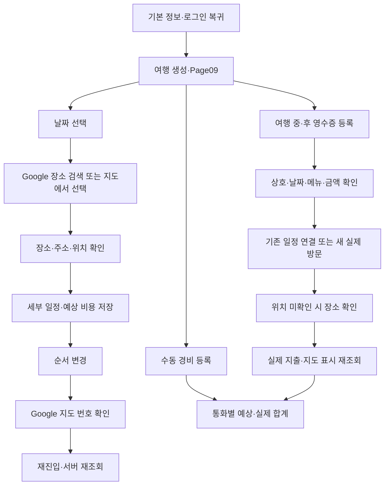

# MVP — 여행 한 건을 끝까지 계획하기

작성일: 2026-10-27 / 버전: v0.1 / 상태: 사용자 지정 최소 범위 반영, 상세 동작은 개발 전 검토안

사용자 요구: 최소 한 번의 여행 계획을 완성하고 구글 지도 장소 추가, 영수증 장소 추가, 세부 일정·경비 등록, 구글 지도 위 순서 표시가 가능해야 합니다. 이번 작업은 명세와 개발 인계입니다. 앱 코드를 수정하거나 개발 완료로 보고하지 않습니다.

## 1. 큰 목표와 완료의 의미

사용자는 여행을 만든 뒤 갈 장소를 넣고, 날짜별 순서를 정하고, 예상 비용을 적습니다. 여행 중이나 다녀온 뒤에는 영수증으로 실제 방문과 지출을 추가합니다. 다시 앱을 열면 일정·위치·순서·비용이 그대로 보여야 합니다.

계획을 만든 경험과 실제 방문 기록을 구분합니다. 영수증을 등록해야만 계획이 완성되는 것은 아닙니다. 아래 두 여정을 각각 검증합니다.

- **계획 완주:** 생성 → 날짜별 장소 추가 → 세부 내용·예상 비용 → 지도 번호·순서 확인 → 저장·재조회.
- **기록 완주:** 해당 여행 → 영수증 확인 → 기존 방문 연결 또는 새 실제 방문 추가 → 메뉴·실제 지출 → 위치 확인 → 재조회.

## 2. 필수 범위와 제외 범위

| 필수                                                 | 이번에 자동으로 추가하지 않는 기능                |
| ---------------------------------------------------- | ------------------------------------------------- |
| 정식 로그인 후 여행·초안 저장과 재조회               | 비회원 서버 저장, 날짜 없는 정식 여행             |
| 실제 Google 지도 위 장소 선택·번호 표시              | SVG 개략도를 Google 지도 완료로 판정              |
| Google 검색 장소 또는 지도 선택 위치를 일정으로 저장 | 없는 장소·좌표·예시 여행 자동 생성                |
| 날짜별 제목·시간·메모·장소·순서·예상 비용 관리       | AI 자동 계획 완성·자동 최적 순서                  |
| 영수증 확인 후 실제 방문·메뉴·지출 추가              | 본인 방문 인증, 여러 장 일괄 처리                 |
| 수동 비용과 통화별 예상·실제 총액                    | 환율 없는 다중 통화 단일 합계, 자동 정산·송금     |
| 방문 번호가 일정 순서와 일치                         | 실제 도로 안내·실시간 내비게이션·교통 최적화 보장 |

‘경로 순서’는 사용자가 정한 방문 순서와 지도 번호입니다. 실제 도로를 따라 그린 경로가 아니면 방문 순서 연결선이라고 설명합니다. 직선·점선을 실제 도로 경로나 이동시간의 근거로 사용하지 않습니다.

플랫폼별로 검수합니다. Android는 현재 Google 공급자 지정 코드가 있어 우선 확인할 수 있습니다. 웹은 SVG 대체 화면을 합격으로 처리하지 않고, iOS도 Google 지도를 실제로 사용하는지 별도 확인합니다. 출시 대상 플랫폼은 이번에 임의로 줄이지 않습니다. 해당 플랫폼의 Google 지도 요구를 확인하지 못하면 그 플랫폼은 미검증 또는 미완료로 남깁니다.

## 3. 페이지별 책임

Page09 내부 단계는 책임 단위이며 새 라우트나 독립 화면을 확정한 것이 아닙니다. 기존 화면·시트·공통 구성요소를 우선 재사용합니다.

| 페이지·단계         | 맡는 일                                  | 들어오는 곳·복귀                                                                  |
| ------------------- | ---------------------------------------- | --------------------------------------------------------------------------------- |
| Page08·Page02~04    | 여행 생성과 인증 복귀                    | 기존 [생성 상세 명세](신규계획_로그인복귀_페이지상세명세.md) 준수, 성공 후 Page09 |
| Page09 날짜별 일정  | 날짜·목록·순서·상세 편집의 기준          | 내 여행·생성 결과에서 진입, 내부 작업 후 같은 날짜 유지                           |
| 장소 검색·지도 선택 | 실제 장소 또는 선택 좌표 확보            | 일정 추가에서 진입, 확인 후 일정 편집으로                                         |
| 일정 편집           | 장소·시간·메모·예상 비용 확인 및 저장    | 새 장소·기존 일정에서 진입, 성공 후 같은 날짜 목록·지도                           |
| 지도                | 선택 날짜의 위치·방문 번호 확인          | 일정에서 진입, 핀 선택 시 연결 일정으로                                           |
| 영수증 등록·확인    | 인식 결과 확인, 실제 방문·메뉴·지출 연결 | Page09/15에서 진입, 성공 후 원래 기록·여행                                        |
| 비용 목록·편집      | 예상·실제 지출과 총액 관리               | Page09에서 진입, 저장 후 같은 여행 비용 재조회                                    |
| Page14/15 기록      | 여행 후 확인·보완                        | 해당 여행·내 기록에서 진입, 원래 여행·기록으로 복귀                               |

## 4. 장소 검색과 지도 선택 상세

### 기능·동작·CTA

- 일정 추가 전 대상 여행과 날짜를 선택합니다. 날짜 미정 초안에서는 정식 일정 저장을 하지 않습니다.
- ‘장소 검색’은 검색어와 필요한 지역 문맥으로 실제 검색을 요청합니다. 결과에 있는 장소 이름·주소를 확인하고 선택합니다. 검색어를 확정 상호처럼 저장하지 않습니다.
- ‘지도에서 선택’은 실제 Google 지도의 POI 또는 위치를 선택합니다. 좌표만 얻었으면 상호·주소를 알아낸 것처럼 꾸미지 않고 사용자가 제목과 위치를 확인하게 합니다.
- ‘이 장소로 일정 작성’은 장소 후보를 편집 단계에 전달합니다. 선택만으로 서버 일정이 만들어지지 않습니다.
- 뒤로가기·취소는 기존 일정을 바꾸지 않습니다. 같은 장소를 다시 방문하는 일정은 허용하며 장소 ID가 같다는 이유로 자동 병합하지 않습니다.

### 데이터 흐름

검색어/지도 선택 → 공급자 응답 → 장소 ID·이름·주소·좌표 확인 → 일정 편집 입력 → 사용자의 저장 → 서버 일정 ID → 목록·지도 재조회.

검색 결과에 좌표가 없으면 실제 상세 정보나 명시적 지도 선택으로 보완합니다. 지도에 찍을 위치를 확인하기 전에는 가짜 좌표를 넣지 않습니다. 좌표 확인 실패가 기존 일정 메모를 지우는 이유가 되어서는 안 됩니다.

### 상태·예외

| 상태                  | 처리                                                                               |
| --------------------- | ---------------------------------------------------------------------------------- |
| 검색 전               | 입력 안내, 사용자 여행 정보를 임의 추천 결과로 만들지 않음                         |
| 검색 중               | 이전 선택과 새 결과를 구분, 늦은 응답이 최신 검색을 덮지 않음                      |
| 결과 없음             | 다른 검색어 또는 지도 위치 선택. 장소 자체를 생성한 것처럼 안내하지 않음           |
| 지도·검색 공급자 오류 | 다시 시도, 작성으로 돌아가기. 서비스 내부 구성 설명을 사용자에게 노출하지 않음     |
| 위치 미확인           | 위치 보완 CTA와 목록 기록 유지. 지도 핀 없음                                       |
| 위치 권한 거절        | 현재 위치 없이 여행지 검색·지도 이동 가능. 불필요하게 계획 기능 전체 차단하지 않음 |

Google의 저장·표시·출처 표기, 키 제한·호출 한도·지원 플랫폼 조건은 구현 전에 공식 자료로 확인합니다. 이번 문서의 데이터 목록이 공급자 자료를 무제한 저장할 허가를 뜻하지 않습니다. 외부 Google Maps 열기만으로 앱 안의 지도 요구를 충족했다고 보지 않습니다.

## 5. Page09 일정 편집과 세부 계획

| 항목           | 기능·검증                                                                                           |
| -------------- | --------------------------------------------------------------------------------------------------- |
| 날짜           | 해당 여행의 실제 DAY 선택. 기간 밖 이동은 기존 정책 검증                                            |
| 일정 이름·장소 | 사용자 확인한 제목, 선택 장소 정보·좌표. 수동 제목과 공급자 장소명 구분                             |
| 시간·소요시간  | 아는 값만 입력, 미정은 임의 시각으로 채우지 않음. 시간과 방문 순서 충돌은 조용히 자동 수정하지 않음 |
| 메모           | 개인 계획 설명. 공개 사본에 자동 포함하지 않음                                                      |
| 예상 비용      | 금액·통화 확인. 실제 지출과 별도 보관, 기존 비용 계약과 연결                                        |
| 순서           | 선택 날짜 안에서 사용자 순서를 저장. 날짜 변경 후 대상 날짜 순서도 일관되게 재계산                  |

‘저장’은 역할·여행 상태·입력·버전을 검증한 뒤 서버에 반영합니다. 수정은 같은 일정 ID를 유지합니다. ‘취소’는 미저장 변경만 버리고 서버 원본을 보존합니다. ‘삭제’는 관련 기록·비용 영향 안내 후 기존 정책대로 수행하며 실제 지출을 조용히 없애지 않습니다.

조회 중·정상·일정 없음·저장 중·오류 상태를 구분합니다. 읽기 권한 사용자는 편집할 수 없습니다. 충돌은 최신 원본을 확인한 뒤 사용자가 재편집하며 다른 동행자의 변경을 덮지 않습니다. 저장 성공 후 목록·지도·비용 표시를 같은 원본에서 재조회합니다.

## 6. 지도 위 순서와 순서 변경

- 지도 번호는 선택 날짜의 저장된 방문 순서에 따라 1부터 표시합니다. 목록과 지도는 별도 순서값을 만들지 않습니다.
- ‘순서 변경’은 목록에서 실행하고 저장한 뒤 지도 번호를 갱신합니다. 드래그가 어려운 사용자도 위로/아래로 이동할 수 있는 동등한 행동을 제공합니다. 구체 배치는 기존 디자인에 맞춰 후속 설계합니다.
- 지도 핀 선택은 같은 일정 ID의 내용을 엽니다. 날짜 전환 시 이전 날짜 핀과 현재 목록을 섞지 않습니다.
- 좌표 없는 항목은 목록 번호를 유지하되 핀을 만들지 않습니다. 예를 들어 2번 위치가 없으면 지도는 1·3번만 보일 수 있으며 ‘위치 미확인 일정’으로 보완을 안내합니다. 누락 번호를 감추려고 다른 번호로 바꾸지 않습니다.
- 같은 위치의 여러 일정은 시간·제목·번호로 각각 찾을 수 있어야 합니다. 핀 겹침 때문에 일부 일정에 접근할 수 없는 상태는 통과가 아닙니다.
- 선을 표시한다면 방문 순서 연결선으로 설명하고 좌표 누락 구간은 추정 연결하지 않습니다. 실제 도로 경로·시간 조회는 별도 검증된 정보가 있을 때만 표시합니다.

실패 시 지도만 다시 불러올 수 있어야 합니다. 지도 조회 실패로 이미 저장한 일정이 없어졌다고 안내하지 않습니다. 순서 저장 실패는 성공한 것처럼 유지하지 않고 서버 원본과 미저장 변경을 구분합니다.

## 7. 영수증으로 실제 장소 추가

정책 원본은 [승인된 영수증 결정표](영수증_정책결정_화면흐름_검토안.md)와 [영수증 상세 명세](영수증_화면상세_모바일스케치_검토안.md)입니다. 아래는 지도·일정·경비로 이어지는 연결을 보완한 검토안이며 승인 정책을 대체하지 않습니다.

1. 권한 있는 여행에서 촬영/사진 선택합니다. 카메라를 거절해도 허용된 사진 선택이나 뒤로가기를 제공합니다.
2. 상호·현지 결제일·통화·총액·품목을 확인합니다. 부분 인식·실패 시 직접 수정합니다. 시각·품목이 없다는 이유로 임의 데이터를 채우지 않습니다.
3. 같은 날짜의 기존 일정에 연결하거나 새 실제 방문을 만듭니다. 기존 계획은 자동으로 바꾸지 않습니다.
4. 확인한 내용과 원본 보관 선택으로 저장합니다. 연결 메뉴·실제 지출을 다시 조회합니다.
5. 새 방문에 좌표가 없다면 ‘위치 확인’으로 상호·주소를 검색하고 실제 후보를 사용자가 선택합니다. 여러 지점이면 자동으로 가장 가까운 곳을 확정하지 않습니다.
6. 위치 보완을 저장한 뒤 같은 방문 ID가 지도에 표시되는지 확인합니다. 보완 때문에 영수증·지출·장소를 다시 만들지 않습니다.

위치 확인은 영수증 기록 성공과 별개입니다. 검색 실패 시 영수증 기록을 잃지 않고 위치 미확인으로 남깁니다. 기존 장소 연결 시에도 결제일과 선택 날짜 조건을 확인합니다. 등록일을 결제일로 대신 쓰지 않습니다.

CTA는 ‘내용 확인’, ‘기존 일정에 연결’, ‘새 실제 방문 추가’, ‘저장’, ‘위치 확인’, ‘다시 시도’입니다. 한 단계의 주 행동을 분명히 하며 모든 버튼을 한 화면에 늘어놓는 배치를 뜻하지 않습니다.

동일 원본·요청은 중복 방지, 유사 결제는 비교, 기존 수동 지출은 승인된 약한 후보 안내를 따릅니다. 메뉴 합계와 영수증 총액을 각각 지출로 더하지 않습니다. 실제 방문을 새로 만들었더라도 본인 방문 인증 배지를 부여하지 않습니다.

## 8. 총 경비 등록과 조회

‘총 경비’는 **여행 전체 예상 비용 합계와 실제 지출 합계**입니다. 통화별로 나눕니다. KRW·JPY·USD를 환산 없이 하나의 숫자로 더하지 않습니다. 별도의 전체 예산 상한 입력은 이번에 새 필수 기능으로 확정하지 않습니다.

| 기능·CTA     | 동작·데이터 흐름                                                              | 예외                                                     |
| ------------ | ----------------------------------------------------------------------------- | -------------------------------------------------------- |
| 비용 추가    | 제목·금액·통화·예상/실제·필요한 날짜/일정 연결 확인 → 서버 저장 → 합계 재조회 | 미지원 통화·잘못된 금액은 수정 안내                      |
| 비용 수정    | 기존 비용 ID 유지 → 버전·권한 확인 → 저장                                     | 다른 계정·동행 수정 충돌 시 덮어쓰기 금지                |
| 비용 삭제    | 영향 확인 → 삭제 → 목록·합계 재조회                                           | 영수증 연동 비용은 원본 영수증 정책을 따라 일관되게 처리 |
| 총 경비 보기 | 통화별 예상/실제 합계와 항목 확인                                             | 조회 실패를 0원으로 표시하지 않음                        |
| 영수증 지출  | 확정된 영수증의 연결 실제 비용을 합산                                         | 품목별 합계·일정 표시값·실제 지출을 중복 합산하지 않음   |

계획 비용을 실제 비용으로 간주하지 않습니다. ‘예상 10,000엔’과 ‘실제 8,000엔’을 합쳐 총 18,000엔이라고 표시하지 않습니다. 수동 실제 비용과 같은 영수증을 함께 등록한 경우 사용자에게 비교·정리 행동을 제공하며 자동 병합하지 않습니다.

## 9. 기존 구현과 요구 차이

읽기 전용 코드 조사 결과이며 실행 검증은 아닙니다.

| 대상      | 확인한 코드                                                                         | 남은 검증·보완                                         |
| --------- | ----------------------------------------------------------------------------------- | ------------------------------------------------------ |
| 지도      | `TripMapCanvas.native.tsx` Android Google·번호 Marker, `TripMapCanvas.tsx` 웹 SVG   | 웹 실제 Google 지도, iOS 공급자 확인, 기기별 표시 검증 |
| 장소 검색 | `apps/api/src/features/places/places.ts` 검색, `PlaceSearchResults.tsx` 후보 선택   | 결과 선택→실제 이름·좌표 확보→일정 저장 연결           |
| 지도 선택 | 네이티브 POI/길게 누르기 좌표 전달                                                  | 장소 식별·사용자 제목 확인, 허위 정보 없는 저장        |
| 순서      | `tripMapModel.ts` DAY·sortOrder 기준 번호, `schedule.reorder` 계약                  | 순서 변경→지도→재조회 일치, 누락·겹침 위치             |
| 도로 정보 | `planningRoutes.ts` 거리·시간 조회, 해당 응답에 도로선 없음                         | 순서선과 실제 도로 안내를 구분                         |
| 영수증    | `workspaceModel.ts` 새 실제 PLACE·품목·비용 생성                                    | 새 방문 좌표·Google 장소 ID 보완 단계                  |
| 경비      | `packages/validation/src/workspace.ts`, `TripDetailParts.tsx` 예상·실제·통화별 합계 | 수동+영수증 중복 처리와 재조회 검증                    |

## 10. 개발 작업 순서와 완료 기준

| 순서 | 작업 묶음                   | 완료 조건                                              |
| ---- | --------------------------- | ------------------------------------------------------ |
| M0   | 확정 정책·생성·인증 복귀    | 로그인 후 기본 입력 복원, 여행 1건 생성·서버 재조회    |
| M1   | 지도·장소 검색 연결         | 실제 Google 지도와 선택 장소의 실제 위치·식별정보 확인 |
| M2   | 일정 등록·세부 편집         | 날짜별 장소·시간·메모·예상 비용 저장·수정·재조회       |
| M3   | 순서·번호                   | 목록 순서 변경과 지도 번호·저장 순서 일치              |
| M4   | 수동 비용·합계              | 예상/실제·통화별 합계가 원본 비용과 일치               |
| M5   | 영수증 방문·위치·실제 지출  | 기존 승인 정책을 유지하며 지도·경비까지 연결           |
| M6   | 동행·권한 회귀와 한 건 완주 | 초대 상세 명세의 역할 제한, 전체 여정과 재진입 검증    |

공개 공유 등 기존 범위를 삭제하는 계획이 아닙니다. 이번 사용자 지정 최소 여정의 우선 연결 순서입니다. 각 작업의 대상 계약을 정한 뒤 요청받은 범위에서만 코드를 수정합니다. 지도 자격증명·공급자 사용 조건·네이티브 설정·시험 계정은 실제 검증의 선행 조건이며 비밀값을 문서에 쓰지 않습니다.

## 11. 통합 검증 시나리오

시험용 자료는 시험 환경에서만 사용하고 실제 사용자 홈에 표시하지 않습니다. 영수증 시험 자료는 개인정보를 제거합니다. 아래 금액은 합계를 확인하기 위한 예시입니다.

| ID     | 조작                                                  | 기대 결과                                               |
| ------ | ----------------------------------------------------- | ------------------------------------------------------- |
| MVP-01 | 회원 여행 생성 후 종료·재진입                         | 동일 여행 한 건, 기간·기본 내용 유지                    |
| MVP-02 | Google 검색 장소 2개와 지도 선택 장소 1개 추가        | 확인한 위치와 일정 ID가 저장되고 Google 지도에 표시     |
| MVP-03 | 같은 DAY 3개 순서를 C→A→B로 변경                      | 목록·지도 번호가 C=1/A=2/B=3, 재조회에도 유지           |
| MVP-04 | 다른 DAY 이동·제목/시간/메모 수정                     | 선택 날짜·일정 ID·순서가 일관되며 이전 날짜 핀 제거     |
| MVP-05 | 좌표 없는 일정·같은 위치 여러 일정                    | 가짜 핀 없음, 모든 목록 항목·겹친 일정 접근 가능        |
| MVP-06 | 예상 JPY 1,000+2,000, 실제 JPY 500, KRW 10,000 입력   | 예상 JPY 3,000, 실제 JPY 500·KRW 10,000 별도 표시       |
| MVP-07 | JPY 800 영수증으로 새 실제 방문 추가                  | 실제 JPY 1,300, 메뉴를 다시 더하지 않음, 원래 계획 유지 |
| MVP-08 | MVP-07 위치 검색·확인·저장                            | 같은 방문이 지도에 추가, 영수증·비용 중복 생성 없음     |
| MVP-09 | 기존 일정에 영수증 연결·메뉴 없음·인식 실패 수동 보완 | 승인 정책대로 저장, 실제 날짜·통화 유지                 |
| MVP-10 | 동일 영수증/요청 재시도·유사 별도 결제                | 동일 자료 중복 방지, 별도 결제 확인 후 진행             |
| MVP-11 | 지도 오류·검색 없음·위치 권한 거절                    | 목록·입력 보존, 가능한 복구 행동 제공                   |
| MVP-12 | 저장 응답 유실·동행 충돌·계정 전환                    | 중복·덮어쓰기·다른 계정 노출 없음                       |
| MVP-13 | 읽기 멤버가 일정·경비·순서 변경                       | 서버 거절. 편집 권한도 허용 범위만 동작                 |
| MVP-14 | 영수증·연결 비용 수정/삭제 후 재조회                  | 승인 삭제 영향과 합계 일치, 다른 일정·기록 보존         |
| MVP-15 | 320/390/430, 200% 글자, KR/EN/JP, 키보드              | 공통 디자인·터치·초점 유지, 지도 외 목록으로도 접근     |
| MVP-16 | 실제 대상 기기에서 지도·카메라·앨범·앱 재진입         | 실제 타일·번호·권한·자료 유지. 웹 자동 검사로 대체 금지 |

**합격 조건:** 계획 여정과 기록 여정을 실제 서버 저장·재조회로 모두 완주하고 필수 검사를 통과해야 합니다. 지도 개략도, 코드 존재, 예시 응답만으로 완료하지 않습니다. 플랫폼마다 통과·실패·미검증을 구분합니다. 실제 위치를 확인하지 못한 일반 항목은 남겨둘 수 있지만 MVP-02·08의 시험 장소는 실제 지도 표시까지 확인해야 합니다.

## 12. 디자인·검증·인계 상태

현재 디자인시스템·design-tokens.json·헤더GNB_규격.md·여행일정_화면규격.md와 승인된 영수증 규격을 따릅니다. LINE Seed·제목·본문·48 터치·안전 영역·기존 색을 유지하며 별도 지도 전용 디자인 체계를 만들지 않습니다. 번호·선택 상태는 색만으로 구분하지 않습니다.

코드 변경 시 `npm run check`, 관련 서버·인증·헤더/이동 검사와 실제 화면 캡처를 수행합니다. 지도·영수증·공유 권한은 실기기 검증 항목으로 따로 기록합니다. 현재 상태는 문서 작성과 코드 읽기 대조까지이며 모든 MVP 동작 시나리오는 미실행입니다.

검토 기록: MVP-JOURNEY-01 / v0.1 / 최초 0회 / 2026-10-27. 분석 담당은 지도·장소·영수증 위치·비용 계약을 읽기 전용 조사했고 주 에이전트가 통합했습니다. 기존 정책 검토 횟수는 초기화하지 않으며 새 근거 없는 반복 검토를 하지 않습니다.
