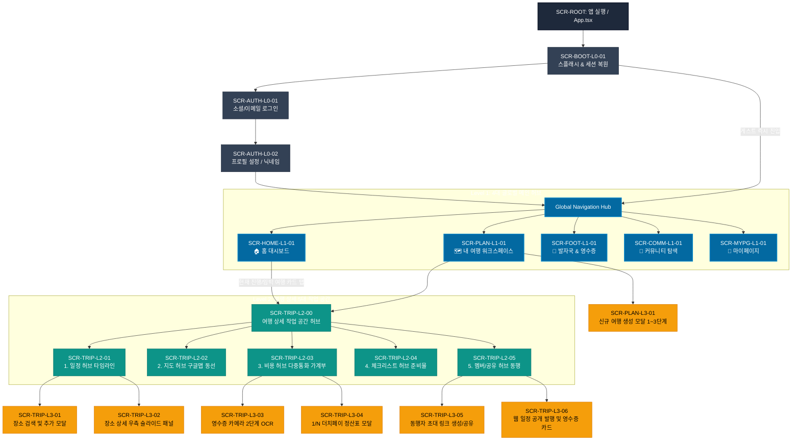

# TripPrint (트립프린트) 정보 구조도 (Information Architecture, IA)

## System Navigation & Screen Hierarchy Specification

> **프로젝트명**: TripPrint (트립프린트)  
> **문서 버전**: v1.0 (Official Baseline Master)  
> **작성 기준일**: 2026-10-21  
> **문서 작성**: 시스템 기획 총괄 (30년차 수석 시스템 아키텍트) & 프로덕트 전략 디렉터 (20년차 전략 기획 리드)  
> **문서 목적**: 화면 간 계층 위계, 라우팅 경로, 컴포넌트 형태, 데이터 상속, 상태 보존(State Preservation), 뒤로가기 동작을 단일 진실 공급원(Single Source of Truth)으로 표준화하여 개발·디자인 간 불일치를 영구히 종식함.  
> **문서 상태**: 공식 승인 (Approved Baseline)

---

## 1. IA 설계 원칙 및 표기 규약 (Architectural Standards)

### 1.1 핵심 설계 4대 원칙

1. **무마찰 탐색 원칙 (Zero-Friction Discovery)**:
   - Level 0(온보딩)에서 회원가입 없이 1탭으로 핵심 가치(홈 대시보드 및 첫 여행 생성)에 도달해야 합니다.
2. **3-Depth 이내 완결 원칙 (Max 3-Depth Rule)**:
   - 어떤 화면에서도 사용자의 핵심 작업(일정 추가, 지도 확인, 영수증 스캔, 정산)은 최대 3단계 뎁스를 넘지 않습니다.
3. **명확한 화면 유형 분리 (Strict View Type Taxonomy)**:
   - `Page` (전체 화면 스택 전환), `Tab` (하단 탭 바 영구 유지 전환), `Modal` (하단 시트 형태의 빠른 입력), `Slide` (우측 슬라이드인 상세 패널), `Dialog` (시스템 경고 및 확인)를 엄격히 구분하여 혼용을 금지합니다.
4. **상태 보존 및 비파괴 뒤로가기 (Non-Destructive Back Navigation)**:
   - 사용자가 하위 모달이나 서브 허브에서 뒤로 가거나 탭을 전환해도 직전에 입력 중이던 필터, 선택된 DAY 인덱스, 스크롤 위치가 유지되어야 합니다.

### 1.2 화면 식별자(Screen ID) 명명 규칙

화면 식별자는 **`SCR-{DOMAIN}-{DEPTH}-{SEQ}`** 체계를 따릅니다.

- **DOMAIN**:
  - `BOOT`: 시작, 스플래시, 인트로
  - `AUTH`: 로그인, 회원가입, 프로필, 계정 복구
  - `HOME`: 홈 대시보드 및 실시간 여정 브리핑
  - `PLAN`: 내 여행 목록 및 신규 여행 빌더
  - `TRIP`: 여행 상세 5대 핵심 허브 (일정, 지도, 가계부, 체크리스트, 멤버)
  - `FOOT`: 발자국 타임라인 및 여행 영수증 출판
  - `COMM`: 커뮤니티 탐색 및 도시 가이드
  - `MYPG`: 마이페이지, 설정, 약관, 탈퇴 유예
- **DEPTH**:
  - `L0`: 진입/온보딩
  - `L1`: 4대 글로벌 메인 허브 (하단 탭)
  - `L2`: 서브 허브 / 상세 페이지 (헤더 네비게이션)
  - `L3`: 액션 모달 / 슬라이드인 패널 / 팝업
- **SEQ**: 두 자리 일련번호 (01, 02, ...)

---

## 2. 전체 정보 구조도 트리 (Global IA Tree)



---

## 3. 화면별 상세 IA 명세 매트릭스 (Screen-by-Screen IA Matrix)

### 3.1 Level 0: 온보딩 및 인증 계층 (Entry & Authentication)

| 화면 ID            | 화면명               | 라우트 경로      | 컴포넌트 형태 | 접근 권한 | 주요 제공 정보                           | 사용자 주요 액션 및 CTA                                                        | 하위 연결 화면                       |
| :----------------- | :------------------- | :--------------- | :------------ | :-------- | :--------------------------------------- | :----------------------------------------------------------------------------- | :----------------------------------- |
| **SCR-BOOT-L0-01** | 스플래시 & 세션 복원 | `/`              | Full Page     | Public    | 로고, 로컬 토큰 검사                     | 자동 세션 복원 또는 인트로 재생                                                | 로그인(`AUTH-01`) 또는 홈(`HOME-01`) |
| **SCR-AUTH-L0-01** | 로그인 허브          | `/login`         | Full Page     | Public    | 소셜 로그인, 이메일 로그인, 게스트 안내  | 1) Google 로그인<br>2) 이메일 로그인<br>3) **[로그인 없이 둘러보기]** (게스트) | 프로필설정(`AUTH-02`), 홈(`HOME-01`) |
| **SCR-AUTH-L0-02** | 프로필 설정          | `/profile-setup` | Full Page     | Auth      | 닉네임 입력 (2~20byte), 여행 스타일 태그 | [완료 및 시작하기]                                                             | 홈 대시보드(`HOME-01`)               |
| **SCR-AUTH-L0-03** | 필수 권한 안내       | `/permissions`   | Overlay Sheet | Public    | 알림, 위치 권한 목적 및 선택 고지        | [확인 및 권한 허용]                                                            | 직전 호출 화면으로 복귀              |

---

### 3.2 Level 1: 4대 글로벌 메인 허브 (하단 네비게이션 바 영구 노출)

_규칙: Level 1 화면 간 전환 시 하단 네비게이션 바(`GlobalNavigation`)는 항상 화면 하단에 고정되며, 탭 전환 시 각 탭의 스크롤 위치를 캐싱합니다._

| 화면 ID            | 화면명               | 라우트 경로          | 컴포넌트 형태 | 접근 권한      | 주요 제공 정보                                                                                                                                         | 사용자 주요 액션 및 CTA                                                                             | 하위 연결 화면                                                        |
| :----------------- | :------------------- | :------------------- | :------------ | :------------- | :----------------------------------------------------------------------------------------------------------------------------------------------------- | :-------------------------------------------------------------------------------------------------- | :-------------------------------------------------------------------- |
| **SCR-HOME-L1-01** | 홈 대시보드          | `/(tabs)`            | Tab Page      | Public / Guest | - 현재 진행 중이거나 가장 가까운 여행 요약<br>- D-Day 카운트다운<br>- AI 여행 코치 '하루' 문맥 팁<br>- 오늘 여정 타임라인 퀵 프리뷰                    | 1) [여행 상세로 이동]<br>2) [새 일정 추가]<br>3) [영수증 스캔]<br>4) [첫 여행 만들기] (여행 0건 시) | 여행 상세(`TRIP-L2-00`), 여행생성(`PLAN-L3-01`), 영수증(`TRIP-L3-03`) |
| **SCR-PLAN-L1-01** | 내 여행 워크스페이스 | `/plans`             | Tab Page      | Public / Guest | - 여행 상태 필터 (전체/예정/여행중/완료/보관함)<br>- 여행 카드 목록 (대표이미지, 기간, 동행자)<br>- 검색 바                                            | 1) [신규 여행 만들기 (+)]<br>2) 여행 카드 클릭 (상세 진입)<br>3) 여행 보관/삭제 메뉴                | 여행생성(`PLAN-L3-01`), 여행 상세(`TRIP-L2-00`)                       |
| **SCR-FOOT-L1-01** | 발자국 & 영수증      | `/(tabs)/footprints` | Tab Page      | Public / Guest | - 완료된 여행 목록<br>- 타임라인 기반 방문 장소 궤적<br>- 발행된 감성 여행 영수증 목록                                                                 | 1) [여행 영수증 다시보기]<br>2) [인스타그램 공유]<br>3) [포토북 미리보기]                           | 영수증카드(`TRIP-L3-06`), 웹공개(`COMM-L2-01`)                        |
| **SCR-COMM-L1-01** | 커뮤니티 탐색        | `/(tabs)/community`  | Tab Page      | Public         | - 8개 주요 도시 가이드 (도쿄, 오사카, 다낭 등)<br>- 유저 공개 추천 여행 일정 큐레이션<br>- 테마별 필터 (미식, 우정, 힐링)                              | 1) 도시 가이드 상세 열람<br>2) 추천 일정 카드 클릭<br>3) **[내 여행으로 일정 가져오기]**            | 공개일정상세(`COMM-L2-01`), 도시가이드(`COMM-L2-02`)                  |
| **SCR-MYPG-L1-01** | 마이페이지           | `/(tabs)/my`         | Tab Page      | Public / Guest | - 내 프로필 (닉네임, 아바타, 계정 연동 상태)<br>- 게스트 상태 시 [계정 연동하기] 유도 배너<br>- 알림 설정, 이용약관, 고객센터<br>- 90일 탈퇴 유예 안내 | 1) [프로필 수정]<br>2) [소셜 계정 연동]<br>3) [회원 탈퇴 (90일 유예)]                               | 계정연동(`AUTH-L0-01`), 이용약관(`MYPG-L2-01`)                        |

---

### 3.3 Level 2: 여행 상세 5대 작업 공간 (Trip Workspace Hub)

_규칙: `SCR-TRIP-L2-HUB` 진입 시 하단 글로벌 탭 바는 숨겨지며, 상단에 `[뒤로가기] [여행제목/기간] [초대/공유] [설정]` 공통 헤더가 노출됩니다. 5대 허브 간 전환은 상단 세그먼트 탭 터치 또는 좌우 스와이프로 0ms 레이턴시로 동작합니다._

| 화면 ID            | 허브 구분         | 라우트 경로              | 컴포넌트 형태 | 데이터 스코프 | 주요 제공 정보                                                                                                                    | 사용자 주요 액션 및 CTA                                                                                | 하위 연결 화면                                                               |
| :----------------- | :---------------- | :----------------------- | :------------ | :------------ | :-------------------------------------------------------------------------------------------------------------------------------- | :----------------------------------------------------------------------------------------------------- | :--------------------------------------------------------------------------- |
| **SCR-TRIP-L2-01** | **1. 일정 허브**  | `/trips/[id]?tab=plan`   | Sub-Hub Tab   | Trip Context  | - DAY 가로 칩 셀렉터 (DAY 1 ~ DAY N, 날짜)<br>- 시간순 타임라인 장소 카드 리스트<br>- 장소 간 이동 거리/시간 요약 카드            | 1) [ + 장소 추가하기 ]<br>2) 장소 카드 탭 (상세 패널 오픈)<br>3) [순서 편집 (드래그앤드롭)]            | 장소검색(`TRIP-L3-01`), 장소상세(`TRIP-L3-02`)                               |
| **SCR-TRIP-L2-02** | **2. 지도 허브**  | `/trips/[id]?tab=map`    | Sub-Hub Tab   | Trip Context  | - Google Maps 네이티브 지도 뷰<br>- DAY별 번호 핀 마커 (1, 2, 3...)<br>- 순차 동선 폴리라인 (Polyline)<br>- 하단 장소 캐러셀 카드 | 1) 마커 탭 시 캐러셀 연동<br>2) 캐러셀 넘김 시 지도 중앙 자동 팬 이동<br>3) **[구글맵 앱에서 길찾기]** | 외부 구글맵 앱 딥링크, 장소상세(`TRIP-L3-02`)                                |
| **SCR-TRIP-L2-03** | **3. 비용 허브**  | `/trips/[id]?tab=cost`   | Sub-Hub Tab   | Trip Context  | - 총 예산 대비 지출 현황 프로그레스<br>- 다중 통화 통합 원화 환산 합계표<br>- 결제 항목 리스트 (통화, 결제자, 카테고리)           | 1) [ 🧾 영수증 스캔 (OCR) ]<br>2) [ + 수동 지출 입력 ]<br>3) **[ 1/N 정산하기 ]**                      | 영수증카메라(`TRIP-L3-03`), 지출입력(`TRIP-L3-04-A`), 정산표(`TRIP-L3-04-B`) |
| **SCR-TRIP-L2-04** | **4. 체크리스트** | `/trips/[id]?tab=check`  | Sub-Hub Tab   | Trip Context  | - 카테고리별(서류, 의류, 전자, 상비약) 준비물<br>- 개인 준비물 vs 동행 공용 준비물 분리 탭<br>- 전체 준비 완료율(%) 게이지        | 1) 체크박스 토글<br>2) [ + 새 준비물 추가 ]<br>3) 공용 준비물 담당자 지정                              | 준비물추가모달(`TRIP-L3-07`)                                                 |
| **SCR-TRIP-L2-05** | **5. 멤버/공유**  | `/trips/[id]?tab=member` | Sub-Hub Tab   | Trip Context  | - 동행 멤버 목록 및 권한 (방장/편집자/뷰어)<br>- 초대 수락 대기 목록<br>- 웹 공개 발행 상태 및 링크 관리                          | 1) **[동행자 초대 링크 복사]**<br>2) **[웹 추천 일정 발행]**<br>3) **[감성 여행 영수증 카드 발행]**    | 초대모달(`TRIP-L3-05`), 웹발행(`TRIP-L3-06-A`), 영수증카드(`TRIP-L3-06-B`)   |

---

### 3.4 Level 3: 세부 기능 모달 / 다이얼로그 / 슬라이드인 패널 (Action Layer)

| 화면 ID              | 화면명                 | 컴포넌트 형태         | 진입 트리거                | 주요 입력 조건 및 기능                                                                                                       | 완료/이탈 동작                                                         |
| :------------------- | :--------------------- | :-------------------- | :------------------------- | :--------------------------------------------------------------------------------------------------------------------------- | :--------------------------------------------------------------------- |
| **SCR-PLAN-L3-01**   | 신규 여행 생성 모달    | Modal Sheet (3단계)   | 내 여행 또는 홈의 [+] 버튼 | 1단계: 목적지 검색 (전세계 국가/도시)<br>2단계: 날짜 선택 (시작일~종료일, 최대 30일)<br>3단계: 여행 제목 및 대표 테마 태그   | [일정표 생성] 클릭 시 `trips` 생성 후 `SCR-TRIP-L2-01`로 다이렉트 전환 |
| **SCR-TRIP-L3-01**   | 장소 검색 및 추가 모달 | Modal Sheet           | 일정 허브의 [+ 장소 추가]  | - Google Places Autocomplete 검색 (300ms 디바운스)<br>- 장소 선택 시 시간/메모/예산 입력<br>- 추천 코스 내 장소 원클릭 삽입  | [일정에 추가] 탭 시 DAY 타임라인에 카드 삽입 후 모달 닫힘              |
| **SCR-TRIP-L3-02**   | 장소 상세 정보 패널    | Slide-in Panel (우측) | 타임라인 장소 카드 탭      | - Google Places 사진, 평점, 운영시간, 팁<br>- 개인 비공개 메모 입력 필드<br>- 지도 바로보기 버튼                             | [뒤로/닫기] 또는 좌측 스와이프 시 닫힘 (스크롤 위치 유지)              |
| **SCR-TRIP-L3-03**   | 영수증 카메라 OCR      | Full Overlay Modal    | 비용 허브 [영수증 스캔]    | - 영수증 카메라 촬영 또는 갤러리 이미지 선택<br>- 2단계 OCR 인식 (상호, 일시, 통화, 총액 파싱)<br>- 오인식 금액 수동 보정 UI | [지출 확정] 탭 시 `amount_in_cents` 저장 후 비용 탭에 즉시 반영        |
| **SCR-TRIP-L3-04-A** | 수동 지출 입력 모달    | Modal Sheet           | 비용 허브 [+ 수동 입력]    | - 금액, 통화(JPY, USD, KRW 등), 카테고리, 결제자, 참여 멤버 선택                                                             | [저장] 클릭 시 가계부에 레코드 추가                                    |
| **SCR-TRIP-L3-04-B** | 1/N 더치페이 정산표    | Modal Sheet           | 비용 허브 [1/N 정산하기]   | - 멤버별 총 지출액, 분담액 계산<br>- 최소 송금 알고리즘 기반 송금 가이드 ("A가 B에게 15,000원 송금")<br>- 계좌번호 복사      | [카카오톡으로 정산 결과 공유] 또는 [닫기]                              |
| **SCR-TRIP-L3-05**   | 동행자 초대 링크 모달  | Modal Sheet           | 멤버 허브 [초대하기]       | - 권한 선택 (편집자 / 뷰어)<br>- 7일 만료 토큰 링크 생성 (`https://tripprint.me/join/{token}`)                               | [카카오톡 초대장 보내기] 또는 [링크 복사]                              |
| **SCR-TRIP-L3-06-A** | 웹 일정 공개 발행 모달 | Modal Sheet           | 멤버 허브 [웹 공개 발행]   | - 공개 범위 선택 (일정, 사진 포함 여부)<br>- "비공개 메모 및 영수증 원본은 제외됩니다" 보안 안내                             | [발행 완료] 탭 시 `share_id` 발급 및 웹 URL 복사                       |
| **SCR-TRIP-L3-06-B** | 감성 여행 영수증 카드  | Full Screen Preview   | 멤버 허브 또는 발자국 탭   | - 9:16 인스타 스토리 규격 세로형 티켓 렌더링<br>- 총 방문 장소, 총 이동 거리, 총 지출액, 대표 사진                           | [이미지 갤러리 저장] 및 [인스타그램 스토리 공유]                       |

---

## 4. 글로벌 네비게이션 및 화면 전이 규칙 (Navigation & Transition Rules)

### 4.1 하단 탭 바 (Global Navigation Bar) 가시성 표준

```
┌────────────────────────────────────────────────────────┐
│               하단 탭 바 노출 / 숨김 규칙               │
├──────────────────────────┬─────────────────────────────┤
│ 하단 탭 바 항시 노출 (O) │ 하단 탭 바 숨김 처리 (X)    │
├──────────────────────────┼─────────────────────────────┤
│ - SCR-HOME-L1-01 (홈)    │ - SCR-BOOT-L0-01 (스플래시) │
│ - SCR-PLAN-L1-01 (내여행)│ - SCR-AUTH-* (로그인/가입)  │
│ - SCR-FOOT-L1-01 (발자국)│ - SCR-TRIP-L2-* (여행상세)  │
│ - SCR-COMM-L1-01 (커뮤니)│ - 모든 L3 모달 및 카메라    │
│ - SCR-MYPG-L1-01 (마이)  │ - SCR-TRIP-L3-06-B (영수증) │
└──────────────────────────┴─────────────────────────────┘
```

1. **글로벌 탭 유지**: Level 1 화면(`홈`, `내 여행`, `발자국`, `커뮤니티`, `마이`)에서는 하단 탭 바가 영구 고정됩니다.
2. **여행 상세 몰입 모드**: Level 2 여행 상세 허브(`SCR-TRIP-L2-00`)에 진입하는 순간 하단 탭 바는 슬라이드 다운 애니메이션(150ms)과 함께 숨겨지며, 여행 전용 5대 탭과 상단 헤더가 전체 화면을 점유합니다.
3. **복귀 시 자연스러운 복원**: 여행 상세에서 헤더의 `[<]`(뒤로가기) 버튼 또는 안드로이드 시스템 백 버튼을 누르면 직전 Level 1 화면으로 복귀하며 하단 탭 바가 즉시 복원됩니다.

### 4.2 뒤로가기(Back Navigation) 및 이탈 방지 가드 (Unsaved Changes Guard)

- **하드웨어 백 버튼 처리**:
  - L3 모달/패널 열림 상태 → 해당 모달/패널만 닫힘 (부모 화면 유지).
  - L2 여행 상세 허브 상태 → 여행 목록 또는 홈으로 1단계 상위 이동.
  - L1 메인 허브 상태에서 백 버튼 탭 → "한 번 더 누르면 앱이 종료됩니다" 토스트 표시 후 2초 이내 재입력 시 앱 종료.
- **작성 중 이탈 보호 (Dirty State Protection)**:
  - 여행 생성, 장소 추가, 지출 금액 입력 중 사용자가 취소나 뒤로가기를 시도할 경우:
    - 입력값이 1자라도 존재하면 `ScheduleExitDialog` 팝업 호출: _"작성 중인 내용이 저장되지 않았습니다. 나가시겠습니까? [계속 작성] [나가기]"_
    - 가짜 저장 성공이나 임의 파기를 방지하고 사용자의 명시적 확인을 받음.

---

## 5. 데이터 상속 및 컨텍스트 모델 (Data Inheritance Architecture)

정보 구조 간의 데이터 꼬임을 방지하기 위해 계층별 데이터 바인딩 규칙을 정의합니다.

```
[Global App Context]
  ├── UserSessionContext (Auth UID, Provider, Profile, GuestFlag)
  └── OfflineSyncQueueContext (Pending Sync Mutations)
        │
        ▼ (특정 여행 선택 시 파생)
  [Trip Workspace Context: trip_id (UUID v4)]
        ├── TripMetadata (Title, Country, City, StartDate, EndDate, Role)
        ├── SelectedDayIndex (Default: DAY 1 or Current Travel Day)
        │     ├── DayScheduleItems (Filtered by day_id)
        │     └── DayMapMarkers (Derived from DayScheduleItems)
        ├── TripExpenses (Filtered by trip_id, Currency Rates)
        ├── TripChecklist (Filtered by trip_id)
        └── TripMembers (Owner, Editors, Viewers)
```

1. **Active Trip Context 보존**:
   - `SCR-TRIP-L2-HUB` 진입 시 발급된 `trip_id`는 하위 5대 탭(일정, 지도, 가계부, 체크리스트, 멤버) 전체가 단일 메모리 캐시(TanStack Query)를 공유합니다.
   - 따라서 '일정'에서 장소를 추가하면 '지도' 탭으로 전환 시 별도의 네트워크 재조회 없이 0ms 만에 신규 마커가 지도상에 즉시 반영됩니다.
2. **DAY Index 상속**:
   - 일정 허브에서 'DAY 2'를 선택한 상태에서 '지도 허브'로 탭을 전환하면, 지도 허브 역시 자동으로 'DAY 2'의 마커와 동선 폴리라인을 기본으로 포커싱합니다.

---

## 6. 결론 및 개발/디자인 팀 실행 지침

1. **디자인팀**:
   - 신규 화면을 스케치하거나 피그마 시안을 작성할 때 반드시 본 문서의 **화면 ID(예: `SCR-TRIP-L2-01`)와 화면 유형(Tab/Modal/Slide)**을 프레임 네이밍에 1:1로 일치시켜야 합니다.
   - 정의되지 않은 임의의 팝업이나 중간 뎁스 화면을 추가할 수 없습니다.
2. **개발팀**:
   - 라우터 파일 경로(`apps/mobile/src/app/`)와 컴포넌트 분기 시 본 문서의 3절 IA 명세 매트릭스의 URL 및 데이터 스코프를 정확히 준수해야 합니다.
   - 게스트 모드와 회원 모드 간 전환 시 5절의 데이터 상속 모델에 따라 로컬 캐시를 마이그레이션합니다.
3. **QA팀**:
   - 2절의 Mermaid 다이어그램과 4절의 뒤로가기 규칙을 바탕으로 네비게이션 무결성 테스트 케이스를 추출합니다.

---

_본 IA 문서는 TripPrint 모바일 앱의 화면 위계와 정보 흐름을 규정하는 공식 표준 기획서입니다._
