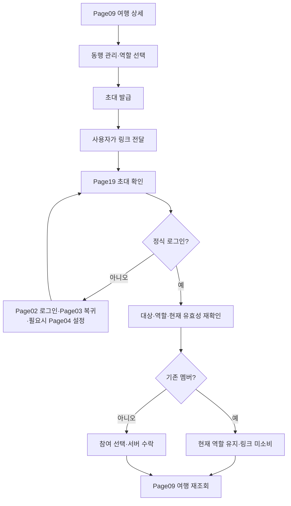

# 동행 초대와 수락 상세 명세

작성일: 2026-10-27 / 버전: v0.1 / 상태: 확정 정책 반영, 개발 전 상세 검토안

기준은 [핵심 정책 확정 사항](<../01. 기능정의/핵심정책_확정사항.md>)입니다. **소유자 발급, 발급 시점부터 7일, 링크당 새 참여자 1명, 기존 멤버는 역할 유지·미소비**를 변경하지 않습니다. 코드는 수정하지 않았으며 아래 동작은 목표 명세입니다.

## 1. 목적과 전체 흐름

여행을 만든 사람이 친구에게 읽기 또는 편집 권한을 줍니다. 친구는 어떤 여행에 어떤 권한으로 참여하는지 확인하고 직접 수락합니다. 링크 전달과 여행 참여 완료는 다릅니다. 같은 여행을 양쪽 계정에서 다시 읽을 수 있어야 흐름이 끝납니다.

이 그림은 작업 순서이며 새 라우트나 페이지 수를 정하지 않습니다. 발급·철회는 Page09의 기존 동행 관리 영역, 수락은 Page19, 인증은 기존 Page02~04를 사용합니다.

## 2. Page09 동행 관리 — 누가 함께할지 정하기

| 구분          | 상세 명세                                                                                                                         |
| ------------- | --------------------------------------------------------------------------------------------------------------------------------- |
| 진입·기능     | 저장된 여행 상세에서 동행 관리로 진입. 서버에서 멤버·본인 역할·여행 상태·발급 초대 상태 조회                                      |
| 일반 멤버     | 허용된 동행 정보만 조회. 소유자 전용 발급·철회·역할 변경을 실행할 수 없음                                                         |
| 역할 선택     | 읽기: 허용된 일정·공동 비용 등을 조회. 편집: 허용된 일정·비용 등을 변경. 편집 권한이 여행 소유권이나 공개 발행 권한을 뜻하지 않음 |
| 발급 CTA      | 소유자이고 보관 여행이 아닐 때 역할을 확인한 뒤 ‘초대 링크 만들기’. 자동 발급하지 않음                                            |
| 데이터 흐름   | tripId·본인 권한·선택 역할·현재 여행 버전 → 서버 검증 → 초대 생성 → 발급 결과·만료 시각·목록 재조회                               |
| 발급 결과     | 유효기간 7일과 새 참여자 한 명용임을 안내. 만료 판단은 서버 시각 사용. 단말 시계가 틀려도 사용 기간을 연장하지 않음               |
| 링크 전달 CTA | 명시적으로 공유 또는 복사. 공유 창을 닫거나 복사했다고 수락 완료·메시지 전달 성공으로 기록하지 않음                               |
| 복귀          | 동행 관리로 돌아오며 여행·선택 위치 유지. 발급 실패 시 역할 선택 유지                                                             |

한 링크를 특정 이메일에 묶는 기능은 없습니다. 전달받은 다른 사람이 먼저 수락할 수 있습니다. 여러 친구에게는 각각 링크를 발급해야 한다고 설명합니다. 기본 역할을 암묵적으로 편집으로 확정하지 않고 발급 전에 선택값을 확인합니다.

초대 원문은 일반 여행 기록·로그에 남기지 않습니다. 기존 구현은 토큰 원문을 발급 응답에서만 주고 서버에는 해시를 보관합니다. 나중에 원문을 다시 읽을 수 없는 경우 ‘기존 링크 복사’가 된 것처럼 만들지 않습니다. 이전 초대를 철회하고 새로 발급하는 복구가 필요합니다. 단순 조회로 새 링크를 만들지 않습니다.

### 철회와 상태

| 상태           | 안내·가능한 행동                                                           |
| -------------- | -------------------------------------------------------------------------- |
| 유효·미사용    | 역할·만료 정보 확인, 소유자 철회 가능                                      |
| 철회 확인      | ‘이 링크로 새로 참여할 수 없게 됩니다.’ 확인 후 철회. 취소하면 유지        |
| 철회 처리 중   | 중복 실행 잠금. 성공 후 서버 목록 재조회                                   |
| 사용 완료      | 새 사람에게 재사용 불가. 기존 참여자는 멤버 관리에서 별도로 관리           |
| 만료           | 필요하면 새 초대를 명시적으로 발급                                         |
| 보관·권한 상실 | 변경 잠금과 최신 여행 재조회. 원래 계정의 결과를 다른 계정에 표시하지 않음 |

이미 사용된 초대를 철회한다고 멤버가 탈퇴하지 않습니다. 멤버 제거·역할 변경은 별도 확인 행동이며 이 명세에서 새로운 권한 정책을 추가하지 않습니다.

## 3. Page19 초대 확인 — 받은 사람이 참여 결정하기

### 진입과 보여줄 내용

외부 링크 또는 기존 붙여넣기 진입을 받습니다. 잘못된 주소를 자동 방문하거나 실행하지 않습니다. 검증한 토큰만 해당 서비스의 확인 요청에 사용합니다. 화면은 토큰 자체보다 참여 목적과 다음 행동을 설명합니다.

비로그인 상태에서는 초대 안내와 로그인 행동을 제공합니다. 여행의 전체 일정·멤버 목록·비용을 수락 전에 공개하지 않습니다. 로그인 후에는 서버가 허용한 최소 여행 식별 정보와 부여될 역할을 확인해야 합니다. 비회원에게 보여줄 세부 필드나 확인 API가 마련되지 않았다면 내용을 추정하지 않습니다. 이는 개발 연결이 필요한 부분입니다.

| CTA·조건        | 동작                                      | 결과                                                               |
| --------------- | ----------------------------------------- | ------------------------------------------------------------------ |
| 로그인하고 확인 | 비회원·익명 게스트                        | 초대 목적을 보존해 Page02로 이동. 아직 수락하지 않음               |
| 여행에 참여     | 정식 회원, 유효한 새 초대, 대상·역할 확인 | 동일 수락 요청 식별값으로 서버 처리. 성공 후 Page09 재조회         |
| 여행 열기       | 이미 참여한 정식 회원                     | 현재 멤버십 확인 후 여행 열기. 역할 변경·링크 소비 없음            |
| 다시 확인       | 조회·수락 결과 불확실                     | 같은 초대와 작업 결과 확인. 새 멤버 생성으로 대체하지 않음         |
| 다른 링크 입력  | 처리 중이 아님                            | 기존 요청과 분리해 형식 검사·상태 초기화. 늦은 이전 응답 적용 금지 |
| 취소·돌아가기   | 사용자가 참여를 중단                      | 해당 대기 초대 정리 후 유효한 이전 위치 또는 홈/내 여행으로 복귀   |

### 데이터 흐름

링크 수신 → 형식 검증 → 인증 왕복용 보관 → 정식 계정 확인 → 최소 초대 정보·현재 멤버십 확인 → 사용자의 수락 → 서버의 만료·철회·사용·여행 상태·권한 재검증 → 멤버 추가와 초대 소비를 함께 확정 → tripId 반환 → 여행 재조회.

새 참여자를 추가하는 시점에 조건을 다시 확인합니다. 화면을 처음 열 때 유효했다고 저장 때도 유효한 것은 아닙니다. 수락 경계는 서버의 `현재 시각 < 만료 시각`으로 정하며 만료 시각과 같으면 새 참여를 거절합니다.

기존 멤버는 새 멤버를 만들지 않고 기존 역할을 유지합니다. 무효 초대를 통해 비공개 여행을 추론해서 열지 않습니다. 이미 참여한 여행은 인증된 내 여행 목록에서 찾을 수 있게 합니다. 사용된 링크의 다른 계정 재사용은 거절합니다. 같은 요청의 성공 재확인도 현재 멤버십이 사라졌다면 제거된 권한을 복원하지 않습니다.

## 4. Page02~04 인증 왕복

로그인 자체의 항목·서식은 [신규 계획·로그인 복귀 명세](신규계획_로그인복귀_페이지상세명세.md)를 재사용합니다. 초대에서는 돌아갈 목적을 Page19로 둡니다.

| 단계             | 맡는 일                           | 보존·예외                                                     |
| ---------------- | --------------------------------- | ------------------------------------------------------------- |
| Page02 로그인    | 정식 계정 인증                    | 초대 목적 보존. 로그인 취소는 Page19로 복귀하며 참여하지 않음 |
| Page03 인증 복귀 | 유효한 인증 결과와 현재 계정 확인 | 중복 콜백·다른 계정 응답 차단. 임의 외부 복귀 주소 금지       |
| Page04 회원 설정 | 필요한 설정 완료                  | 완료 후 Page19. 홈으로 일괄 이동하거나 자동 수락하지 않음     |
| Page19 복귀      | 대상·역할·만료를 다시 확인        | 사용자가 다시 참여를 선택. 인증 중 만료·철회되면 실패 안내    |

여행 작성 중 새 초대가 들어오면 작성 내용을 조용히 버리지 않습니다. 새 목적을 이어갈지 확인하고 기존 이탈 보호를 적용합니다. 대기 초대가 저장돼 있다는 이유만으로 모든 다음 로그인에서 강제로 수락하지 않습니다. 명시적 초대 취소·수락 결과 확인 후에는 대기 값을 정리합니다. 인증 취소로 Page19에 머무는 동안에는 다시 시도할 수 있게 유지합니다.

기존 보관은 웹의 현재 탭 세션 저장소와 모바일 보안 저장소를 사용합니다. 구현 시 수명·만료 정리·계정 전환을 대조합니다. 원문 토큰을 문서·분석 로그·일반 초안에 넣지 않습니다.

## 5. Page09 수락 결과 인계

수락 성공과 여행 조회 성공을 구분합니다. 참여는 됐지만 조회만 실패하면 ‘참여하지 못했어요’ 대신 여행을 다시 불러오도록 안내합니다. 같은 요청을 새 초대로 바꾸지 않습니다.

여행 재조회에서 현재 역할·멤버 상태를 확인합니다. 읽기 멤버는 허용된 읽기만, 편집 멤버는 허용된 쓰기만 수행해야 합니다. 발급자 쪽도 새로고침·재진입으로 같은 멤버 상태를 확인해야 합니다. 실시간 자동 갱신을 새로 보장하지 않습니다. 수락 후 뒤로가기가 인증 콜백이나 다시 수락하는 단계로 돌아가지 않게 합니다.

## 6. 상태·예외 처리

| 상황                       | 사용자에게 제공할 행동                  | 처리 원칙                                                               |
| -------------------------- | --------------------------------------- | ----------------------------------------------------------------------- |
| 초대 목록 없음             | 소유자는 첫 링크 발급, 다른 멤버는 읽기 | 예시 초대·가상 동행을 만들지 않음                                       |
| 조회·발급·수락 중          | 진행 상태 안내, 중복 제출 잠금          | 페이지 전체를 불필요하게 비우지 않음                                    |
| 잘못된 링크                | 받은 링크 확인·다시 입력                | 외부 주소 자동 열기 없음                                                |
| 만료·철회·다른 사람이 사용 | 새 링크 요청 안내·돌아가기              | 허용된 정보 이상으로 대상 여행을 노출하지 않음                          |
| 수락과 철회 동시 발생      | 서버 결과 재조회                        | 어느 작업이 먼저 확정됐는지에 따라 일관된 상태, 화면에서 성공 추정 금지 |
| 두 새 계정 동시 수락       | 한 명 성공, 나머지는 사용 불가          | 멤버 추가·소비를 원자적으로 처리                                        |
| 401/403·계정 변경          | 재로그인 또는 권한 있는 위치로 복귀     | 익명 계정의 회원 전용 동작 차단, 이전 계정 응답 무시                    |
| 409/412·여행 버전 충돌     | 최신 상태 확인 후 재시도                | 다른 변경 자동 덮어쓰기 없음                                            |
| 429·통신·서버 실패         | 재시도·돌아가기                         | 원인 확정 전 만료나 빈 목록으로 위장하지 않음                           |
| 발급 응답 유실             | 발급 결과와 원문 재사용 가능 여부 확인  | 원문 복원이 불가능하면 기존 초대 철회 후 명시적 재발급. 무한 발급 금지  |
| 수락 응답 유실             | 같은 요청 결과 재확인                   | 멤버 중복·초대 추가 소비 없음                                           |

## 7. 데이터 계약과 현재 차이

- 발급·철회는 기존 여행 명령 `invite.create` / `invite.revoke`, 수락은 기존 `POST /api/v1/invites/accept` 연결을 사용합니다. 새 API를 이 문서에서 확정하지 않습니다.
- 발급 입력은 여행·역할·버전·같은 작업 식별값, 반환은 초대 ID·원문 토큰과 확인 가능한 만료 정보입니다. 원문 재전달 가능 여부는 서버의 기존 재시도 계약과 맞춰야 합니다.
- 수락은 원문 토큰과 같은 수락 작업 식별값을 전달하고 서버가 사용자를 세션에서 확인합니다. 클라이언트가 보낸 사용자 ID만으로 참여시키지 않습니다.
- 현재 코드 대조에서는 24시간 발급, 기존 멤버 수락도 소비하는 경로, 여행 정보 사전 확인 없이 참여하는 화면이 확인됐습니다. 7일·기존 멤버 미소비·확인 후 수락은 후속 구현 대상입니다.
- 근거: `packages/validation/src/workspaceModel.ts`의 `createInvite`·역할 검사, `apps/api/src/features/trips/cloudRpc.ts`의 `accept`·`acceptSnapshot`, `cloudStore.ts`의 `consumeStatement`, `apps/mobile/src/features/workspace/InviteScreen.tsx`, `invite.ts`. 실제 배포 환경 동작은 미검증입니다.

## 8. 디자인 유지

현행 디자인시스템·design-tokens.json·헤더GNB_규격.md와 신규 계획 명세의 공통 접근성 기준을 재사용합니다. LINE Seed KR/Sans/JP, 제목 26/36, 본문 16/26, 보조 14/22, 최소 48 터치, 좌우 20, 공통 ScreenHeader·HeaderAction을 유지합니다. GNB 표시·순서·개수는 바꾸지 않습니다.

역할·상태를 색만으로 구분하지 않습니다. 긴 여행명·만료 안내는 줄바꿈하고 작은 화면·200% 글꼴·키보드에도 CTA에 접근할 수 있어야 합니다. 오류는 읽히는 설명과 재시도를 함께 제공합니다. 토큰 입력보다 초대 역할·다음 행동이 먼저 이해되도록 후속 화면을 설계하되 이번에는 배치를 변경하지 않습니다.

## 9. 검증 시나리오

| ID      | 조건·조작                                 | 기대 결과                                        |
| ------- | ----------------------------------------- | ------------------------------------------------ |
| INV-D01 | 소유자가 읽기/편집 초대 각각 발급         | 선택 역할과 발급 시각+7일 확인, 서버 재조회 일치 |
| INV-D02 | 편집자·뷰어·익명 계정이 발급/철회 시도    | 앱과 서버 모두 거절                              |
| INV-D03 | 만료 직전·정각·직후 새 계정 수락          | 직전만 가능, 기기 시간 조작으로 연장 불가        |
| INV-D04 | 비회원 수신→로그인→신규 설정→복귀         | 초대 유지, 대상·역할 재확인 후 명시적으로 수락   |
| INV-D05 | 로그인 취소·실패·중복 콜백                | 자동 수락·중복 참여 없음, Page19 재시도 가능     |
| INV-D06 | 기존 소유자·편집자·뷰어가 유효 링크 열기  | 기존 역할 유지, 멤버 추가·링크 소비 없음         |
| INV-D07 | 새 계정 두 개가 동시에 같은 링크 수락     | 새 참여자 한 명만 확정                           |
| INV-D08 | 수락 성공 응답 유실 후 동일 요청 재시도   | 동일 결과, 중복 멤버 없음                        |
| INV-D09 | 사용된 링크를 다른 계정이 사용            | 새 참여 거절                                     |
| INV-D10 | 철회/보관과 수락이 겹침                   | 서버 확정 순서에 맞는 한 결과, 무단 참여 없음    |
| INV-D11 | 참여 뒤 멤버 제거, 이전 수락 재시도       | 제거된 멤버십 복구 금지                          |
| INV-D12 | 수락 성공 후 여행 조회 실패               | 참여 사실 유지, 같은 여행 다시 조회              |
| INV-D13 | 발급 응답 유실·공유 취소·복사 실패        | 수락 완료로 표시하지 않음, 불필요한 재발급 없음  |
| INV-D14 | 로그인 중 다른 링크/계정/작성 목적 전환   | 이전 응답과 목적이 새 상태를 덮지 않음           |
| INV-D15 | 320/390/430, 글꼴200%, KR/EN/JP, 긴 제목  | 공통 규격·초점·오류 읽기·CTA 접근 유지           |
| INV-D16 | Android/iOS 링크 열기·인증 왕복·공유 취소 | 실기기에서 목적 보존, 안전 영역·뒤로가기 확인    |

모든 시나리오는 미실행입니다. 후속 개발은 `npm run check`, 인증·서버 계약·헤더/이동 관련 검사와 실제 화면·기기 검증을 구분해 기록합니다.

검토 기록: INV-SPEC-01 / 최초 0회 / 2026-10-27 / 주 에이전트. 기존 POL-05 재검토 1회 이력을 초기화하지 않습니다. 새 명세의 재검토는 변경 근거가 있을 때 최대 2회입니다.
