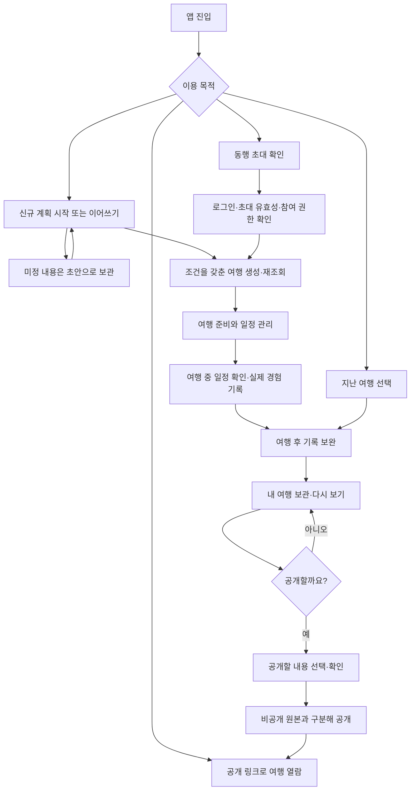

# TripPrint 서비스 상위 기획과 네 가지 핵심 흐름

작성·검토일: 2026-10-27 / 버전: v0.1

상태: 서비스 방향과 POL-01·02·05·06의 권장 A안 사용자 승인 반영(2026-10-27). 현행 정책은 [핵심 정책 확정 사항](<../01. 기능정의/핵심정책_확정사항.md>)을 따릅니다. 아래 정책 비교표는 결정 전 이력이며 그 밖의 흐름별 세부 범위는 검토안입니다.

범위: 서비스 목적, 사용자 문제, 전체 흐름, 신규 계획·동행 초대·여행 기록·공개 공유의 범위와 완료 기준. 세부 화면, 디자인, 코드, 데이터 구조는 변경하지 않습니다. 이 문서의 완료 기준은 앞으로 확인할 기준이며 현재 구현의 통과 판정이 아닙니다.

## 1. 이 앱은 왜 필요한가요?

TripPrint는 여행을 계획하고, 다녀온 경험을 같은 여행 안에 기록하고, 필요한 사람에게 나누는 앱입니다. 기존 브랜드명·로고와 하루 캐릭터를 유지합니다.

여행 전에는 갈 곳을 정리합니다. 여행 중에는 계획과 다르게 움직이기도 합니다. 돌아온 뒤에는 어디에서 무엇을 먹고 얼마를 썼는지 기억하기 어렵습니다. 앱은 이 과정을 하나의 여행으로 연결합니다.

핵심은 영수증을 활용한 기록입니다. 영수증에서 읽은 내용을 사용자가 확인하면 실제 방문 일정과 음식·상품 내역에 연결합니다. 영수증을 읽었다는 사실만으로 구매의 진위나 본인 방문을 보장하지 않습니다. 원래 계획도 실제 기록으로 자동 덮어쓰지 않습니다.

초기에는 다른 사용자의 여행이 없어도 쓸 수 있어야 합니다. 내 여행을 만들고 다시 여는 경험을 먼저 완성합니다. 공개 기록은 이용자가 선택해 공유하면서 쌓이게 합니다. 인기 여행·추천 통계가 없다는 이유로 기본 이용이 막혀서는 안 됩니다.

## 2. 누구의 어떤 불편을 해결하나요?

아래 문제는 기획 가설입니다. 실제 사용자 관찰로 중요도와 발생 빈도를 확인해야 합니다. 한 사람이 세 역할을 모두 경험할 수 있습니다.

| 사용자                        | 불편                                                               | 앱을 사용한 뒤 얻는 결과                         |
| ----------------------------- | ------------------------------------------------------------------ | ------------------------------------------------ |
| 여행 계획을 시작하는 사람     | 아직 정하지 않은 내용이 많고, 작성하다 멈추면 이어가기 어렵습니다. | 아는 내용부터 정리하고 나중에 이어서 준비합니다. |
| 친구에게 여행을 공유받은 사람 | 어떤 일정이 최신인지, 내가 바꿔도 되는지 헷갈립니다.               | 같은 여행을 확인하고 허용된 범위에서 참여합니다. |
| 다녀온 여행을 공유하려는 사람 | 사진·일정·영수증이 흩어져 있고 개인정보 공개가 걱정됩니다.         | 기록을 모아 보관하고 공개할 내용만 선택합니다.   |

## 3. 서비스는 어떤 순서로 가치를 주나요?

1. **준비:** 혼자서 여행을 만들고 저장한 내용을 다시 확인합니다.
2. **경험:** 여행 중 일정을 확인하고 실제 방문·메뉴·지출을 남깁니다.
3. **정리:** 여행 후 빠진 기록을 보완합니다.
4. **공유:** 동행자와 같은 여행을 보거나, 다른 사람에게 공개할 내용을 선택합니다.

동행 초대는 준비 중에도 가능합니다. 위 순서는 사용자가 반드시 따라야 하는 절차가 아니라 서비스 가치를 설명하는 순서입니다. 여행 기록 역시 여행 중과 여행 후 어느 때나 시작할 수 있습니다.

기획과 검증은 신규 계획 → 여행 기록 → 동행 초대 → 공개 공유 순서로 의존 관계를 확인합니다. 초대와 공유는 요청된 핵심 범위이며 이 순서를 이유로 제외하지 않습니다. 개발 착수 순서는 구현 현황과 아래 정책 결정을 확인한 뒤 따로 정합니다.

## 4. 전체 사용자 흐름

아래는 서비스 이용 흐름입니다. 페이지 번호나 실제 화면 이동 경로를 새로 정한 그림이 아닙니다.

로그인이 필요하면 사용자가 하려던 일을 기억하고 인증 후 그 흐름으로 돌아옵니다. 초대가 만료됐거나 공개가 중단됐으면 접근할 수 없는 이유와 돌아갈 방법을 안내합니다. 통신 실패는 여행이 없다는 뜻으로 처리하지 않습니다.

홈은 지금 내 여행에서 할 일을 찾는 출발점입니다. 처음 온 사람은 여행 시작, 작성 중인 사람은 이어쓰기, 여행 중인 사람은 일정 확인과 기록, 다녀온 사람은 정리를 이어갈 수 있어야 합니다. 노출 순서와 배치는 후속 화면 기획에서 결정합니다.

## 5. 신규 계획 — 내 여행의 시작

### 시작 조건

- 사용자가 새 여행을 준비하거나 본인의 저장된 초안을 이어 쓰려 합니다.
- 날짜가 정해지지 않아도 준비를 시작할 수 있습니다. 출발일이 없는 계획은 작성 중으로 분류합니다.
- 기본 정보는 정식 로그인 전에 입력합니다. 서버 초안 저장·정식 여행 생성은 로그인과 본인 권한을 확인한 뒤 진행합니다(POL-01 확정).

### 반드시 제공할 기능

- 목적지·기간 등 여행의 기본 내용을 입력하고 수정합니다. 필수 입력의 정확한 항목은 기존 계약과 대조하며, 새 필드를 이 문서에서 추가하지 않습니다.
- 날짜가 미정이면 초안으로 저장하고 다시 열어 이어 씁니다. 초안 저장과 여행 생성 완료를 구분합니다.
- 조건을 갖추면 여행을 생성하고 일정 등록·수정으로 이어갑니다. 항공편이 없어도 여행 생성을 막지 않습니다.
- 저장 결과를 서버에서 확인하고 목록과 여행 내용에 같은 결과를 보여줍니다.
- 저장 실패·중복 누름·응답 유실·다른 곳에서 수정된 경우를 구분하고, 확인 없이 덮어쓰거나 중복 생성하지 않습니다.

### 이번 범위에서 제외할 것

- 인기 여행 데이터가 있어야만 가능한 계획 생성, AI 자동 일정 완성, 자동 최적 동선 보장.
- 항공·숙소 예약 및 결제, 입력 사실만으로 예약 완료 인증.
- 날짜 없는 초안을 완성된 여행으로 자동 전환하는 새 정책, 오프라인 자동 동기화 보장.

### 완료 기준

| ID      | 확인할 상황                                 | 완료로 판단할 결과                                                                                             |
| ------- | ------------------------------------------- | -------------------------------------------------------------------------------------------------------------- |
| PLAN-01 | 날짜가 미정인 계획 저장 후 재진입           | 본인 서버 초안에서 저장한 내용을 다시 읽고 이어 씁니다. 여행 생성 완료로 표시하지 않습니다.                    |
| PLAN-02 | 유효한 기본 정보로 여행 생성, 항공편은 생략 | 여행이 한 건 생성되고 목록·상세 재조회에서 같은 내용이 확인됩니다. 일정 등록으로 이어갈 수 있습니다.           |
| PLAN-03 | 첫 일정 저장·수정 후 재조회                 | 해당 여행에 변경 내용이 남고 다른 여행에는 영향을 주지 않습니다.                                               |
| PLAN-04 | 저장 응답을 받지 못한 뒤 재시도             | 기존 결과를 확인하며 동일한 여행이 두 개 생기지 않습니다. 입력 오류나 충돌은 해결 전 완료로 표시하지 않습니다. |

초안 저장은 중간 완료입니다. 이 흐름 전체의 완료는 생성한 여행을 다시 열고 첫 일정을 저장·재조회하는 데까지 둡니다. 사용자가 일정 없이 여행만 보관하는 선택도 허용하며 이를 오류로 취급하지 않습니다.

## 6. 동행 초대 — 같은 여행을 함께 보기

### 시작 조건

- 서버에 저장된 여행이 있고 초대하는 사람에게 멤버 관리 권한이 있습니다.
- 초대받는 사람은 링크로 진입합니다. 참여 확정 전 로그인과 초대의 유효성을 확인합니다.
- 초안이나 공개 게시물을 여행 참여 권한으로 취급하지 않습니다.

### 반드시 제공할 기능

- 초대 권한이 있는 사람이 참여 역할을 정하고 초대를 발급·철회합니다.
- 초대받은 사람은 참여할 여행과 자신에게 허용될 일을 확인하고 수락합니다.
- 참여 후 같은 여행의 최신 내용을 조회합니다. 읽기만 가능한 사람은 수정할 수 없고, 편집 가능한 사람은 허용된 항목만 바꿉니다.
- 만료·철회·이미 참여·권한 변경을 처리합니다. 반복 수락으로 멤버가 중복되거나 권한이 임의 상승하지 않습니다.
- 여행 공개 게시와 동행 참여를 구분합니다. 초대 메시지는 사용자가 공유 행동을 선택했을 때 전달합니다.

### 이번 범위에서 제외할 것

- 로그인 없는 공동 편집, 실시간 동시 편집 보장, 앱 내부 채팅.
- 연락처 자동 수집과 자동 초대 발송, 링크를 본 모든 사람에게 편집 권한 제공.
- 무제한·다중 사용 초대. 확정 정책은 7일·링크당 새 참여자 1명입니다.

### 완료 기준

| ID     | 확인할 상황                                     | 완료로 판단할 결과                                                                                   |
| ------ | ----------------------------------------------- | ---------------------------------------------------------------------------------------------------- |
| INV-01 | 비로그인 사용자가 유효 초대를 열고 로그인·수락  | 초대 흐름으로 돌아오고 지정된 권한으로 여행에 참여합니다. 양쪽 계정에서 같은 멤버 상태가 확인됩니다. |
| INV-02 | 읽기 전용 멤버와 편집 멤버가 같은 변경을 시도   | 각 역할에 맞게 허용·거절되며 서버도 같은 규칙을 적용합니다. 허용된 변경은 재조회에 반영됩니다.       |
| INV-03 | 만료·철회된 초대 또는 이미 참여한 계정으로 수락 | 허용되지 않은 참여가 생기지 않고, 기존 멤버와 권한을 보존합니다. 다음 행동을 안내합니다.             |
| INV-04 | 수락 중 재시도 또는 계정 전환                   | 멤버가 중복되지 않고 다른 계정의 여행 정보가 노출되지 않습니다.                                      |

초대 발급은 중간 완료입니다. 전체 흐름은 상대가 수락하고 허용된 여행 정보를 재조회해야 완료입니다.

## 7. 여행 기록 — 계획을 실제 경험과 연결하기

### 시작 조건

- 기록할 여행이 있으며 사용자가 해당 여행을 편집할 수 있습니다.
- 여행 중과 여행 완료 후 모두 시작할 수 있습니다. 보관으로 잠긴 여행은 권한 있는 사용자가 보관을 해제한 뒤 수정합니다.
- 영수증을 촬영하거나 선택할 수 있습니다. 인식이 실패하면 내용을 직접 입력해 계속할 수 있습니다.

### 반드시 제공할 기능

- 한 번에 영수증 한 장을 등록하고 읽은 상호·현지 결제일·통화·총액·메뉴를 확인·수정합니다.
- 시각이 없으면 추정해 채우지 않습니다. 메뉴가 없더라도 승인된 필수 조건을 갖추면 저장하고 나중에 보완할 수 있습니다.
- 같은 날짜의 기존 일정에 연결하거나 새 실제 방문을 추가합니다. 원래 계획을 덮어쓰지 않습니다.
- 음식·상품 품목과 실제 지출을 연결하고 중복 원본·유사 결제·기존 수동 지출을 구분합니다.
- 원본 사진 보관 여부를 선택합니다. 기록 수정·삭제 후 연결된 메뉴와 지출을 확인합니다. 기록 삭제만으로 장소 일정까지 지우지 않습니다.
- 사진·메모 등 관련 여행 자료는 기존 기능 범위에서 연결하며 공개 대상으로 자동 전환하지 않습니다.

### 이번 범위에서 제외할 것

- 영수증에 의한 본인 방문·구매 진위 보장, 자동 인증 배지.
- 여러 장 일괄 자동 처리, 이미지 유사도만으로 완벽한 중복 판정.
- 미지원 통화의 임의 환산, 원래 계획 자동 수정, 영수증 입력의 영속 초안·오프라인 자동 전송을 새로 보장하는 기능.

### 완료 기준

| ID     | 확인할 상황                                      | 완료로 판단할 결과                                                                                         |
| ------ | ------------------------------------------------ | ---------------------------------------------------------------------------------------------------------- |
| REC-01 | 여행 중 등록과 여행 후 모아 등록                 | 업로드일이 아닌 확인한 현지 결제일에 기록되고, 방문·메뉴·지출 연결을 재조회로 확인합니다.                  |
| REC-02 | 부분 인식·인식 실패·메뉴 없음                    | 사용자가 고치거나 직접 입력해 저장합니다. 없는 시각·품목을 만들어 넣지 않습니다.                           |
| REC-03 | 동일 원본 재등록·유사한 별도 결제·저장 응답 유실 | 동일 기록은 중복 생성하지 않고 별도 결제는 확인 후 진행합니다. 비용이 의도치 않게 중복되지 않습니다.       |
| REC-04 | 날짜 수정·기록 삭제·원본 보관 선택               | 승인된 연결·삭제 정책대로 반영되며 원래 계획과 다른 영수증을 보존합니다. 원본 정리 실패는 별도로 알립니다. |
| REC-05 | 읽기 전용·권한 상실·보관된 여행에서 변경 시도    | 허용되지 않은 변경이 저장되지 않습니다. 이미 입력한 내용과 복구 안내는 승인 정책을 따릅니다.               |

이미지 업로드나 인식 성공만으로 완료하지 않습니다. 사용자가 내용을 확인해 저장한 뒤 실제 기록을 다시 읽어야 완료입니다. 세부 한도와 삭제 규칙은 승인된 RCP-D01~D14를 유지합니다.

## 8. 공개 공유 — 보여줄 내용만 나누기

### 시작 조건

- 공유할 여행과 공개 권한이 있는 사용자가 있습니다.
- 계획은 선택 일정이 한 개 이상이고 보관 상태가 아니면 여행 전부터 공개할 수 있습니다. 여행 기록은 완료 상태에서 공개합니다.
- 원본 여행과 공개할 내용을 구분하고 사용자가 공개 범위를 확인합니다. 소유자가 공개할 일정·사진·장소·날짜와 선택 비용 합계를 확인합니다. 세부 기준은 확정 정책을 따릅니다.

### 반드시 제공할 기능

- 일정·사진·지역·비용 등 기존 필수 공유 범위를 검토하되, 공개 허용 항목만 선택·확인합니다. 모든 비용이나 자료를 반드시 공개하도록 강요하지 않습니다.
- 비공개 원본과 분리한 공개 사본을 발행합니다. 개인 메모·영수증 원본·메뉴·정밀 위치·동행 개인정보를 자동 포함하지 않습니다.
- 링크나 커뮤니티에서 허용된 내용을 열람합니다. 공개 여행을 봤다고 원본 수정 권한을 얻지 않습니다.
- 발행 결과를 확인하고 공개 중단이 가능합니다. 원본의 일반 수정은 자동 공개하지 않고 소유자가 확인해 같은 공개글을 갱신합니다. 사진 삭제 영향은 확정 정책을 따릅니다.
- 공개 자료가 없을 때 빈 상태를 안내하고 예시 여행을 실제 사용자 게시물처럼 넣지 않습니다.

### 이번 범위에서 제외할 것

- 여행 종료 즉시 자동 공개, 동행자 개인정보·결제 증빙의 자동 공개.
- 공개 링크를 통한 원본 공동 편집, 여행 복제·추천 순위·팔로우·수익화의 신규 확장.
- 공유가 중단된 뒤 이미 내려받거나 외부에 재공유된 자료까지 회수한다는 보장.

### 완료 기준

| ID     | 확인할 상황                              | 완료로 판단할 결과                                                                                                                    |
| ------ | ---------------------------------------- | ------------------------------------------------------------------------------------------------------------------------------------- |
| PUB-01 | 권한 있는 사용자가 범위를 확인하고 발행  | 공개 사본을 재조회할 수 있고 비공개 원본은 유지됩니다. 공유 창을 열었다는 사실만으로 발행 완료 처리하지 않습니다.                     |
| PUB-02 | 비회원 또는 비참여 계정이 공개 링크 열람 | 선택·허용된 항목만 보입니다. 원본 여행·영수증·동행 개인정보에 접근할 수 없습니다.                                                     |
| PUB-03 | 원본 수정 또는 공개 중단                 | 확정된 수동 갱신 정책대로 동작합니다. 중단 후 새 조회에서 공개 자료를 제공하지 않고 안전한 복귀를 안내합니다. 캐시 범위도 검증합니다. |
| PUB-04 | 권한 없는 발행·반복 요청·발행 실패       | 무단 공개나 중복 발행이 생기지 않고 실패를 성공으로 표시하지 않습니다.                                                                |

공유자의 발행과 받는 사람의 열람을 모두 확인해야 전체 흐름이 완료됩니다. 공개 중단도 같은 기능의 필수 검증에 포함합니다.

## 9. 기존 문서와 다른 정책은 어떻게 정리하나요?

아래 표는 결정 당시 비교 이력입니다. POL-01·02·05·06은 2026-10-27 코드 대조의 권장 A안으로 확정했습니다. 표의 종전 후보와 차이는 핵심 정책 확정 사항을 따릅니다. 기존 승인 정책을 다시 승인받지 않습니다.

| ID·주제                    | 확인한 차이와 출처                                                                                                                              | 정리 방향·권장안                                                                                                                                                               | 이유·영향                                                                                                      | 상태                                                           |
| -------------------------- | ----------------------------------------------------------------------------------------------------------------------------------------------- | ------------------------------------------------------------------------------------------------------------------------------------------------------------------------------ | -------------------------------------------------------------------------------------------------------------- | -------------------------------------------------------------- |
| POL-01 로그인·게스트       | S1은 무가입 협업을 제안하고 S2·S5는 회원 저장과 권한 검사를 구분합니다.                                                                         | 공개 자료와 초대 최소 안내는 허용 범위에서 비회원 열람. 서버 초안·여행 저장과 초대 수락은 로그인 후 진행. 비회원 입력 시작 허용 시 인증 복귀·내용 보존 범위를 함께 확정합니다. | 사용자 식별 없이 공동 자료를 바꾸는 위험을 줄입니다. 기존 기기 기록을 삭제하거나 자동 이전하지 않습니다.       | 권장안. 비회원 입력 범위 결정 필요                             |
| POL-02 날짜 없는 계획      | S3은 최종 여행의 날짜를 사용하고 S4·S5는 날짜 없는 초안을 구분합니다.                                                                           | 출발일 없음은 작성 중 분류를 유지. 날짜 미정은 서버 초안으로 저장하고 정식 여행 생성은 기존 날짜 조건을 유지하는 안을 권장합니다.                                              | 준비를 일찍 시작하면서 날짜별 일정의 기준을 유지합니다. 초안 완료와 여행 생성 완료를 구분합니다.               | 분류는 확정 유지. 최종 생성 조건은 권장안                      |
| POL-03 데이터 원본         | S4 앞부분은 기기 초안·고정 팁, 말미의 2026-10-26 결정은 서버 초안·발행 팁입니다.                                                                | 말미의 서버 전환 결정을 따릅니다. 기기 원본은 명시적으로 가져오고 복구용으로 보존합니다. 팁이 없으면 숨깁니다.                                                                 | 기기별 목록 불일치와 예시 데이터 오인을 줄입니다. 자동 이전·원본 삭제를 하지 않습니다.                         | 기존 확정 유지                                                 |
| POL-04 영수증·오프라인     | S1의 방문 인증·오프라인 중심 구상과 S6의 인증 표현·단건 처리·입력 유지 범위가 다릅니다.                                                         | S6의 승인된 RCP-D01~D14를 우선합니다. ‘영수증으로 기록’으로 설명하고 오프라인 자동 저장·전송을 보장하지 않습니다.                                                              | 인식 성공과 방문 증명을 혼동하지 않고 데이터 유실·중복 저장을 막습니다.                                        | 기존 확정 유지                                                 |
| POL-05 초대 유효기간·역할  | S2의 7일·1회 사용은 권장값이며 승인 전으로 기록돼 있습니다.                                                                                     | 여행 소유자 발급, 읽기/편집 역할 선택, 철회 가능을 권장합니다. 7일·1회 사용을 초기 후보로 두되 실제 계약과 기존 승인 유무를 확인한 뒤 확정합니다.                              | 무제한 재전달을 줄이되 여러 동행자 초대 방식에 영향을 주므로 숫자를 임의 확정하지 않습니다.                    | 권장안. 만료·사용 횟수 결정 필요                               |
| POL-06 공개 사본·공개 권한 | S2는 종료 여행 공유·사진·비용·지역을 필수 범위로 기록하고 S5는 공개 사본과 자동 개인정보 공개 금지를 명시합니다. 갱신 규칙은 명확하지 않습니다. | 종료 여행을 소유자가 발행하는 안을 권장합니다. 공개 가능한 필드 목록에서 선택하고 원본 변경은 자동 반영하지 않습니다. 사용자가 다시 확인해 사본을 갱신하도록 권장합니다.       | 공동 여행 원본 변경이 의도치 않은 공개로 이어지는 것을 막습니다. 사진·비용·지역 지원과 강제 공개를 구분합니다. | 원본 분리·자동 공개 금지 유지. 발행자·필드·갱신 방식 결정 필요 |
| POL-07 서비스 확장         | S1에는 자동 일정·실시간 협업·환율·출판 등 넓은 구상이 있고 최근 지시는 데이터 없는 초기 MVP를 우선합니다.                                       | 네 흐름을 먼저 완주하도록 범위를 정하고 추천·예약·출판 등 신규 확장은 이번 기획 밖으로 둡니다.                                                                                 | 다른 이용자 콘텐츠나 대규모 외부 연동 없이 핵심 가치를 검증합니다. 기존 필수 공유 기능은 제외하지 않습니다.    | 상위 방향 동의 반영. 기존 기능 삭제 승인 아님                  |

POL-01·02·05·06은 코드 대조 후 권장 A안으로 확정했습니다. 비교표의 종료 여행만 공개·승인 필요 설명은 결정 전 이력입니다. 새 페이지 역할과 이동은 [페이지 이동 구조](<../02. 사용자흐름/전체사용자흐름_페이지역할_이동구조.md>)에서 이어갑니다. 공급자나 통신 규격의 현재 구현은 별도 조사 대상이며 이 문서에서 구현 사실로 단정하지 않습니다.

## 10. 검증과 다음 작업

### 네 흐름에 공통으로 확인할 것

- 정상 동작뿐 아니라 빈 데이터·조회 실패·저장 중·저장 실패·권한 상실·중복 요청을 구분합니다.
- 저장 직후 표시와 화면 재진입·서버 재조회를 함께 확인합니다. 계정 전환 시 이전 계정 자료가 보이지 않아야 합니다.
- 한국어·영어·일본어와 모바일 환경에서 같은 핵심 흐름을 이용할 수 있어야 합니다. 현행 디자인·헤더·GNB 규격은 유지합니다.
- 카메라·앨범·외부 공유·로그인 복귀는 웹 검사와 실제 기기 검사를 구분합니다. 가짜 응답으로 통과한 검사를 실제 서버 성공으로 보고하지 않습니다.

검증 결과는 통과·실패·미검증·해당 없음으로 기록합니다. 대상 버전, 환경, 사전 조건, 조작 순서, 기대 결과, 실제 결과, 증거 위치를 남깁니다. 이 문서의 PLAN/INV/REC/PUB ID를 검사와 연결합니다. 현재 이 문서에 적힌 동작 검사는 모두 미실행입니다.

처음에는 계획 생성·재조회 성공, 초대 수락·열람 성공, 영수증 확정·재조회 성공, 공개 발행·외부 열람 성공을 각각 측정합니다. 시작한 사용자 중 완료한 비율과 중단 지점을 확인하되 목표 수치는 실제 기준값을 얻은 뒤 정합니다. 집계에 영수증 원문·결제 상세 등 개인정보를 수집하지 않습니다.

### 다음 작업 순서

1. 완료: POL-01·02·05·06을 코드와 대조하고 권장 A안을 확정했습니다. 구현 차이는 확정 정책 문서에서 추적합니다.
2. 네 흐름의 필수 기능을 현재 구현과 대조해 정상·미구현·오류·미검증으로 나눕니다.
3. 흐름마다 필요한 페이지의 역할과 연결을 정합니다. 이때 처음으로 세부 화면 기획에 들어갑니다.
4. 데이터·오류·검증 시나리오를 개발 작업에 연결하고 요청받은 범위에서 구현합니다.

검토 기록: TOP-PLAN-01 / v0.1 / 최초 검토 0회 / 2026-10-27 / 주 에이전트. 이후 POL-01·02·05·06 코드 대조는 재검토 1회, 이번 갱신은 사용자 결정 반영입니다. 추가 재검토는 실행하지 않았습니다. 사용자 동의 방향과 S1~S6의 충돌을 대조했습니다. 별도 검토 에이전트와 앱 동작 검증은 실행하지 않았습니다. 재검토 시 같은 쟁점의 횟수를 이어가며 최대 2회 기준을 적용합니다.

## 11. 참조 문서

- S1: [사업기획서](<../00. 서비스정의/01_사업기획서_제안서.md>) — 초기 사업 구상. 통계·시장 수치는 이번 기획의 검증된 근거로 사용하지 않았습니다.
- S2: [서비스 정책 결정사항](<../01. 기능정의/서비스정책_결정사항.md>) — 사용자 직접 결정과 승인 전 권장안을 구분합니다.
- S3: [여행 생성 사용자 흐름](<../02. 사용자흐름/여행생성_사용자흐름.md>) — 기본 정보와 항공편 생략 흐름.
- S4: [홈 여행목록 기능기획](홈_여행목록_기능기획.txt) — 출발일 분류와 말미 서버 전환 결정.
- S5: [여행노트 페이지별 기능정의서](여행노트_페이지별_기능정의서.txt) — 서버 자료·권한·공개 사본·오류 처리의 기존 검토 기준.
- S6: [영수증 정책 결정표](영수증_정책결정_화면흐름_검토안.md) — 승인된 RCP-D01~D14.
- [에이전트와 스킬 운영기준](<../../00. 문서안내/에이전트_스킬_운영기준.md>) — 큰 단위부터 기획하는 순서와 검증·재검토 기록 양식.
