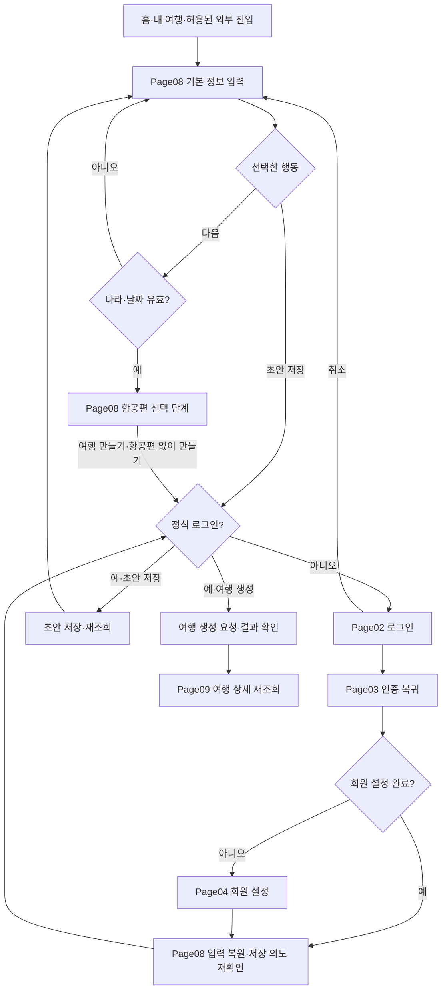

# 신규 계획 생성과 로그인 복귀 상세 명세

작성일: 2026-10-27 / 버전: v0.1 / 상태: 확정 정책을 바탕으로 작성한 개발 전 검토안

적용 페이지: Page08 여행 만들기, Page02 로그인, Page03 인증 복귀, Page04 회원 설정. 연결 범위: Page05 홈·Page07 내 여행에서 진입하고 Page09 여행 상세에서 결과를 확인하는 과정까지입니다. 동행·공개·영수증의 상세 화면은 다음 작업으로 남깁니다.

정책은 [핵심 정책 확정 사항](<../01. 기능정의/핵심정책_확정사항.md>), 상위 연결은 [페이지 역할과 이동 구조](<../02. 사용자흐름/전체사용자흐름_페이지역할_이동구조.md>)를 따릅니다. 이 문서는 목표 동작을 정의합니다. 기존 코드에 일부 처리 함수가 있어도 전체 동작을 구현·검증했다고 판단하지 않습니다. 코드·디자인 토큰·화면 시안은 변경하지 않았습니다.

## 1. 사용자가 얻어야 하는 결과

사용자는 가입 전에 여행 기본 정보를 적을 수 있습니다. 저장하려고 할 때 로그인하고, 쓰던 내용으로 돌아와 계속합니다. 날짜가 없으면 초안으로 보관합니다. 날짜를 정했다면 항공편을 선택적으로 추가하고 여행을 만듭니다. 저장된 여행을 다시 열었을 때 같은 내용이 보여야 합니다.

예: ‘일본 여행’을 적다가 날짜를 아직 못 정했다면 초안으로 저장합니다. 이때 로그인해야 한다면 작성한 나라와 이름을 유지합니다. 로그인 후 내용을 확인하고 초안을 저장합니다. 나중에 날짜를 정해 정식 여행으로 바꿉니다.

## 2. 전체 이동과 완료 상태

그림의 로그인 취소는 실제로 로그인에 들어오기 직전의 Page08 단계로 돌아갑니다. 소셜 인증은 Page03을 거치며 이메일 인증은 같은 확인 절차를 내부에서 수행할 수 있습니다. Page03 경유를 위해 불필요한 화면을 추가하지 않습니다.

| 상태             | 의미                                       | 사용자에게 알릴 내용                                      |
| ---------------- | ------------------------------------------ | --------------------------------------------------------- |
| 입력 중          | 아직 저장하지 않은 내용                    | 저장됐다고 안내하지 않음                                  |
| 로그인 완료      | 계정을 확인한 상태                         | 작성 내용으로 돌아가 저장을 계속할 수 있음                |
| 초안 저장 완료   | 날짜 미정 등을 포함한 초안이 서버에 보관됨 | ‘초안을 저장했어요.’ 정식 여행 생성과 구분                |
| 여행 생성 확인   | 서버가 새 여행 식별값을 반환함             | 생성 사실은 확인됐으며 상세를 불러오는 중일 수 있음       |
| 여행 재조회 완료 | 저장한 여행 내용을 다시 읽음               | 여행 상세에서 일정을 등록할 수 있음                       |
| 결과 확인 중     | 요청 결과를 확실히 알 수 없음              | ‘저장 결과를 확인하고 있어요.’ 새 여행을 다시 만들지 않음 |

## 3. 공통 디자인·접근성

이번 명세는 기존 구성요소와 값을 재사용합니다. 별도의 색상·글꼴·헤더·GNB를 만들지 않습니다.

| 항목      | 유지할 기준                                                                                               |
| --------- | --------------------------------------------------------------------------------------------------------- |
| 브랜드    | TripPrint 로고·브랜드명·하루 원본 유지                                                                    |
| 글꼴      | 현재 언어에 맞는 LINE Seed KR / Sans / JP. 이전 문서의 Pretendard 표기는 변경 전 이력                     |
| 제목·본문 | 공통 화면 제목 26/36·700, 본문 16/26, 보조 14/22, 버튼 16/24. 현행 토큰과 연결                            |
| 여백·너비 | 좌우 20, 넓은 화면 최대 640. 기존 화면별 여백 토큰 유지                                                   |
| 터치·헤더 | 터치 최소 48×48. 이동 바 최소 56과 상하 여백·확장 규칙 유지. ScreenHeader·HeaderAction·ScreenTitle 재사용 |
| 색상·상태 | design-tokens.json의 의미별 색 사용. 오류는 색뿐 아니라 글과 아이콘으로 전달                              |
| 큰 글꼴   | 200%에서 제목·설명 줄바꿈과 높이 확장. 글자 축소·말줄임으로 회피하지 않음                                 |
| 입력      | 보이는 항목 이름 유지. 키보드가 입력·오류·주 행동을 가리지 않게 스크롤. 오류 항목으로 초점 이동           |
| 팝업      | 제목 읽기, 배경 조작 제한, 닫은 뒤 호출 위치로 초점 복귀. 비밀번호·토큰을 알림에 포함하지 않음            |
| 공통 이동 | 기존 화면별 헤더 유형·GNB 표시 정책 유지. 로그인·생성 페이지용 별도 하단 탐색을 추가하지 않음             |

참조: [디자인시스템](<../../02. 디자인/00. 공통규격/디자인시스템.md>), [토큰](<../../02. 디자인/00. 공통규격/design-tokens.json>), [헤더·GNB](<../../02. 디자인/00. 공통규격/헤더GNB_규격.md>), [여행일정 규격](<../../02. 디자인/01. 화면설계/여행일정_화면규격.md>), [인증·회원 설정](<../01. 기능정의/인증온보딩_기능정의.md>). 화면별 문서와 공통 규격의 이전 이력이 다르면 최신 승인 규칙을 따릅니다. UI/UX Pro Max의 오류 복구·오류 읽기·전송 상태 안내 지침을 참고했으며 기존 수치는 변경하지 않았습니다.

## 4. Page08 — 여행 기본 정보

### 역할과 진입

여행의 기본 내용을 적고 초안 또는 정식 여행으로 이어갑니다. 홈의 +, 내 여행의 새 여행, 본인 초안 이어쓰기에서 진입합니다. 기존 경로는 `/new-trip`이며 새로운 경로를 추가하지 않습니다. 초안 조회는 정식 로그인·소유권 확인 후에만 진행합니다.

### 기능과 입력 기준

| 항목           | 동작·검증                                                                                                       |
| -------------- | --------------------------------------------------------------------------------------------------------------- |
| 나라           | 정식 생성 필수. 기존 목록 선택·직접 입력 검증 유지. 다른 나라를 예시 기본값으로 채우지 않음                     |
| 도시           | 선택. 없으면 빈 값 유지. 나중 상세에서 나라로 표시할 수 있으나 저장값을 임의 도시로 바꾸지 않음                 |
| 출발·도착일    | 초안은 미정 허용. 정식 생성은 실제 날짜 둘 다 필요, 출발≤도착, 시작일 포함 1~90일                               |
| 여행 이름      | 선택. 입력 시 기존 50자 한도 유지. 비우면 기존 공통 이름 생성 규칙 사용                                         |
| 시간대·통화    | 기존 나라·여행지 기본값과 검증 사용. 정식 생성 계약에 유효한 값을 전달. 사용자 선택이 있으면 임의 덮어쓰기 금지 |
| 기존 추가 정보 | 기존 다도시·항공편 등 저장된 값을 화면 진입만으로 버리지 않음. 기능 확장이나 새로운 필수 입력 추가 없음         |

날짜가 빠졌다는 이유로 초안 저장을 막지 않습니다. 초안이 정식 생성 검증을 통과한 것처럼 표시하지도 않습니다. 초안은 기존 크기·개수·버전 제한을 적용합니다.

### CTA와 사용자 동작

CTA는 사용자가 다음 행동을 선택하는 버튼이나 링크입니다. 아래는 행동 정의이며 새로운 버튼 위치를 지정하는 표가 아닙니다.

| 행동               | 누를 수 있는 조건                      | 결과                                                                                 |
| ------------------ | -------------------------------------- | ------------------------------------------------------------------------------------ |
| 다음               | 다른 저장·인증 처리가 진행 중이지 않음 | 나라·기간 검증. 오류는 해당 항목 안내, 성공은 항공편 단계로. 서버 여행을 만들지 않음 |
| 초안 저장          | 저장 중이 아님                         | 미인증이면 입력 보존 후 Page02, 회원이면 초안 저장 의도 확인·서버 처리               |
| 뒤로가기           | 저장 결과가 불확실하지 않음            | 변경 없으면 호출한 홈/내 여행. 변경 있으면 이탈 확인                                 |
| 계속 작성 / 나가기 | 이탈 확인에서 선택                     | 계속은 입력 유지. 나가기는 미저장 변경만 버리고 기존 서버 초안은 삭제하지 않음       |
| 다시 불러오기      | 초안 조회 실패                         | 같은 계정·초안 재조회. 빈 새 양식으로 대체하지 않음                                  |

초안 저장 후에는 현재 단계에 남아 저장 결과를 알립니다. 사용자가 나가기를 선택하면 원래 목록으로 돌아갑니다. 저장 자체로 항공편 단계나 여행 상세에 강제 이동하지 않습니다.

### 데이터 흐름

새 입력: 사용자 입력 → 현재 작성 상태 → 항목 검증 → 다음 단계 또는 저장 요청.

초안 이어쓰기: 계정·초안 ID 확인 → 서버 초안 조회 → revision(저장본 버전)과 values 복원 → 수정 → 이전 버전을 포함해 저장 → 서버 결과 재조회.

다른 계정으로 바뀌면 이전 계정의 초안을 새 계정 양식에 넣지 않습니다. 늦게 도착한 이전 조회 결과도 무시합니다.

### 화면 상태와 예외

- 처음: 빈 양식과 기존 도움말. 임의 여행 이름·날짜로 채우지 않습니다.
- 조회 중: 해당 초안을 읽는 중임을 알리고 중복 저장을 막습니다.
- 입력 오류: ‘도착일은 출발일과 같거나 이후여야 해요.’처럼 고칠 행동을 알려줍니다. 다른 입력은 유지합니다.
- 초안 한도: 기존 5개를 덮어쓰지 않고 내 여행에서 정리할 수 있게 안내합니다. 한도와 충돌을 서버가 구별하지 못하면 한도 초과로 단정하지 않습니다.
- 충돌: 최신 저장본 확인 후 재편집합니다. 사용자 입력을 조용히 최신 값으로 덮거나 이전 버전으로 강제 저장하지 않습니다.

## 5. Page08 내부 단계 — 항공편과 여행 생성

### 역할·기능

유효한 나라·여행 기간을 확인한 뒤 항공편을 선택적으로 추가합니다. 항공편이 없어도 여행을 생성할 수 있습니다. 기존 출발·도착·추가편과 최대 30편, 역할 중복·기간 검증을 유지합니다. 항공권 구매·예약 완료를 보장하지 않습니다.

정식 로그인 전에는 기본 정보를 유지한 채 항공편을 건너뛰어 생성 의도를 선택할 수 있습니다. 계정이 필요한 항공 조회·저장 행동은 기존 서버 권한을 우회하지 않고 로그인 안내 후 해당 단계로 돌아옵니다. 로그인 전 외부 조회 허용 범위를 이번 명세로 확대하지 않습니다.

| 행동                | 동작·이동                                                                       |
| ------------------- | ------------------------------------------------------------------------------- |
| 항공편 추가·수정    | 기존 입력 단계를 열고 완료한 값만 현재 생성 입력에 반영. 취소는 수정 전 값 유지 |
| 이전                | 기본 정보로 복귀하며 항공편 입력 유지                                           |
| 항공편 없이 만들기  | 기존 건너뛰기 확인을 거쳐 생성 의도 확인. 미인증이면 Page02 후 같은 단계로 복귀 |
| 여행 만들기         | 입력 전체 재검증 → 계정 확인 → 서버 생성. 중복 누름 잠금                        |
| 저장 결과 다시 확인 | 성공 여부가 불확실할 때 기존 작업 결과 확인. 새 생성 작업을 발행하지 않음       |

### 저장 데이터와 결과

계정·입력 확인 → 기존 생성 요청 ID 준비 → 여행 생성 요청 → 반환된 tripId 확인 → 여행 목록·해당 여행 재조회 → Page09 이동.

초안에서 생성할 때는 기존 초안 ID·revision과 생성 요청의 연결을 보존합니다. 생성 성공을 확인하기 전에 초안을 삭제하지 않습니다. 생성 후 초안 정리가 실패했거나 불확실하면 새 여행을 또 만들지 않고 기존 결과와 초안을 확인합니다. 기기의 이전 게스트 원본은 이 처리로 삭제하지 않습니다.

생성 성공 응답 뒤 상세 조회만 실패했다면 ‘여행을 만들지 못했어요’가 아니라 ‘여행은 만들었지만 내용을 불러오지 못했어요’로 안내합니다. 같은 tripId 재조회와 내 여행 복귀를 제공합니다.

## 6. Page02 — 로그인

### 역할·기능

저장하려는 사용자의 정식 계정을 확인합니다. 입력한 여행을 대신 저장하는 페이지가 아닙니다. 현재 실제로 사용 가능한 이메일·소셜 인증만 제공합니다. 공급자 연결이 없는 로그인을 성공하는 기능처럼 안내하지 않습니다.

진입 시 보존하는 내용은 원래 Page08 단계, 기본 입력, 사용자가 선택한 초안 저장/여행 생성 목적입니다. 계정 소유 초안의 ID·버전도 필요할 때 보존하되 다른 계정으로 넘기지 않습니다. 여행 입력 전체·비밀번호·인증 토큰을 URL에 넣지 않습니다.

| 행동          | 처리                                                 | 이후 이동                                                                |
| ------------- | ---------------------------------------------------- | ------------------------------------------------------------------------ |
| 로그인        | 실제 인증 요청. 중복 제출 방지                       | 이메일 성공은 인증 결과·회원 설정 확인 절차, 소셜은 Page03               |
| 회원가입      | 기존 가입 검증과 인증 조건 적용                      | 필요한 인증이 끝난 뒤 Page04. 가입 요청 성공만으로 로그인 완료 취급 금지 |
| 취소·뒤로가기 | 이번 인증 시도 종료, 늦은 성공 응답의 자동 저장 금지 | 작성하던 Page08 단계로 복귀                                              |
| 다시 시도     | 동일한 복귀 목적 유지, 인증만 재시도                 | Page02 또는 공급자 인증                                                  |

이번 신규 계획 저장 흐름에서는 게스트 계속하기를 저장 대안으로 제공하지 않습니다. 취소한 뒤 기본 입력은 이어갈 수 있으나 서버 저장은 정식 로그인이 필요합니다. 기존 게스트 자료 복구는 별도 Page18의 책임입니다.

### 데이터 흐름·예외

복귀 목적 보관 → 실제 인증 요청 → 서버 세션 확인 → 계정 프로필 조회 → 설정 완료 여부 확인 → Page08 또는 Page04.

- 잘못된 입력은 해당 항목에서 설명합니다. 오류 후 이메일은 유지할 수 있으나 비밀번호를 여행 초안이나 영구 복귀 자료에 저장하지 않습니다.
- 취소·거절은 저장 실패로 표현하지 않습니다. ‘로그인을 마치지 않았어요. 작성은 계속할 수 있어요.’처럼 다음 행동을 안내합니다.
- 네트워크 실패를 잘못된 비밀번호나 로그아웃으로 단정하지 않습니다.
- 로그인한 계정이 이전 초안의 소유자와 다르면 초안을 자동 복원·저장하지 않습니다. 원래 계정으로 다시 로그인하거나 현재 작업을 닫도록 안내합니다.

## 7. Page03 — 인증 복귀

### 역할·동작

외부 인증 결과가 올바른 요청의 결과인지 확인하고 서버 세션을 확정합니다. 외부에서 넘긴 주소로 바로 이동하지 않습니다. 기존 허용된 내부 복귀 목적만 사용합니다.

인증 응답 검증 → 세션 확인 → 현재 사용자 일치 확인 → 회원 프로필 조회 → 설정 미완료면 Page04 → 완료면 Page08의 원래 단계.

| 상태·CTA               | 동작                                                                            |
| ---------------------- | ------------------------------------------------------------------------------- |
| 확인 중                | 진행 상태를 읽을 수 있게 표시. 저장 완료 안내 없음                              |
| 성공                   | 중복 확인창 없이 다음 단계로 이동. 생성/초안 저장 요청은 자동 실행하지 않음     |
| 실패·다시 로그인       | 복귀 목적과 가능한 입력 상태를 유지해 Page02로                                  |
| 취소·작성으로 돌아가기 | 입력 상태가 남아 있으면 Page08. 없으면 복원하지 못했음을 알리고 새 작성/홈 복귀 |

중복 콜백은 같은 인증 완료를 두 번 처리하지 않아야 합니다. 만료·변조·다른 계정 응답은 거부합니다. 신규 외부 초대가 들어오면 진행 중인 작성 목적을 조용히 덮지 않습니다. 새 목적을 선택할지 확인하고 작성 입력을 보호합니다. 이 부분은 현재 대기 초대 우선 처리와 대조해 구현해야 합니다.

## 8. Page04 — 필요한 회원 설정

### 역할·기능

새 계정에 필요한 설정을 마치고 여행 작성으로 돌려보냅니다. 기존 닉네임·선택 정보 계약을 유지하며 새 개인정보 필드를 추가하지 않습니다. 기존 안내상 닉네임은 UTF-8 2~20바이트, 공백만 입력 불가, 기존 회원 유지 시 예외를 따릅니다. 성별은 선택 안 함을 허용하고 생년월일은 필수가 아닙니다. 정확한 오류는 현행 서버 검증과 맞춥니다.

| CTA           | 동작·데이터 흐름                                                                                         |
| ------------- | -------------------------------------------------------------------------------------------------------- |
| 설정 완료     | 항목 검증 → 현재 계정으로 프로필 저장 → 완료 상태 재조회 → 보존한 Page08 단계로 복귀                     |
| 다시 저장     | 입력 유지, 같은 프로필 변경을 재시도. 여행 생성 요청과 섞지 않음                                         |
| 취소·뒤로가기 | 설정 미완료 상태를 완료로 위장하지 않음. Page08 입력으로 돌아가되 저장 시 설정 완료 절차가 필요함을 안내 |

닉네임 중복·길이 오류는 항목 옆에 안내합니다. 저장 응답이 불확실하면 프로필을 재조회합니다. 조회 실패 시 설정을 완료했다고 추정하지 않습니다. 계정이 바뀌면 이전 계정 결과를 반영하지 않습니다. 회원 설정이 끝난 기존 사용자는 이 페이지를 반복해서 거치지 않습니다.

## 9. Page08 복귀와 Page09 인계

### 복귀 직후

1. 이번 인증 요청과 작성 목적이 연결되는지 확인합니다.
2. 같은 사용자의 입력·작성 단계를 복원합니다. 저장된 초안이면 본인 자료와 버전을 재확인합니다.
3. ‘작성하던 내용을 확인하고 저장해 주세요.’라고 안내합니다. 로그인 직전 행동을 자동 실행하지 않습니다.
4. 사용자가 다시 초안 저장 또는 여행 만들기를 선택하면 현재 계정·값·버전으로 처리합니다.

입력 상태를 잃었다면 임의 값을 만들거나 이전 계정 자료를 보여주지 않습니다. 회원의 서버 초안이 있으면 본인 초안을 찾아 이어가게 하고, 저장한 것이 없으면 새 작성 또는 홈 복귀를 안내합니다. 앱 종료 후 미저장 내용 복구를 보장하지 않는다는 기존 정책을 유지합니다.

### 생성 결과를 받는 Page09

입력: 서버가 확인한 tripId와 현재 계정. 여행 원본은 서버에서 다시 읽습니다. 신규 여행은 일정이 없을 수 있으므로 ‘일정 추가’로 이어갈 수 있는 실제 빈 상태를 보여줍니다. 예시 일정이나 항공편을 만들지 않습니다.

뒤로가기는 원래 내 여행/홈으로 돌아갑니다. 로그인·인증 콜백으로 되돌아가는 경로를 남기지 않습니다. 생성 완료 후 이전의 생성 행동을 반복하지 않도록 이동 이력을 정리하되 사용자 입력 보호와 공통 뒤로가기 정책을 유지합니다.

## 10. 개발 인계용 데이터 연결

아래 경로는 기존 자료의 연결 기준입니다. 새 API·DB 컬럼을 확정하거나 코드에 추가하지 않습니다.

| 작업        | 기존 연결·데이터                                                                | 이번 명세에서 요구하는 보완                                                           |
| ----------- | ------------------------------------------------------------------------------- | ------------------------------------------------------------------------------------- |
| 초안 저장   | `PUT /api/v1/plan-drafts/:id`, step·values·revision                             | 정식 회원 제한과 로그인 복귀 연결. 한도·충돌의 정확한 안내                            |
| 초안 재조회 | `GET /api/v1/plan-drafts`                                                       | 현재 계정의 선택 초안 복원, 다른 계정 응답 차단                                       |
| 정식 생성   | `POST /api/v1/trips`, 나라·도시·기간·시간대·통화·선택 제목/항공편·초안 revision | 동일 의도 요청의 중복 방지, 성공과 결과 불확실 구분                                   |
| 여행 재조회 | `GET /api/v1/trips/:id/workspace` 및 목록 조회                                  | 생성 결과와 목록·상세 일치, 일정 등록으로 연결                                        |
| 인증 복귀   | `authReturn.ts`, `destination.ts`의 허용된 내부 복귀                            | 현재 새 여행 복귀는 목적지 중심. 전체 기본 입력·단계 보존까지 된 것으로 간주하지 않음 |
| 회원 설정   | 기존 프로필 조회·`PATCH /api/v1/profile`, onboardingCompleted                   | 저장 후 완료 상태 확인, 원래 작성 목적 유지                                           |

복귀에 필요한 정보는 원래 진입 위치, 작성 단계, 기본 입력, 로그인 전 의도, 필요한 경우 초안 ID·버전·소유 계정, 현재 인증 시도를 구분할 연결 정보입니다. 이는 논리적 요구 목록이며 새 저장 형식이 아닙니다. 저장 위치·수명·만료·정리 방법은 구현 설계에서 정합니다. 로그인 성공·취소 왕복은 지원하되 장기 보관·앱 강제 종료 복원을 암묵적으로 약속하지 않습니다.

## 11. 공통 실패 처리

| 상황                  | 사용자 안내·다음 행동                   | 데이터 보호                                         |
| --------------------- | --------------------------------------- | --------------------------------------------------- |
| 401·세션 만료         | 로그인 후 작성 위치로 복귀              | 입력 유지, 자동 저장 없음                           |
| 403·다른 계정 자료    | 해당 계정으로 로그인하거나 돌아가기     | 이전 계정 자료 노출·새 계정 저장 금지               |
| 초안 없음·삭제됨      | 초안을 찾을 수 없음, 내 여행/새 작성    | 서버 오류를 빈 양식으로 바꿔 성공처럼 표시하지 않음 |
| 400/422·검증 실패     | 고칠 항목과 이유                        | 다른 항목 유지, 임의 잘라 저장하지 않음             |
| 409/412·충돌          | 최신 내용 확인 후 재편집                | 양쪽 변경 자동 덮어쓰기 금지                        |
| 429·요청 제한         | 잠시 후 다시 시도                       | 서버 제한 존중, 무한 자동 반복 금지                 |
| 통신 중단·5xx         | 입력 유지, 다시 시도                    | 저장 성공 표시 금지                                 |
| 저장 응답 유실        | 기존 요청 결과 확인·같은 의도 재시도    | 새 키로 중복 생성 금지                              |
| 생성 성공·재조회 실패 | 생성 사실 안내, 같은 여행 다시 불러오기 | 새 여행 생성 행동으로 돌려보내지 않음               |

상태 코드는 기존 오류 계약과 매핑해 사용하며 모든 서버가 위 코드를 이미 구분해 반환한다고 가정하지 않습니다. 사용자 화면에는 API·revision·토큰 등 구현 용어를 노출하지 않습니다.

## 12. 완료 기준과 검증 시나리오

모든 항목은 이번 문서 작업에서 미검증입니다. 개발 시 대상 버전·계정 유형·웹/기기·실서버/가짜 응답 여부·실제 결과·증거를 기록합니다.

| ID      | 사전 조건·조작                                     | 기대 결과                                                               |
| ------- | -------------------------------------------------- | ----------------------------------------------------------------------- |
| NEW-A01 | 비회원이 나라·이름 입력, 날짜 없이 초안 저장 선택  | Page02로 이동하며 서버에 익명 초안을 만들지 않음                        |
| NEW-A02 | A01에서 기존 회원 로그인                           | 같은 기본 정보와 단계로 복귀. 재확인 후 저장, 재진입 시 동일 초안 확인  |
| NEW-A03 | A01에서 신규 가입·회원 설정 완료                   | Page04 뒤 원래 작성으로 복귀. 홈으로 일괄 이동하거나 자동 생성하지 않음 |
| NEW-A04 | 인증 취소·실패·재시도                              | 입력 유지, 인증 실패와 저장 실패를 구분, 중복 요청 없음                 |
| NEW-A05 | 출발일만 입력 또는 잘못된 기간                     | 초안은 보관 가능하되 정식 생성은 차단. 실제 오류 항목을 설명            |
| NEW-A06 | 날짜·나라 유효, 제목·도시·항공편 생략              | 기존 기본값 규칙으로 여행 한 건 생성·재조회, 일정 추가 가능             |
| NEW-A07 | 초안 5개, 새 초안 저장 또는 다른 기기 수정 후 저장 | 기존 자료를 덮지 않음. 한도/충돌의 확인된 원인을 안내                   |
| NEW-A08 | 생성 버튼 연속 누름·응답 유실·재시도               | 동일 여행 한 건, 초안과 여행 중복 표시 없음                             |
| NEW-A09 | 생성 성공 후 상세 조회만 실패                      | 생성 사실 유지, 같은 tripId로 재시도. 재생성 없음                       |
| NEW-A10 | 계정 A 초안 작성 중 B 로그인·늦은 A 응답           | A 자료를 B에게 보여주거나 B로 저장하지 않음                             |
| NEW-A11 | 인증 중 외부 초대 도착·중복 콜백·잘못된 복귀 주소  | 작성 목적 무단 덮어쓰기 없음, 외부 임의 이동·중복 저장 없음             |
| NEW-A12 | 로그인 왕복 중 입력 상태 소실·앱 재시작            | 허위 복원 없음, 본인 서버 초안 탐색 또는 새 작성 안내                   |
| NEW-A13 | 저장 후 Page09에서 첫 일정 추가·수정·재진입        | 같은 여행에 변경이 남음. 상위 PLAN-03과 연결                            |
| NEW-A14 | 320/390/430 너비, 글자 100/200%, 긴 제목, KR/EN/JP | 공통 제목·터치·줄바꿈 유지, 키보드·초점·오류 안내 접근 가능             |
| NEW-A15 | Android/iOS 외부 인증 복귀·뒤로가기·앱 전환        | 웹 검수와 별도로 입력·목적 보존 및 이탈 보호 확인                       |

개발 후 필수 검사는 `npm run check`, 인증 변경의 `npm run test:auth`, 계약 변경의 `npm run test:foundation`, 이동 변경의 `npm run test:headers:web` 및 관련 이탈 보호 검사입니다. 자동 검사와 실제 화면·실기기 검증은 구분합니다. 이번 문서 작업은 문서 구조·링크·서식만 검사합니다.

## 13. 남은 구현 설계와 검토 기록

- 인증 왕복 중 입력을 보존할 저장 방식과 안전한 정리 시점, 현재 대기 초대 우선 처리와 새 작성 보호의 연결을 정해야 합니다.
- 초안 한도·버전 충돌 구분, 생성 후 초안 정리·응답 유실 복구를 현행 서버 계약과 맞춰야 합니다.
- 신규 게스트 체험 제한은 기존 자료 복구를 보존하면서 적용해야 합니다. 이번 문서로 기기 자료를 삭제하지 않습니다.
- 항공편 내부 입력의 기존 시안 차이는 별도 화면 대조에서 정리합니다. 본 명세는 새 필드·새 조회 공급자를 추가하지 않습니다.

검토 기록: NEW-AUTH-SPEC-01 / v0.1 / 최초 0회 / 주 에이전트 / 2026-10-27. 새 쟁점은 확정 정책 아래의 페이지별 입력·인증 복귀·저장 연결 명세입니다. 기존 POL-01·02의 정책 결정과 재검토 1회 이력을 초기화하지 않습니다. 재검토는 변경 근거가 있을 때 최대 2회입니다.
