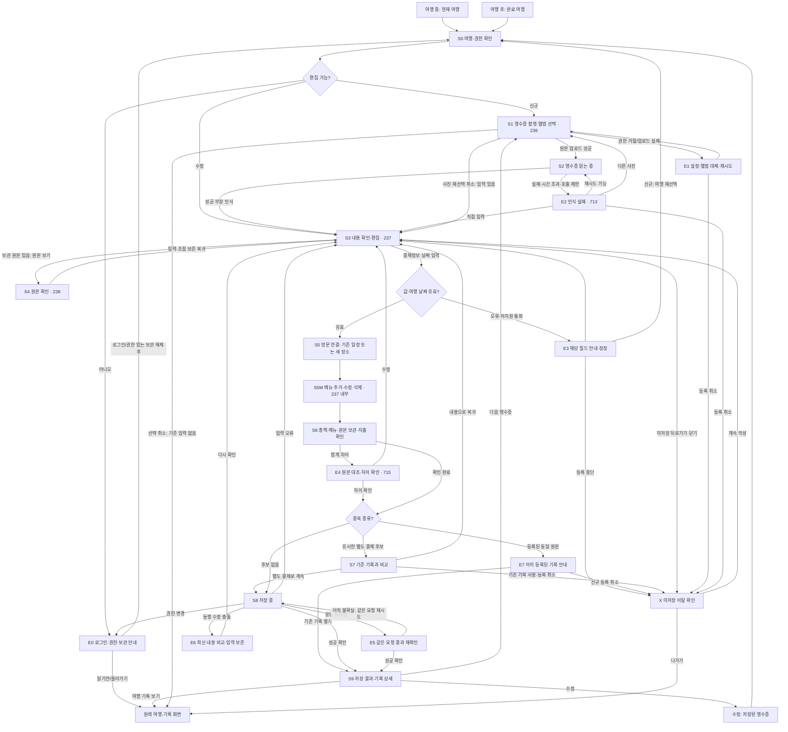

# 영수증 정책 결정표·통합 화면 흐름 검토안

- 버전: v0.2 / 작성·검토일: 2026-10-26
- 상태: RCP-D01~D14 권장안 사용자 승인 완료(2026-10-26). 통합 흐름의 상세 화면 표현은 검토 중이며 개발·구현 완료가 아니다.
- 적용 범위: 영수증 MVP의 여행 중·여행 후·수정·실패 흐름. 모바일 우선, 코드 변경 없음.
- 사용자 확정 방향: 영수증으로 일정·메뉴 추가, 모바일 우선 규격 준수. 세부 정책 RCP-D01~D14는 아래 권장안대로 진행한다.
- 연결 문서: [MVP 범위](영수증_MVP_검토안.md), [P0 개발 인계](영수증_P0_개발인계_검토안.md), [모바일·접근성 규격](영수증_모바일접근성_검토안.md)
- 정책 ID의 상세 기준은 이 문서에서 관리한다. 승인자는 사용자, 승인일은 2026-10-26이다. 근거는 “정책은 권장안대로 진행”이라는 이번 대화 지시다. 화면 상세는 별도 검토안으로 관리하며 데이터 계약은 구현 단계에서 반영한다.

## 1. 1단계 정책 결정표

대안은 비교를 위한 기록이며 현재 제공 기능이라는 뜻이 아니다. 기존 사용자 승인과 일치하는 내용은 반복 승인을 요구하지 않고, 개발에 영향을 주는 미결정 사항만 확인한다.

| ID·결정 주제                | 권장안                                                                                                                                           | 비교한 대안과 선택 이유                                                                                                 | 영향·검증 연결                                                                  |
| --------------------------- | ------------------------------------------------------------------------------------------------------------------------------------------------ | ----------------------------------------------------------------------------------------------------------------------- | ------------------------------------------------------------------------------- |
| RCP-D01 메뉴 필수 여부      | 메뉴 없이도 저장 허용. 추가한 행은 이름 필수, 수량·단가·금액은 미확인 허용. 빈 행은 입력 또는 삭제 안내                                          | 메뉴 필수화는 OCR이 읽지 못한 영수증을 버리게 한다. 전체 기록은 보존하고 메뉴 보완은 선택하게 한다                      | P0-01, M01~M06. 0개 품목 저장과 누락 메뉴 추가 모두 확인                        |
| RCP-D02 결제일·시각         | 인쇄된 현지 결제일 사용, 시각 누락은 비움. 업로드일 대입·자동 UTC 환산 금지                                                                      | 업로드일 사용은 여행 후 날짜를 틀리게 만든다. 시각 추정은 실제 기록에 근거 없는 값을 추가한다                           | P0-02, D01~D05. 여행 밖 날짜는 수정·여행 재선택·권한 있는 기간 변경으로 해결    |
| RCP-D03 계획·실제 연결      | 새 실제 장소 생성 또는 같은 DAY 기존 일정 연결. 기존 계획을 덮어쓰지 않음. 저장된 영수증 날짜 변경 시 새 장소 재연결 허용                        | 원래 계획 자동 수정은 계획과 실제의 차이를 없애고 다른 기록에 영향을 준다. 기존 방문 연결은 중복 일정 생성을 줄인다     | P0-02/04, D02~D03. 원래 일정·다른 영수증 보존, 수정 ID 유지                     |
| RCP-D04 인증 표현           | ‘영수증으로 기록’, ‘내용 확인’ 사용. 구매 진위·본인 방문 보장 배지는 제외                                                                        | OCR 성공은 읽기 성공이지 진위 판정이 아니다. 원본 미보관·수동 수정에도 같은 한계를 적용한다                             | P0-04, P01. 화면·접근성 이름·공유 설명 함께 점검                                |
| RCP-D05 중복 영수증         | 같은 요청/원본 ID는 중복 생성 방지. 상호·결제일시·통화·총액이 비슷하면 후보 안내, 별도 결제 선택 허용                                            | 자동 차단은 같은 날 재방문·분할 결제를 막는다. 단순 재업로드 허용만 하면 지출이 중복된다                                | P0-03, F01~F03. 이미지 유사도 판정은 P1                                         |
| RCP-D06 기존 수동 지출      | 영수증 확정 시 실제 지출 생성 유지. 같은 DAY·통화·총액의 수동 지출은 약한 후보로 안내. 기존 기록 열기·등록 취소·별도 결제로 계속 제공            | 자동 병합은 서로 다른 결제를 지울 수 있다. P0는 사용자가 비교하도록 하고 기존 지출 정리는 별도 명시적 행동으로 수행한다 | P0-03, F04. 편집자 권한·확인 절차 유지, 같은 결제는 중복 정리 후 등록 권장      |
| RCP-D07 삭제                | 영수증 삭제 시 메뉴·연결 실제 지출 제거, 장소 일정 유지. 보관 사진 삭제는 영수증 기록 삭제 후 별도 행동                                          | 장소까지 자동 삭제하면 연결 사진·메모·다른 결제를 잃는다. 사진까지 삭제했다고 오해하지 않도록 결과를 설명한다           | P0-04, P04~P05. 삭제 확인과 재조회, 원본 정리 실패 별도 처리                    |
| RCP-D08 통화 복구           | 미인식/오인식은 원본 확인 후 KRW·JPY·USD로 정정하고 재확인. 실제 미지원 통화는 임의 환산 없이 확정 제한                                          | 통화 오인식을 고칠 수 없으면 복구가 막힌다. 지원 통화로 바꿔치기하면 금액 의미가 달라진다                               | P0-03, F08. 통화 확대·환산은 범위 밖                                            |
| RCP-D09 여행 상태·권한      | 이번 서버 기록 흐름은 권한 있는 회원 여행에서 사용. COMPLETED 추가·수정 허용, ARCHIVED는 보관 해제 후 진행. 뷰어는 허용된 조회만 가능            | 완료와 보관을 함께 잠그면 여행 후 기록이 불가능하다. 편집 제한을 풀면 공동 여행 권한이 무너진다                         | P0-02/04, D06·P03. 기존 게스트 기기 기록은 유지하며 서버 이전은 이번 범위 밖    |
| RCP-D10 원본 보관·공개      | 신규 확정 전 ‘사진도 보관/내용만 보관’ 명시 선택. 원본·품목은 허용된 여행 멤버만 조회하고 외부 공개에 자동 포함하지 않음                         | 무조건 보관은 사용자 선택을 없애고, 무조건 삭제는 나중 확인을 막는다. 공개 일정과 결제 증빙의 공개 범위는 다르다        | P0-04, P01~P05. 기존 수정에서는 원본·보관 선택 유지, 새 사진 교체는 별도 범위   |
| RCP-D11 처리 단위·입력 한도 | 한 번에 한 장. 메뉴 최대 50개, 이름 1~120자 등 현행 입력 계약 유지. 초과는 설명하고 조용히 자르지 않음                                           | 다중 자동 처리부터 만들면 실패·중복·호출 한도가 복잡해진다. 단건 완주를 먼저 검증한다                                   | P0-01/05. 여러 장 연속 처리 지원은 P1. 50/51개 경계 검증 필요                   |
| RCP-D12 취소·초안           | 화면이 살아 있는 동안 오류·원본 보기 왕복에서 입력 유지. 미저장 이탈 시 계속 작성/나가기 확인. 영속 초안·자동 오프라인 전송을 새로 보장하지 않음 | 가짜 자동 저장 안내는 기록 유실을 숨긴다. 초안 동기화는 계정·권한·충돌 설계가 추가로 필요하다                           | P0-03/05, F05~F07·Q03. 원본 업로드와 기록 확정은 별개, 취소 원본 정리 정책 확인 |
| RCP-D13 저장 불확실·충돌    | 응답 유실은 같은 요청 결과부터 재확인. 버전 충돌은 입력 보존 후 최신 내용과 비교, 재확인한 작업만 저장                                           | 새 ID로 즉시 재전송하면 중복되고, 최신 내용 무시 저장은 동행의 변경을 지운다                                            | P0-03, F01·F05. 성공 응답 없이 완료 화면 진입 금지                              |
| RCP-D14 모바일 배치         | 등록·확인을 한 열 중심으로 구성하고 기존 헤더·GNB·타이포·여백·터치 토큰 유지. 큰 글꼴은 줄바꿈·높이 확장                                         | 작은 화면에 데스크톱 표를 축소하면 메뉴·오류·버튼이 읽히지 않는다. 공통 규격 임의 변경은 다른 화면 회귀를 만든다        | P0-05, A01~A10. 상세 기준은 모바일 규격에 단일 관리                             |

### 정책 확정 기록

각 정책의 확정 시 `ID / 선택안 / 상태 / 확정 근거 / 승인자 또는 사용자 지시 / 날짜 / 영향 P0·화면·계약 / 재검토 조건`을 남긴다. RCP-D01~D14 전 항목은 권장안 채택으로 확정했다. 대안은 결정 이력으로 남긴다. 핵심 의존 순서는 D01·D02·D03·D08 → 입력/연결 설계, D05·D06·D13 → 중복/저장 설계, D07·D09·D10·D12 → 권한/보관/이탈 설계다. D04·D14는 모든 화면에 적용한다.

## 2. 하나의 통합 화면 흐름도

아래 도식은 **화면 전환과 상태를 설명하는 기획용 흐름도**다. 완성 UI, 실행 화면 또는 새 라우트 확정안이 아니다. 사각형은 화면/상태, 마름모는 판정이다. S·E·G 번호는 이 문서의 기획 ID이며 기존 페이지 번호와 구분한다. 실패 분기는 아래 오류 표와 함께 읽는다.

S3·S5·S5M·S6은 모바일 확인 화면의 연속 구역으로 구성하는 안이며, 각각 별도 페이지를 추가하라는 뜻이 아니다. 읽기·포커스 순서는 결제 정보·날짜 → 방문 연결 → 메뉴 → 합계·보관 확인으로 통일한다. 화면·시트 분리 여부는 모바일 시안에서 결정한다. X는 입력이 있는 모든 편집 구역에 공통 적용하며, ‘계속 작성’은 실제 이탈 직전 구역으로 복귀한다. 흐름도는 이를 S3로 묶어 표현했다. 저장 결과가 불확실할 때의 이탈은 저장 취소가 아니며, 원래 요청을 재확인할 수 있도록 연결 정보를 유지한다.

G2는 동일 원본의 확정 중복과 유사 후보를 구분한다. 확정 중복에는 ‘별도 결제로 계속’을 제공하지 않는다. 같은 요청 재시도는 기존 성공 결과를 반환하며 신규 생성하지 않는다. 저장된 기록 수정에서는 자기 자신의 영수증·원본·연결 지출을 중복 후보에서 제외한다. S9가 기존 기록 조회로 열린 경우에는 새로 저장했다고 알리지 않는다. 비교 후 신규 입력을 버리고 기존 기록으로 이동할 때도 X의 이탈 확인을 적용한다.

## 3. 화면별 역할과 다음 행동

| 기획 ID·기존 참조   | 보여줄 내용·주요 행동                                                     | 뒤로가기·보존 규칙                                                                   |
| ------------------- | ------------------------------------------------------------------------- | ------------------------------------------------------------------------------------ |
| S0 여행 선택·권한   | 여행 제목·기간·상태, 현재 선택 확인. 필요한 경우 로그인                   | 로그인 후 선택 여행을 재검증. 원래 화면으로 돌아갈 수 있음                           |
| S1 / 236            | 촬영·앨범 중 선택, 사진 등록. 사진이 없으면 기존 비용 직접 입력 경로 안내 | 촬영/선택 취소는 영수증·일정·지출을 생성하지 않음                                    |
| S2 / 인식 중        | 실제 처리 상태, 중단·실패 시 다음 행동                                    | 늦은 결과가 닫힌 화면이나 다른 계정에 적용되지 않음                                  |
| S3 / 237            | 상호·현지 결제일·시각·통화·총액 확인·수정                                 | 변경 후 이탈은 X. 저장된 기록 수정은 OCR 재호출 없이 시작                            |
| S4 / 238            | 원본 전체 확인·확대, 편집으로 복귀                                        | 임시 입력과 스크롤·초점 유지. 원본 미보관이면 접근 버튼 대신 미보관 안내             |
| S5 / 237 구역       | 같은 DAY의 기존 일정 또는 새 장소 선택                                    | 날짜 변경 시 연결을 다시 확인. 수정 시 다른 여행으로 이전하지 않음                   |
| S5M / 237 구역      | 메뉴 추가·수정·삭제, 메뉴 없는 상태 확인                                  | 추가·삭제 후 적절한 행으로 초점 이동, 원본 왕복 시 입력 유지                         |
| S6 / 237 구역       | 메뉴 없는 상태, 총액 차이, 신규 원본 보관 선택, 지출 생성 결과 확인       | 금액·통화·날짜·메뉴 변경 시 관련 확인 상태를 다시 검증. 수정의 기존 보관 선택은 잠금 |
| S7 / 중복 비교      | 기존 후보의 날짜·상호·통화·금액·기록 종류, 후보 근거                      | 후보 열기는 읽기 비교로 왕복하며 입력 보존. 기존 수동 지출 삭제는 별도 명시적 확인   |
| S8 / 저장 상태      | 중복 제출 잠금, 진행·재시도 상태                                          | 확정된 결과만 완료로 표시. 불확실 상태에서 새 영수증 ID로 재생성 금지                |
| S9 / 기존 기록 상세 | 실제 저장된 날짜·장소·메뉴·지출, 수정·다음 등록·기록 보기                 | 수정은 같은 ID 사용. 삭제는 D07 정책에 따라 영향 설명 후 확인                        |
| X / 이탈 확인       | ‘계속 작성’과 ‘나가기’, 미저장 변경이 남지 않는다는 설명                  | 저장 중/결과 불확실이면 중단과 서버 취소를 혼동하지 않도록 안내                      |

새로운 독립 완료 화면을 만들기보다 기존 기록 상세에서 저장 결과와 다음 행동을 확인하는 안을 우선한다. 원본이 업로드된 것과 일정·지출이 저장된 것은 구분한다.

## 4. 실패·예외별 복구 계약

| 상태                       | 사용자에게 제공할 행동                                                   | 금지할 처리                                     | 정책·검증        |
| -------------------------- | ------------------------------------------------------------------------ | ----------------------------------------------- | ---------------- |
| E0 로그인 필요             | 로그인 후 선택 여행·권한 재조회, 돌아가기                                | 미인증 상태를 가짜 계정으로 대체                | D09, P03         |
| E0 뷰어/보관 여행          | 허용된 조회 또는 권한 있는 보관 해제 경로, 돌아가기                      | 뷰어 쓰기 허용, 보관 자동 해제                  | D09, D06         |
| E1 카메라 거절/업로드 실패 | 기기 설정·앨범 대체·재시도·취소                                          | 사진 없이 OCR 성공 표시                         | D12, Q02         |
| E2 인식 실패/시간 초과     | 재시도·다른 사진·직접 입력·취소                                          | 예시 메뉴/금액 채움                             | D01·D12, M01·F06 |
| E2 호출 제한               | 가능한 재시도 시점 안내, 직접 입력 또는 취소                             | 재시도 반복으로 제한 우회                       | D11, F06         |
| E3 결제일이 여행 밖        | 날짜 수정, 신규는 여행 재선택, 권한 있는 기간 변경 후 재조회             | 자동 날짜 이동·여행 기간 확장                   | D02·D03, D04     |
| E3 통화 미인식/오인식      | 원본 확인 후 실제 지원 통화로 정정·재확인                                | 원본 확인 없이 통화 강제 변경                   | D08, F08         |
| E3 실제 미지원 통화        | 지원 범위 안내·등록 중단·원본을 기기에 별도 보관하도록 안내              | 환산·다른 통화로 위장 저장, 원본 영구 저장 보장 | D08, F08         |
| E4 합계 차이               | 원본 비교·금액 수정 또는 세금/할인 등 차이 확인 후 계속                  | 메뉴 합계로 실제 결제 총액 자동 덮어쓰기        | D01, M05         |
| S7 중복 후보               | 기존 기록 비교·등록 취소·별도 결제로 계속                                | 후보만으로 자동 삭제/병합                       | D05·D06, F02~F04 |
| E7 동일 원본 확정 중복     | 기존 결과 조회·기존 기록 열기·신규 등록 취소                             | 별도 결제로 중복 생성 허용                      | D05, F01·F02     |
| E5 결과 불확실             | 같은 요청 결과 조회/재시도, 중복 위험 설명                               | 실패로 단정한 뒤 새 요청으로 재등록             | D13, F01         |
| E6 버전 충돌               | 입력 보존·최신 내용 비교·다시 확인 후 저장                               | 동행의 변경 덮어쓰기                            | D13, F05         |
| 원본 정리 실패             | 내용 저장 여부와 사진 정리 상태 구분, 내부 재처리·사용자에게 필요한 안내 | 실제 남은 원본을 삭제 완료로 표시               | D07·D10, P05     |

다른 여행 재선택·여행 기간 변경은 신규 입력과 기존 기록 수정의 차이를 지킨다. 같은 서버 원본을 다른 여행으로 직접 재사용하지 않는다. 신규 여행을 바꾸면 사진 등록 권한과 원본 연결을 새 여행 기준으로 다시 준비하고, 이전 업로드는 취소 원본 정리 정책을 따른다. 미저장 입력의 이동·폐기 여부를 먼저 안내한다.

## 5. 모바일 규격 대조

기준 문서는 [모바일·접근성 검토안](영수증_모바일접근성_검토안.md), [디자인 시스템](<../../02. 디자인/00. 공통규격/디자인시스템.md>), [공통 토큰](<../../02. 디자인/00. 공통규격/design-tokens.json>), [Ledger 토큰](<../../02. 디자인/00. 공통규격/ledger-tokens.json>), [헤더·GNB](<../../02. 디자인/00. 공통규격/헤더GNB_규격.md>)다. 현재 화면 참조는 236·237·238·713·715이며 상세 링크는 모바일 검토안에 둔다.

- S3·S5·S5M·S6은 한 열 읽기 순서를 우선한다. 좁은 폭에서 원본과 편집 폼을 나란히 두지 않는다. 원본 왕복으로 입력을 잃지 않게 한다.
- 공통 헤더 26/36·700, 본문 16/26, 보조 14/22, 버튼 16/24·600을 유지한다. Ledger 구역 제목 20/28과 공통 헤더를 혼동하지 않는다.
- 좌우 20, 카드 안쪽 16, 라벨과 입력 사이 8, 그룹 12, 구역 24를 재사용한다. 최소 터치 48×48, 주요 버튼 52를 유지하며 큰 글꼴에서는 높이를 확장한다.
- 메뉴 필드는 모바일에서 이름을 전체 폭으로, 수량·단가·금액은 필요할 때 아래 행으로 배치한다. 긴 이름을 축소·잘라내지 않는다.
- S7 중복 비교도 가로 표 대신 후보 카드로 읽는다. 원본 기록 열기 후 돌아오면 후보 선택과 입력 위치를 보존한다.
- 키보드·안전 영역·스크린리더·웹 키보드 조작을 고려한다. 추가 후 새 메뉴로, 삭제 후 인접 행으로 초점을 이동한다. 오류는 필드와 연결한다.
- GNB 표시·숨김, 제목·뒤로가기·이탈 보호는 기존 공통 정책을 따른다. 새로운 탭·헤더 구조를 추가하지 않는다.

대조 결과: 이번 계획은 현행 폰트·간격·터치 값과 충돌하지 않는다. 변경 제안은 메뉴 추가/삭제, 날짜 재연결, 중복 비교와 복구 행동이다. 아직 실제 화면·스케치를 제작하거나 캡처 대조하지 않았으므로 줄바꿈·터치 실측·초점 이동의 시각/행동 검수는 남아 있다. 흐름도를 완성 디자인으로 취급하지 않는다.

## 6. 흐름별 검증과 다음 작업

| 흐름      | 대표 경로                                                       | 기존 인수 사례        |
| --------- | --------------------------------------------------------------- | --------------------- |
| 여행 중   | S0 → S1 → S2 → S3 → S5 → S5M → S6 → S8 → S9                     | M01~M06, Q01·Q02      |
| 여행 후   | 완료 여행 S0 → 앨범 S1 → 과거 날짜 S3 → S5 → S5M → S6 → S8 → S9 | D01·D04·D05, Q01      |
| 수정      | 기록 C → S0 → S3 → 새 날짜/연결 S5 → S5M → S6 → S8 → S9         | D02·D03, Q04          |
| 실패 복구 | E2 직접 입력 / E3 정정 / S7 비교 / E5 재확인 / E6 최신 비교     | F01~F08, P03·P05, Q03 |

검증 사례의 상세 기대 결과는 P0 인계 문서를 따른다. 추가 확인은 품목 50/51개 경계, 원본 미보관 수정, 신규 여행 재선택 시 원본 재등록, 결과 불확실 상태의 이탈·재진입이다. 구현 전 해당 항목의 인수 사례를 보완한다.

다음 작업은 정책 선택 반영 → 화면별 상태·행동 명세와 모바일 스케치 → 데이터/API 영향 확정 → 작업 단위별 개발 인계 순서다. 현재 단계에서는 코드·DB·토큰을 바꾸지 않는다.

## 7. 후속 화면 명세

[화면별 상세 명세](영수증_화면상세_모바일스케치_검토안.md)와 [모바일 상태 스케치](영수증_모바일스케치_검토안.html)에서 승인 정책을 화면에 적용한다. 정책 승인과 스케치 승인·실제 앱 구현을 구분한다.
