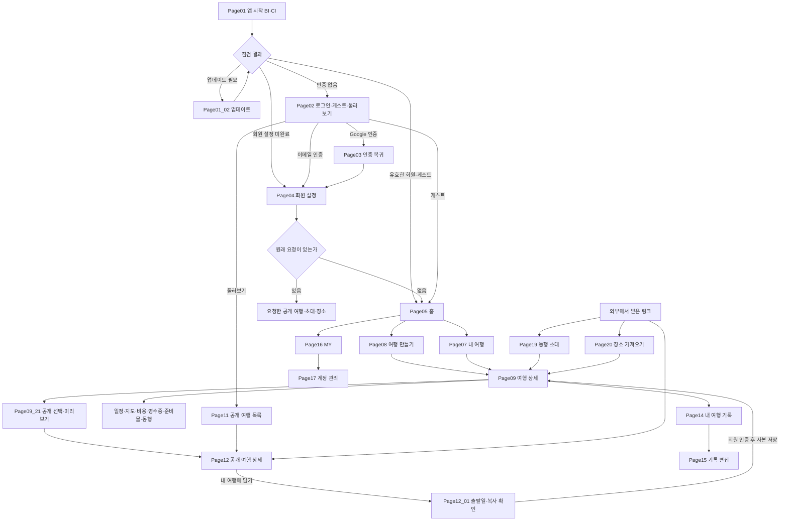

# TripPrint 전체 앱 화면별 프로세스

기준일: 2026-10-26 / 상태: 현재 구현 기준 검토안 / 범위: 앱 시작부터 계획·여행 기록·공개·계정 종료까지

실제 동작 상태와 후속 작업은 [78개 항목 대조 및 개발 계획](<../../05. 검수/02. 검수보고/2026-10-26_전체앱78항목_대조및개발계획.md>)에서 같은 화면 ID로 확인한다.

화면의 역할과 진입 조건, 사용자가 할 일, 데이터 처리, 다음 화면을 함께 정의한다. 현재 연결된 기능을 기준으로 하며 미구현 기능을 완료된 기능으로 포함하지 않는다. 화면 번호는 이 문서의 관리 번호이며 앱 경로나 기존 디자인 시안 번호를 변경하지 않는다.

`PageNN`은 독립 화면, `PageNN_01`은 해당 화면의 단계·시트·확인창·예외 분기다. 하위 번호가 모두 독립 페이지라는 뜻은 아니다. **연결됨**은 코드에 진입과 처리 연결이 있다는 뜻이며 실기기 검수 통과를 뜻하지 않는다. 알려진 공백은 해당 행과 마지막 보완 목록에 표시한다.

## 1. 전체 흐름

기존 회원의 이메일·Google 로그인은 회원 설정을 이미 마쳤다면 Page04를 건너뛴다. 공개 여행 복사와 동행 초대는 다른 흐름이다. 전자는 내 사본을 만들고, 후자는 원본 여행에 정해진 권한으로 참여한다. 그림의 정상 흐름과 별도로 현재 알려진 예외는 아래 표에 기록한다.

## 2. 시작과 인증

| ID        | 화면·유형                         | 진입 조건·목적                                   | 사용자 기능                                                                 | 데이터·시스템 처리                                                                                  | 다음 화면·예외                                                                                                                                        |
| --------- | --------------------------------- | ------------------------------------------------ | --------------------------------------------------------------------------- | --------------------------------------------------------------------------------------------------- | ----------------------------------------------------------------------------------------------------------------------------------------------------- |
| Page01    | BI·CI / 시작 화면                 | 앱 실행, 브랜드 노출과 초기 점검                 | 로딩 상태 확인                                                              | 기기 데이터·공통 데이터 버전 확인, 세션·프로필 복원, Google Play 업데이트와 앱 정책 확인            | 완료한 회원·게스트 → Page05 또는 대기 목적지, 미인증 → Page02, 설정 미완료 → Page04                                                                   |
| Page01_01 | 초기 로딩·재시도 / 상태           | 필수 점검 진행 또는 실패                         | 실패 항목 재시도, 조건 충족 시 다시 로그인                                  | 성공한 점검 유지, 실패 항목 재조회. 인증 실패를 정상 로그인으로 처리하지 않음                       | 완료 전 화면 유지. 데이터·정책 오류를 로그인 이동으로 우회하지 않음                                                                                   |
| Page01_02 | 앱 업데이트 / 분기                | 설치 버전과 최소·권장 버전 정책 비교             | 업데이트, 선택 업데이트 미루기, 재확인                                      | Android Play 업데이트 가능 여부·설치 채널 확인, 즉시 업데이트 또는 스토어 열기, 복귀 후 버전 재조회 | 선택 업데이트는 계속 가능. 필수 업데이트는 충족 전 진입 제한. 취소·스토어 실패 별도 안내                                                              |
| Page02    | 로그인 선택 / 화면                | 인증 없음 또는 사용자가 로그인 선택              | Google 로그인, 이메일 로그인·가입, 게스트 시작, 로그인 없이 발자국 둘러보기 | 제공자 활성 상태 조회, 중복 요청 차단, 원래 이동 목적 보관                                          | Google → Page03, 신규 회원 → Page04, 기존 회원·게스트 → 원래 목적지 또는 Page05, 둘러보기 → Page11                                                    |
| Page02_01 | 기존 로그인 정보 있음 / 자동 분기 | Page01에서 저장된 세션 발견                      | 필요 시 재로그인                                                            | 서버 세션과 현재 계정·프로필 확인. 유효 세션 복원과 새 인증 성공을 구분                             | 유효 → Page05 또는 원래 목적지, 설정 미완료 → Page04, 만료·오류 → 복구 안내·Page02. 앱 실행마다 마지막 로그인 시각 갱신은 현재 기능으로 확정하지 않음 |
| Page02_02 | 이메일 로그인 / 모달              | 이메일 계정 선택                                 | 이메일·비밀번호 입력, 로그인                                                | 입력 검사, 서버 인증, 세션 보관, 프로필 조회                                                        | 기존 회원 목적지 복귀. 잘못된 정보·통신 실패는 입력 화면에서 안내                                                                                     |
| Page02_03 | 이메일 회원가입 / 모달            | 회원가입 선택                                    | 이메일·닉네임·비밀번호·확인 입력                                            | 형식·중복 검사, 계정·세션 생성                                                                      | 성공 → Page04. 중복 계정·닉네임·가입 실패는 안내 후 수정                                                                                              |
| Page02_04 | 게스트 시작 / 분기                | 가입 없이 이용 선택                              | 기기 보관 안내 확인 후 시작                                                 | 최초 게스트 발급 또는 저장된 기기 게스트 복원. 여행은 기기에 보관                                   | Page05. 회원 가입 후 기기 여행 자동 이전은 미지원, 서버 세션 만료 후 검색 복구는 추가 검증 필요                                                       |
| Page02_05 | Google 이용 불가·취소 / 예외      | 제공자 비활성, 조회 실패, 인증 취소              | 다시 확인, 이메일 선택                                                      | 비활성 제공자 요청 차단, 취소를 로그인 성공으로 처리하지 않음                                       | Page02 유지. 실제 Google 인증 성공은 별도 검수                                                                                                        |
| Page02_06 | 비밀번호 복구 / 미구현            | 비밀번호를 잊은 회원                             | 필요한 기능: 복구 요청·새 비밀번호 설정                                     | 재설정 메일·일회용 링크 연결 필요                                                                   | 현재 앱에는 복구 진입·완료 흐름 없음(G02). 새 계정 가입은 기존 계정 복구가 아님                                                                       |
| Page03    | Google 인증 복귀 / 처리 화면      | `/auth/callback`                                 | 처리 확인, 실패 시 재시도                                                   | 일회용 코드·검증값 확인, 세션 교환, 프로필·복귀 목적 확인                                           | 기존 회원 → 목적지, 신규 회원 → Page04, 취소·만료·교환 실패 → 인증 복구                                                                               |
| Page04    | 회원 설정 / 화면                  | 신규 회원 또는 설정 미완료                       | 닉네임, 성별 또는 선택 안 함, 선택적 생년월일 확인·저장                     | 프로필 유효성 검사, 설정 완료 상태·시각 저장                                                        | 완료 → 원래 요청 또는 Page05. 저장 실패는 입력 유지                                                                                                   |
| Page04_01 | 설정 중 공유 링크 재진입 / 결함   | 설정 미완료 상태에서 `/community/{id}` 다시 열기 | 설정 완료 후 친구 일정으로 돌아가야 함                                      | 현재 복귀 경로 변환에서 공개 상세 ID 누락                                                           | **현재 홈으로 이동하는 결함 재현(G01)**. 정상 신규 가입 연속 흐름과 구분                                                                              |

“구글 버전”은 Google 계정·Gmail 버전이 아니라 **Google Play의 설치 앱 업데이트 확인**으로 정의한다. 플랫폼별 지원 여부가 다르며 웹에서 Play 검사를 했다는 이유로 Android 설치 검수를 완료한 것으로 보지 않는다. 로그인 기록 정책은 10절에서 별도 정의한다.

## 3. 홈과 여행 생성

| ID        | 화면·유형                     | 진입 조건·목적                       | 사용자 기능                                                       | 데이터·시스템 처리                                | 다음 화면·예외                                                                |
| --------- | ----------------------------- | ------------------------------------ | ----------------------------------------------------------------- | ------------------------------------------------- | ----------------------------------------------------------------------------- |
| Page05    | 홈 / 화면                     | 시작·인증 완료, 하단 홈 선택         | 내 여행 확인, 새 여행 만들기, 추천 여행지·활용 안내 접근, MY 이동 | 현재 계정의 여행 목록과 공개 여행지 자료 조회     | 여행 → Page09, 생성 → Page08, 여행지 → Page06, MY → Page16                    |
| Page05_01 | 홈 빈 상태·조회 오류 / 상태   | 여행 없음 또는 불러오기 실패         | 첫 여행 만들기 또는 다시 불러오기                                 | 빈 결과와 통신 실패 구분                          | 빈 여행을 예시 데이터로 채우지 않음. 각 행동 후 Page08 또는 Page05            |
| Page06    | 여행지 안내 / 화면            | 홈의 도시 카드·`/destinations/{key}` | 도시 설명, 관광지·먹거리 확인, 해당 도시로 계획 시작              | 선택 도시 정보·이미지·출처 표시, 생성 목적지 전달 | Page08, 인증 필요 시 Page02 후 생성. 알 수 없는 도시 → 목록 복귀              |
| Page06_01 | 정보·사진 출처 / 모달         | 출처 보기                            | 제공처·자료 출처 확인                                             | 화면에 쓰인 출처 목록 표시                        | 닫으면 Page06                                                                 |
| Page07    | 내 여행 / 화면                | 하단 내 여행·`/plans`                | 여행 목록·상태 확인, 해당 여행 열기, 새 여행 만들기               | 회원 서버 여행 또는 현재 게스트 기기 여행 조회    | Page09 또는 Page08. 빈 상태·조회 실패 별도 안내                               |
| Page08    | 여행 계획 만들기 / 화면       | 새 여행 만들기·도시에서 계획하기     | 여행 기간, 국가·도시, 여행 이름 입력                              | 필수 입력·날짜 범위·목적지 검사, 초안 유지        | 다음 → Page08_02. 취소·이탈은 작성 내용 보호 정책 적용                        |
| Page08_01 | 국가·도시 선택 / 시트         | 여행지 입력                          | 검색·선택·직접 입력                                               | 목적지 후보 조회·기본 통화와 시간대 결정에 활용   | Page08. 검색 불가와 직접 입력 구분, 사용자가 내용 확인                        |
| Page08_02 | 항공편 입력 / 생성 단계       | 날짜·목적지 입력 완료                | 항공편 검색·선택, 수동 입력, 항공편 없이 생성                     | 입력한 항공권과 여행 기간 검증, 생성 요청 준비    | 저장 → Page09. 항공편은 필수 아님                                             |
| Page08_03 | 여행 저장 중·결과 불명 / 예외 | 생성 요청 중 또는 응답 유실          | 기다리기, 같은 요청 재시도·조회                                   | 중복 생성 방지, 저장 완료와 후속 조회 실패 분리   | 저장 확인 → Page09. 실패를 성공으로 표시하거나 새 요청으로 중복 생성하지 않음 |

## 4. 여행 상세와 작업 화면

Page09의 핵심 탭은 **일정·지도·비용**이다. 사진·영수증, 준비물, 동행, 여행 공유는 더보기에서 연다. 별도 GNB 탭을 추가하지 않는다. 회원은 서버 자료, 게스트는 기기 자료를 기준으로 표시하며 쓰기 가능 여부는 여행 권한에 따른다.

| ID        | 화면·유형                                  | 진입 조건·목적                        | 사용자 기능                                                 | 데이터·시스템 처리                                                | 다음 화면·예외                                                                   |
| --------- | ------------------------------------------ | ------------------------------------- | ----------------------------------------------------------- | ----------------------------------------------------------------- | -------------------------------------------------------------------------------- |
| Page09    | 여행 상세 / 화면                           | 내 여행·생성 완료·초대 수락·사본 저장 | 여행 제목·상태·DAY 확인, 일정·지도·비용 전환, 더보기        | 여행 스냅샷·접근 권한·버전 조회                                   | 각 작업 영역. 인증 만료 → 로그인 복구, 접근 불가 → 목록, 조회 실패 → 재시도      |
| Page09_01 | DAY 일정 / 영역                            | 일정 탭                               | 날짜별 일정 확인·추가·관리, 추천 일정 확인                  | 선택 DAY의 일정과 연결 비용·항공권 표시                           | 일정 편집 → Page09_02, 항공권 → Page09_04                                        |
| Page09_02 | 일정 추가·수정 / 모달                      | 일정 추가 또는 일정 관리              | 제목·시간·장소·메모·공유 설명·체류 시간·예상 비용 입력      | 입력 검증, 일정과 관련 데이터 저장, 변경 버전 확인                | 저장 후 해당 DAY. 취소·뒤로가기는 입력 이탈 확인, 저장 중 중복 동작 차단         |
| Page09_03 | 일정 복사·DAY 이동·순서·삭제 / 행동·확인창 | 기존 일정 관리                        | 다른 DAY로 복사·이동, 순서 조정, 삭제 확인                  | 새 일정 식별자·DAY 연결·관련 비용 갱신, 삭제 영향 처리            | Page09_01. 충돌 시 최신 원본 확인 후 재작업                                      |
| Page09_04 | 항공권 조회·수정 / 모달                    | 항공 일정 선택·항공권 편집            | 편명·날짜 조회, 후보 확인, 직접 입력·수정                   | 공급자 응답과 수동 입력 구분, 날짜·시간·공항 정보 검사            | Page09_01. 조회 실패 시 직접 입력 안내                                           |
| Page09_05 | 장소 검색·선택 / 내부 단계                 | 일정 장소 입력                        | 이름 검색, 결과 선택, 지도 공유 장소 연결                   | 실제 장소 후보 조회, 좌표·주소·제공처 반영                        | 일정 편집으로 복귀. 공급자·인증 실패는 저장 성공으로 바꾸지 않음                 |
| Page09_06 | 지도 / 영역                                | 지도 탭                               | 일정의 위치 확인, 외부 지도 연결                            | 저장된 좌표로 지도 표시, 플랫폼별 지도 지원 확인                  | 해당 여행 유지. 좌표 없음·지도 이용 불가를 구분                                  |
| Page09_07 | 비용 목록 / 영역                           | 비용 탭                               | 비용·통화별 합계 확인, 추가·수정·삭제                       | 일정·영수증 연결 비용 조회, 통화별 계산                           | 편집 → Page09_08. 자료 없음·조회 실패 구분                                       |
| Page09_08 | 비용 편집 / 모달                           | 비용 추가·수정                        | 금액·통화 등 비용 정보 확인·저장                            | 비용 입력 검증, 관련 일정과 연결, 영수증 비용 중복 처리 규칙 유지 | Page09_07. 저장 실패·충돌 시 재확인                                              |
| Page09_09 | 사진·영수증 목록 / 영역                    | 더보기 → 사진·영수증                  | 사진 확인·추가·삭제, 영수증 확인·수정·삭제·인식 재시도      | 비공개 사진 접근, 영수증 상태·일정·지출 연결 조회                 | 사진 등록 또는 Page09_10·11. 삭제 시 영향 확인                                   |
| Page09_10 | 영수증 촬영·선택 / 기기 선택 단계          | 여행 중·여행 후 영수증 등록           | 카메라·앨범에서 이미지 선택                                 | 권한 확인, 업로드·인식 요청, 원본 처리 정책 적용                  | 인식 후 Page09_11. 취소는 등록 완료가 아니며 권한·통신·인식 실패 구분            |
| Page09_11 | 영수증 확인·수정 / 모달                    | 인식 결과·기존 영수증·재시도          | 상호·결제일시·통화·총액·메뉴 검토, 방문 연결 또는 일정 추가 | OCR 추출값을 사용자 확인값과 구분, 여행 DAY·방문·지출 연계 검증   | 저장 후 일정·비용·영수증 재조회. OCR만으로 실제 방문·원본 진위 인증하지 않음     |
| Page09_12 | 메뉴·구매 품목 편집 / 내부 단계            | 영수증 확인                           | 품목명·수량·금액 수정·추가·삭제                             | 품목 입력·합계 차이 검증·안내                                     | Page09_11. 품목 합계 차이를 임의로 숨기지 않음                                   |
| Page09_13 | 날짜·중복·원본 보관 확인 / 예외 분기       | 여행 밖 날짜·중복 후보·보관 선택      | 연결 대상·날짜 확인, 기존 기록 여부 확인, 보관 선택         | 중복 후보·기존 비용·일정 연결 대조                                | 확인 후 저장 또는 편집 유지. 중복 후보를 자동 삭제하지 않음                      |
| Page09_14 | 인식 실패·직접 보완·저장 재시도 / 예외     | OCR 실패·저장 실패·응답 유실          | 다시 인식, 직접 입력, 결과 재조회·재시도                    | 실패 단계와 저장 완료 여부 구분, 같은 영수증·지출 중복 생성 방지  | Page09_11 또는 저장 결과. 실패를 가짜 인식값으로 대체하지 않음                   |
| Page09_15 | 사진·영수증 삭제 / 확인창                  | 삭제 선택                             | 삭제 범위 확인·취소·확정                                    | 원본 사진과 기록·지출 삭제 범위를 구분, 정리 작업 처리            | 목록 재조회. 실패 시 삭제 완료로 표시하지 않음                                   |
| Page09_16 | 준비물 / 영역                              | 더보기 → 준비물                       | 준비물 확인·추가·완료 표시                                  | 여행 체크리스트 저장                                              | 해당 영역 유지. 보기 전용 권한은 변경 불가                                       |
| Page09_17 | 동행 / 영역                                | 더보기 → 동행                         | 참여자·권한 확인, 보기·편집 초대, 초대 취소·참여 해제       | 초대와 여행 멤버 권한 관리, 계정·권한 검사                        | 초대 전달 → 상대방 Page19. 공개 여행 게시와 다른 권한 흐름                       |
| Page09_18 | 여행 더보기 / 시트                         | 헤더 더보기                           | 사진·영수증·준비물·동행·공유, 여행 정보·기간·도시 관리 선택 | 선택 영역 전환, 소유자 권한에 따른 행동 제한                      | 해당 하위 영역·편집창                                                            |
| Page09_19 | 여행 정보·기간 편집 / 모달                 | 소유자의 정보·기간 수정               | 제목·여행 정보·기간 변경                                    | 기간 변경에 따른 DAY·일정 영향 검증, 버전 충돌 검사               | Page09. 관련 기록을 임의 유실시키지 않음                                         |
| Page09_20 | 여행 도시 관리 / 모달                      | 도시 관리 선택                        | 방문 도시 추가·수정·삭제                                    | 도시와 DAY·일정 연결의 삭제·변경 제약 검사                        | Page09. 참조 중인 항목의 제한 안내                                               |
| Page09_21 | 여행 공유 선택 / 영역·편집 단계            | 더보기 → 여행 공유                    | 계획·기록 공유, DAY·일정·사진·비용 선택, 소개 입력          | 공개할 사본 범위 구성. 개인 메모·영수증 원본·메뉴 자동 공개 제외  | Page09_22. 게스트 기기 여행의 회원 이전은 미지원                                 |
| Page09_22 | 공개 미리보기·확인 / 단계·확인창           | 공유 선택 완료                        | 공개 내용 검토, 돌아가 수정, 공개 확정                      | 선택 대상의 현재 버전·삭제 여부 확인, 공개 사본 저장              | Page12 또는 공유 영역. 충돌 시 최신 원본 확인·재선택                             |
| Page09_23 | 공개 링크 보내기 / 시스템 행동             | 공개 저장 완료                        | 공유 시트 또는 링크 복사                                    | HTTPS 공개 주소 생성, 기기 공유·웹 공유 또는 클립보드 실행        | 공개본 유지. 로컬 HTTP 링크 생성 불가(E01), 공유 API 거절 후 복사 대안 부족(G03) |
| Page09_24 | 재공개·공개 중단 / 확인 단계               | 이미 공개한 여행                      | 수정한 원본을 재공개, 공개 중단                             | 같은 공개 ID 갱신 또는 공개 접근 중단                             | Page09·12. 기존 수신자의 독립 사본은 삭제하지 않음                               |
| Page09_25 | 저장 충돌·결과 불명·이탈 / 공통 예외       | 저장 중 이동·버전 불일치·응답 유실    | 계속 편집·이탈 확인, 최신 원본 조회, 동일 저장 재시도       | 중복 요청 잠금·원본 버전 대조·결과 재조회                         | 저장 성공과 후속 조회 실패를 분리. 미저장 입력을 조용히 버리지 않음              |
| Page09_26 | DAY 소개 / 편집창                          | DAY 제목·컨셉 편집                    | 날짜별 소개 작성·저장                                       | 해당 DAY의 계획 정보 갱신                                         | 일정 탭. 입력 오류·충돌 안내                                                     |
| Page09_27 | 추천 코스 / 선택 시트                      | DAY 추천 선택                         | 장소 미리보기·선택·검색 전환                                | 선택 장소를 새 일정 초안에 반영                                   | Page09_02. 시트에서 선택만 했다고 일정 저장 완료로 처리하지 않음                 |
| Page09_28 | 일정 위치 선택 / 내부 화면                 | 일정 위치 입력·수정                   | 현재 위치 조회·위치 선택·적용                               | 권한·위치 정확도 확인, 선택 좌표를 초안에 반영                    | Page09_02에서 별도 저장. 권한 거절·늦은 응답 처리                                |
| Page09_29 | 일정 구간 이동수단 / 선택 단계             | 일정 사이 이동수단 선택               | 이동 방법 지정                                              | 일정 구간의 이동수단 저장                                         | 일정 탭. 편집 권한·버전 충돌 확인                                                |
| Page09_30 | 여행 완료·기록 공유 전환 / 행동·확인       | 여행 공유에서 기록 공개 선택          | 여행 완료 처리 후 기록 공유                                 | 여행 상태 변경. 기록 공유는 완료한 여행에 적용                    | Page09_21. 계획 공유와 기록 공유의 조건을 구분                                   |

## 5. 공개 여행 탐색과 공유받은 여행

| ID        | 화면·유형                      | 진입 조건·목적                              | 사용자 기능                                         | 데이터·시스템 처리                                                                         | 다음 화면·예외                                                                      |
| --------- | ------------------------------ | ------------------------------------------- | --------------------------------------------------- | ------------------------------------------------------------------------------------------ | ----------------------------------------------------------------------------------- |
| Page10    | 발자국 / 화면                  | 하단 발자국·`/footprints`                   | 공개 여행 카드 탐색·조건 변경·상세 열기             | 공개 피드 조회·추가 페이지 로드                                                            | Page12. 비로그인 열람 가능. 현재 브랜드 헤더와 검색창 표시 정책 유지                |
| Page11    | 여행 커뮤니티 / 화면           | 로그인 없이 둘러보기·`/community`           | 검색·조건 설정·공개 여행 열기                       | 같은 공개 피드의 검색·조건 조회                                                            | Page12. Page10과 경로·표현이 다르나 공개 자료는 같은 정책 적용                      |
| Page11_01 | 검색·필터·더 보기 / 내부 상태  | 탐색 조건 입력·목록 끝                      | 조건 변경, 추가 목록 보기                           | 검색어·종류·일수 조건과 페이지 상태 관리                                                   | 결과 목록. 검색 결과 없음과 조회 실패 구분                                          |
| Page11_02 | 신고·사용자 차단 / 시트·확인창 | 공개 게시물의 관리 행동                     | 신고 사유 제출, 작성자 차단 확인                    | 인증·입력 검사, 신고·차단 저장                                                             | 목록 갱신. 미인증은 로그인 안내, 실패 시 다시 시도                                  |
| Page12    | 공유된 여행 / 화면             | 공개 카드 또는 친구의 `/community/{postId}` | DAY·장소·설명·선택 사진·비용 확인, 내 여행으로 담기 | 공개 사본 조회. 원본 비공개 여행 권한을 부여하지 않음                                      | Page12_01. 공개 중단·없는 ID → 안내와 공개 목록 복귀                                |
| Page12_01 | 내 여행에 일정 담기 / 시트     | 공개 여행의 담기 선택                       | 내 여행 이름·출발일 확인, 복사 범위 확인            | 원본 공개 자료 재조회, 내 계정 소유의 새 여행·일정 생성. 사진·비용·영수증·비공개 메모 제외 | 성공 → Page09. 미인증·게스트는 회원 인증 후 같은 공개 여행으로 복귀                 |
| Page12_02 | 담기 저장·복귀 예외 / 상태     | 중복 누름·응답 유실·공개 철회               | 동일 요청 재시도, 저장한 여행 열기                  | 저장 키 유지·중복 방지, 원본 공개 상태 확인                                                | 기존 사본은 독립 유지. 설정 도중 링크 재진입은 G01, HTTPS→설치 앱 연결은 미구현 G04 |

## 6. 개인 여행 기록

| ID        | 화면·유형                    | 진입 조건·목적                                    | 사용자 기능                                                         | 데이터·시스템 처리                         | 다음 화면·예외                                                   |
| --------- | ---------------------------- | ------------------------------------------------- | ------------------------------------------------------------------- | ------------------------------------------ | ---------------------------------------------------------------- |
| Page13    | 나의 발자국 / 화면           | MY의 개인 기록·`/my-footprints`                   | 내 여행 기록 검색·연도 필터·더 보기·상세 열기                       | 본인 여행·기록 조회                        | Page14. 공개 피드 Page10과 구분, 빈 기록·조회 실패 안내          |
| Page14    | 여행기록 / 화면              | 여행의 기록 보러가기·개인 기록 목록·`/diary/{id}` | 날짜·장소별 기록·사진·메모·비용 확인, 기록 추가·수정                | 여행 스냅샷과 실제 기록을 묶어 조회        | Page15, 비용·영수증은 해당 여행 작업으로 연결. 접근 권한 확인    |
| Page15    | 여행기록 추가·편집 / 화면    | 기록 추가·기존 장소 기록 편집·`/record/{id}`      | 장소 선택, 기록 메모·공유 설명·팁, 사진 추가·삭제, 영수증·지출 보완 | 원본 버전 확인, 기록 저장·관련 사진 처리   | 성공 → Page14. 저장 충돌은 최신 원본 확인 후 편집                |
| Page15_01 | 사진 삭제·기록 이탈 / 확인창 | 사진 삭제·작성 중 뒤로가기                        | 유지·삭제, 계속 작성·나가기                                         | 확인한 범위만 삭제, 저장 중 중복·이탈 제한 | Page15 또는 Page14. 저장 성공 후 화면 전환 실패와 저장 실패 구분 |

## 7. MY와 계정

| ID        | 화면·유형                    | 진입 조건·목적                         | 사용자 기능                                             | 데이터·시스템 처리                                               | 다음 화면·예외                                                 |
| --------- | ---------------------------- | -------------------------------------- | ------------------------------------------------------- | ---------------------------------------------------------------- | -------------------------------------------------------------- |
| Page16    | MY / 화면                    | 하단 MY·홈 계정 버튼·`/my`             | 프로필·여행 통계, 개인 기록, 계정 관리, 로그인·로그아웃 | 계정 프로필·여행 통계 조회, 게스트와 회원 상태 구분              | Page13·17·18 또는 Page02                                       |
| Page16_01 | 개인 프로필 수정 / 모달      | 프로필 수정                            | 닉네임·한 줄 소개·여행 스타일 수정                      | 닉네임 제약·중복 확인, 프로필 저장                               | Page16. 실패는 수정창에서 안내                                 |
| Page16_02 | 로그아웃 / 확인창            | 로그아웃 선택                          | 계속 이용·로그아웃 확정                                 | 서버 세션 종료, 계정 관련 캐시 정리. 실패를 완료로 처리하지 않음 | 성공 후 인증 상태에 맞는 화면. 기기 여행 원본 자동 삭제와 구분 |
| Page17    | 계정 관리 / 화면             | MY → 계정 관리·`/account`              | 탈퇴 유예·보관 범위 확인, 탈퇴 요청                     | 현재 계정과 최근 인증 확인, 서버 탈퇴 요청                       | 완료 안내·세션 해제. 인증 오래됨 → 재로그인 후 복귀            |
| Page17_01 | 탈퇴 확인·처리 / 확인창·상태 | 탈퇴 요청                              | 취소·확정, 필요 시 재로그인                             | 중복 요청 잠금, 서버 유예 종료일 확인, 성공한 경우만 세션 정리   | 삭제 즉시 완료로 표현하지 않음. 응답 불명은 계정 상태 재확인   |
| Page18    | 이 기기의 이전 기록 / 화면   | MY에서 이전 기록 보기·`/local-records` | 기기에 남은 기존 기록 조회                              | 로컬 여행·방문 자료 조회                                         | MY로 복귀. 회원 서버 여행으로 이전하는 기능과 구분             |

## 8. 외부 진입과 공통 예외

| ID        | 화면·유형                             | 진입 조건·목적                         | 사용자 기능                                   | 데이터·시스템 처리                                     | 다음 화면·예외                                                                  |
| --------- | ------------------------------------- | -------------------------------------- | --------------------------------------------- | ------------------------------------------------------ | ------------------------------------------------------------------------------- |
| Page19    | 여행 초대 / 화면                      | 친구의 동행 초대 링크·`/invite`        | 초대된 여행·보기/편집 권한 확인, 참여 수락    | 초대 토큰·만료·취소·인증·참여 권한 확인                | 수락 → Page09. 미인증은 Page02 후 초대 복귀. 링크 열기만으로 자동 수락하지 않음 |
| Page19_01 | 만료·취소·권한 오류 / 상태            | 사용할 수 없는 초대                    | 안내 확인, 새 초대 요청·돌아가기              | 잘못된 초대나 토큰 재사용 차단                         | 기존 여행 권한을 임의 부여하지 않음                                             |
| Page20    | 저장한 장소를 여행으로 / 화면         | 지도 장소 공유 인텐트·`/import-place`  | 받은 장소 확인, 내 여행·DAY 선택, 일정에 추가 | 장소 링크 해석·검색, 인증 후 대기 입력 복구, 일정 저장 | Page09. 지도 저장 목록 일괄 가져오기는 미지원, 단일 장소·이름 검색 안내         |
| Page20_01 | 링크 해석·저장 실패 / 상태            | 지원하지 않는 주소·조회 실패·저장 충돌 | 이름으로 검색·다시 시도·입력 수정             | 장소 정보와 대상 여행 권한 검증                        | 실패를 예시 장소 저장으로 바꾸지 않음                                           |
| Page21    | 페이지 없음 / 화면                    | 지원하지 않는 앱 내부 경로             | 홈으로 돌아가기                               | 잘못된 경로 안내, 민감 정보 노출 방지                  | Page05 또는 인증 상태에 맞는 시작 흐름                                          |
| Common01  | 접근 권한 요청 / 기기 대화상자        | 카메라·사진 등 실제 기능 실행          | 허용·거절, 필요 시 기기 설정 확인             | 요청한 기능에 필요한 권한만 확인                       | 거절은 해당 작업 중단·대안 안내. 앱 전체 성공·실패와 구분                       |
| Common02  | 인증 만료·계정 변경 / 공통 상태       | 보호된 작업 중 인증 실패·계정 전환     | 재로그인·다시 조회                            | 이전 계정의 응답·캐시가 새 계정에 반영되지 않게 차단   | 허용된 원래 목적지로 복귀. 임의 외부 복귀 주소는 거부                           |
| Common03  | 정상·빈 상태·오류·저장 중 / 공통 상태 | 모든 자료 조회·입력 화면               | 상태에 맞는 재시도·생성·취소                  | 빈 자료와 실패 구분, 저장 중 중복 차단, 요청 결과 확인 | 성공 근거 없이 완료 처리하지 않음                                               |

## 9. 실제 경로와 화면 번호 대조

| 앱 경로·진입 파일           | 문서 ID | 화면 연결 근거                                                                              |
| --------------------------- | ------- | ------------------------------------------------------------------------------------------- |
| `app/index.tsx`             | Page01  | 시작 BI·초기 점검. 홈과 주소 표현이 겹칠 수 있어 파일 기준으로 구분                         |
| `/login`                    | Page02  | `app/login.tsx`, `features/auth/EmailAuth.tsx`                                              |
| `/auth/callback`            | Page03  | `app/auth/callback.tsx`                                                                     |
| `/profile-setup`            | Page04  | `app/profile-setup.tsx`                                                                     |
| `app/(tabs)/index.tsx`, `/` | Page05  | `HomeScreen.tsx`                                                                            |
| `/destinations/:key`        | Page06  | `CityGuideScreen.tsx`                                                                       |
| `/plans`                    | Page07  | `MyTripsScreen.tsx`                                                                         |
| `/new-trip`                 | Page08  | `PlanEditor.tsx`, `TripPlanningFlowView.tsx`                                                |
| `/trips/:id`                | Page09  | `WorkspaceScreen.tsx`, `WorkspaceView.tsx`, `WorkspaceSections.tsx`, `WorkspaceDialogs.tsx` |
| `/footprints`               | Page10  | `PublicFootprintsScreen.tsx`                                                                |
| `/community`                | Page11  | `CommunityScreen.tsx`, `useDiscoveryController.ts`                                          |
| `/community/:postId`        | Page12  | `CommunityPlanScreen.tsx`, `useCommunityImport.ts`                                          |
| `/my-footprints`            | Page13  | `FootprintsScreen.tsx`                                                                      |
| `/diary/:id`                | Page14  | `DiaryScreen.tsx`                                                                           |
| `/record/:id`               | Page15  | `RecordEditorScreen.tsx`                                                                    |
| `/my`                       | Page16  | `features/profile/MyAccountView.tsx`                                                        |
| `/account`                  | Page17  | `app/account.tsx`                                                                           |
| `/local-records`            | Page18  | `features/trail/TrailScreen.tsx`                                                            |
| `/invite`                   | Page19  | `InviteScreen.tsx`                                                                          |
| `/import-place`             | Page20  | `ImportPlaceScreen.tsx`                                                                     |
| `app/+not-found.tsx`        | Page21  | 없는 경로 안내                                                                              |

위 소스 경로는 `apps/mobile/src` 기준이다. `_layout.tsx`는 공통 틀, `+native-intent.tsx`는 외부 입력 해석이므로 독립 사용자 화면으로 세지 않는다. 연결되지 않은 시안용·대체 컴포넌트는 파일이 있다는 이유만으로 현재 화면에 포함하지 않는다.

## 10. 데이터 처리와 추가 결정 사항

| 항목                | 현재 처리·구분                                                                                                | 정의·개발이 더 필요한 부분                                                                                                                                                |
| ------------------- | ------------------------------------------------------------------------------------------------------------- | ------------------------------------------------------------------------------------------------------------------------------------------------------------------------- |
| 로그인 정보 체크    | 세션·현재 사용자·프로필·설정 완료 상태 확인                                                                   | 세션 복원 실패 시 원래 목적지 유지. G01 예외 수정 필요                                                                                                                    |
| 마지막 로그인 일자  | `cloudAuth.ts`의 프로필 변환은 `lastSignInAt`에 현재 기기 시각을 넣음. 서버 프로필 응답·업무 저장 이력과 다름 | 별도 서버 마지막 로그인 필드·갱신 규칙을 도입하려면 신규 인증 성공 시각과 단순 앱 재실행 시각을 분리해 결정. 현재 앱 시작마다 서버 로그인 이력을 갱신한다고 정의하지 않음 |
| Google Play·앱 버전 | Play 업데이트 조회와 최소·권장 버전 정책 비교                                                                 | 실제 설치 경로별 업데이트·취소·복귀 검수 필요                                                                                                                             |
| 개인 여행 저장      | 회원 서버 저장과 게스트 기기 저장 구분                                                                        | 게스트 기기 여행의 회원 계정 이전 정책 결정(L01)                                                                                                                          |
| 영수증              | OCR 추출 → 사용자 확인 → 일정·메뉴·비용 연결                                                                  | OCR과 본인 방문 인증을 구분. 실제 표본 인식 품질 검수 필요                                                                                                                |
| 공개 여행           | 선택된 정보로 공개 사본 저장, 원본 수정과 재공개 분리                                                         | 링크 전달·공개 저장을 각각 검증. G03 복사 대안, G04 앱 링크 연결 결정                                                                                                     |
| 공개본 담기         | 수신자 소유의 독립 일정 사본 생성                                                                             | 원본 멤버십·사진·비용·영수증 자동 복사 없음                                                                                                                               |
| 동행 초대           | 원본 여행에 보기·편집 권한 부여                                                                               | 공개 링크 열람과 초대 수락을 혼동하지 않도록 안내 유지                                                                                                                    |
| 탈퇴                | 최근 인증 확인 후 유예·정리 정책 실행                                                                         | 화면의 요청 성공과 실제 유예 종료 후 삭제 완료를 분리                                                                                                                     |

## 11. 세 페르소나의 완료 경로

| 페르소나                    | 주 경로                                        | 완료 조건                                             | 현재 남은 공백                                                 |
| --------------------------- | ---------------------------------------------- | ----------------------------------------------------- | -------------------------------------------------------------- |
| 계획을 만들러 온 사용자     | Page01 → 02 → 04 → 05 → 08 → 09 → 07           | 생성·편집한 여행이 재접속 후 동일하게 조회됨          | 비밀번호 복구 G02, 게스트 계정 이전 L01, 검색·설치 유입 실검증 |
| 친구에게 일정을 받은 사용자 | Page12 → 02·04(필요 시) → 12_01 → 09           | 친구 원본을 바꾸지 않고 내 사본을 수정·저장함         | 설정 중 링크 재진입 G01, 설치 앱으로 바로 열기 G04             |
| 내 여행을 공유하는 사용자   | Page09 → 09_21 → 09_22 → 09_23 → 상대방 Page12 | 선택 내용만 상대방이 열람하고 이후 갱신·철회를 반영함 | 공유 실패 대안 G03, 실제 HTTPS 전달 E01·실기기 검증            |

## 12. 적용 범위와 근거

이 문서는 기능·처리 순서 정의이며 화면 디자인 변경안이 아니다. 하단 메뉴는 홈·내 여행·여행 만들기·발자국·MY의 공통 규격을 유지한다. 화면별 헤더 유형·글꼴·간격·안전 영역·저장 중 잠금은 기존 공통 규격을 따른다.

- [헤더·GNB 공통 규격](<../../02. 디자인/00. 공통규격/헤더GNB_규격.md>)
- [디자인 시스템](<../../02. 디자인/00. 공통규격/디자인시스템.md>)
- [인증·온보딩 기능 정의](<../01. 기능정의/인증온보딩_기능정의.md>)
- [여행 화면 탐색 규칙](<../02. 사용자흐름/여행화면_탐색규칙.md>)
- [영수증 상세 명세](영수증_화면상세_모바일스케치_검토안.md)
- [세 페르소나 기본 경로 검수](<../../05. 검수/02. 검수보고/2026-10-26_3페르소나_검수.txt>)
- [미동작·미지원 목록과 재현 조건](<../../05. 검수/02. 검수보고/2026-10-26_3페르소나_미동작목록.txt>)

소스 기준은 `screenNavigationPolicy.json`의 21개 화면과 실제 경로 파일이다. 이 문서 작성으로 코드·DB·디자인·배포는 변경하지 않는다. 추가 기능을 구현할 때는 해당 행의 수용 기준과 검증 시나리오를 구체화하고 기존 완료 기능의 회귀를 확인한다.
