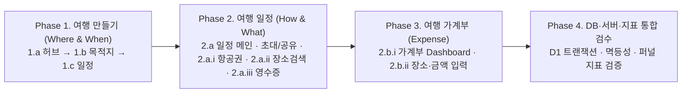

# 여행 계획 및 일정·가계부 전체 작업 계획서 & 계층형 To-Do 리스트

본 문서는 **여행 만들기(`1.a ~ 1.c`)**와 **여행 일정·가계부(`2.a ~ 2.b.ii`)** 전체 8개 화면을 구현·검증하기 위한 **작업 계획서**이자, 각 페이지별 **6대 설계 영역(1. 화면 설계 / 2. 디자인 설계 / 3. 기능 추가 / 4. DB 연동 / 5. 서버 연동 / 6. 지표 연동)**을 **큰 작업 단위(대분류) → 중간 작업 단위(페이지) → 작은 작업 단위(세부 실행 To-Do)**로 구조화한 실행 명세서입니다.

---

## 0. 전체 작업 원칙 및 진행 순서 (Master Plan)

### 0.1 4대 핵심 제작 원칙

1. **최소 제약사항 모듈 팝업 및 디자인 규격화**: 필수값 누락·기간 초과(30일)·권한/충돌 발생 시 인라인 경고 나열 대신 [팝업 규격](<../../02. 디자인/00. 공통규격/팝업_규격.txt>) 및 [디자인 시스템](<../../02. 디자인/00. 공통규격/디자인시스템.md>) 기반의 `ActionSheet(variant="confirm")` 중앙 모달 팝업으로 안내하고 즉시 해결 행동으로 연결합니다.
2. **모바일 반응형 완벽 대응**: `320px ~ 640px` 모바일 뷰포트, `fontScale` 큰 글자 모드(1.3배~1.6배 이상 시 달력→날짜 입력 필드 자동 전환 및 다단→단일 열 전환), 최소 터치 영역 `48×48dp`를 전 화면에 적용합니다.
3. **불필요한 아이콘 제거 및 명확한 시각 계층**: 장식성 아이콘을 제거하고 의미 전달에 필수적인 `TripIcon` 및 방향·상태 아이콘만 유지합니다.
4. **100% 사용자 중심 텍스트(User-Centric Copywriting)**: 시스템·개발자 관점의 기능 설명이나 생색내기 문구(예: `"구글 연동 중"`, `"OCR 자동 추출"`, `"가계부 연동 완료"`)를 전면 금지하고, 여행자가 지금 해야 할 행동과 혜택만 간결하게 안내합니다.

### 0.2 단계별 작업 로드맵 (큰 작업 단위 흐름)

---

## 대분류 1. 여행 만들기 (`/new-trip`) — Where & When

### 중분류 1.a. 장소 & 일정 선택 페이지 (`< 여행 만들기`)

> **대상 코드**: `apps/mobile/src/features/workspace/planning/ui/TripPlanningFlowView.tsx`, `TripPlanningBasics.tsx`, `TripFields.tsx`

#### 1) 화면 설계 (Screen Layout)

- [x] **1.a-1.1** 상단 공통 헤더(`ScreenHeader`)에 `< 내 여행으로 돌아가기` 뒤로가기와 `여행 만들기` 타이틀을 배치한다.
- [x] **1.a-1.2** 첫 화면에 검색창·도시 목록·달력을 한꺼번에 노출하지 않고, 한 화면에서 목적을 바로 인지할 수 있도록 **단일 진입 허브**로 구성한다.
- [x] **1.a-1.3** 상단 1번째 블록에 `나의 여행 목적지는?` 라벨과 선택 박스(`destination-selector-box`)를 배치한다.
- [x] **1.a-1.4** 중단 2번째 블록에 `내 여행 기간` 라벨과 선택 박스(`period-selector-box`)를 배치한다.
- [x] **1.a-1.5** 하단 3번째 블록에 `추천 여행지` 가로 스와이프 카드 리스트(`recommended-destinations-section`)를 배치하고 우측에 다음 카드가 일부 보이도록(`width: 232px`, `gap: 12px`) 설계한다.
- [x] **1.a-1.6** 최하단에 주 행동 버튼 `[세부 일정 만들기]`(`create-trip-submit-btn`)를 고정 배치한다.

#### 2) 디자인 설계 (Design System & UX)

- [x] **1.a-2.1** 선택 박스는 미선택 시 `colors.surface` + `colors.borderStrong`(`1.5px`), 선택 완료 시 `colors.selectedSurface` + `colors.selected` 토큰을 적용해 완료 상태를 시각적으로 구분한다.
- [x] **1.a-2.2** 추천 여행지 카드는 `cityGuides` 공식 관광청 사진 위에 어두운 스크림(`rgba(15, 23, 42, 0.42)`)을 얹어 흰색 텍스트(`#FFFFFF`)와의 WCAG AA 명도 대비를 확보한다.
- [x] **1.a-2.3** 모든 터치 요소(`destination-selector-box`, `period-selector-box`, 추천 카드, 하단 버튼)의 최소 높이를 `48dp` 이상(`minHeight: 72~96`)으로 설계한다.
- [x] **1.a-2.4** 안내 문구는 `"터치해서 여행할 나라나 도시를 골라보세요"`, `"터치해서 날짜를 고르거나 여행 일수만 먼저 정해보세요"`와 같이 이용자 관점 문구로 통일한다.

#### 3) 기능 추가 (Client Features)

- [x] **1.a-3.1** 홈(`/(tabs)`)에서 `[새 여행 만들기]` 클릭 시 빈 상태로 진입하고, 추천 도시 코스 클릭 시 `?destination={key}` 파라미터를 읽어 목적지가 미리 채워진 상태로 진입한다.
- [x] **1.a-3.2** `나의 여행 목적지는?` 박스 클릭 시 **1.b. 장소 입력 페이지** 모달을 연다.
- [x] **1.a-3.3** `내 여행 기간` 박스 클릭 시 **1.c. 일정 입력 페이지** 모달을 연다.
- [x] **1.a-3.4** `추천 여행지` 가로 카드 클릭 시 즉시 해당 국가(`country`)와 도시(`city`)를 폼 상태에 반영하고 선택 체크 배지를 표시한다.
- [x] **1.a-3.5** `[세부 일정 만들기]` 클릭 시 목적지 미선택이면 `"목적지를 선택해 주세요"` 확인 모달(`ActionSheet variant="confirm"`)을 띄우고 `[여행 목적지 선택하기]` 클릭 시 `1.b`를 즉시 연다.
- [x] **1.a-3.6** 목적지는 있으나 기간이 미선택이면 `"여행 일정을 선택해 주세요"` 확인 모달을 띄우고 `[여행 일정 선택하기]` 클릭 시 `1.c`를 즉시 연다.
- [x] **1.a-3.7** 목적지와 기간이 모두 유효하면 `{도시 또는 국가} {N박 M일} 여행` 기본 제목을 생성해 여행 생성을 실행하고 `/trips/[id]`로 이동한다.

#### 4) DB 연동 (Database & Local Storage)

- [x] **1.a-4.1** 작성 중 이탈이나 앱 재시작 시 입력값이 유실되지 않도록 `creationDraftStorage`(`creation_drafts`)에 `country`, `city`, `startDate`, `endDate`, `timezone`, `defaultCurrency` 초안을 사용자 ID별로 분리 저장한다.
- [x] **1.a-4.2** 여행 생성 확정 시 Cloudflare D1 `trips` 테이블(`id`, `user_id`, `title`, `country`, `city`, `start_date`, `end_date`, `status`, `default_currency`, `version`), `trip_days` 테이블(`DAY 1..N`), `trip_members` 테이블(`role = 'owner'`)에 단일 트랜잭션으로 저장한다.
- [x] **1.a-4.3** 게스트 계정(`authProvider === 'guest'`)일 경우 기기 내 로컬 저장소에 동일 스키마로 저장하고 로그인 전환 시 계정으로 이관(`handoff`)한다.

#### 5) 서버 연동 (Server & API)

- [x] **1.a-5.1** `[세부 일정 만들기]` 실행 시 `POST /trips` API에 `Idempotency-Key` 헤더와 `tripCreationRequestSchema` 검증 본문을 전송해 중복 터치로 인한 중복 여행 생성을 방지한다.
- [x] **1.a-5.2** 생성 성공 응답(`201 Created`) 수신 시 React Query의 `['trips', userId]` 목록 캐시와 `['workspace', userId, tripId]` 상세 캐시를 즉시 갱신한다.
- [x] **1.a-5.3** 비로그인 상태에서 생성 시도 시 작성한 초안을 보존한 채 로그인 화면(`/login`)으로 이동시키고 인증 완료 후 자동 복원(`restoreCreation`)한다.

#### 6) 지표 연동 (Metrics & Analytics)

- [x] **1.a-6.1** `trip_create_hub_view`: 진입 경로(`source: 'home_cta' | 'home_destination_card' | 'plans_tab' | 'resume_draft'`)별 허브 진입 횟수 집계.
- [x] **1.a-6.2** `trip_create_recommended_click`: 추천 여행지 가로 카드 클릭률 및 도시별(`osaka`, `tokyo`, `danang` 등) 선택 비중 측정.
- [x] **1.a-6.3** `trip_create_constraint_popup_shown`: 필수값 누락 팝업 노출 사유(`missing_destination` vs `missing_period`) 및 팝업 내 즉시 이동 버튼 전환율 측정.
- [x] **1.a-6.4** `trip_create_completed`: 허브 진입 대비 최종 `[세부 일정 만들기]` 완료 전환율(Funnel Conversion) 및 소요 시간 측정.

---

### 중분류 1.b. 장소 입력 페이지 (`< 여행 목적지 선택`)

> **대상 코드**: `apps/mobile/src/features/workspace/planning/ui/TripFields.tsx`, `TravelInputs.tsx`, `DestinationPicker.tsx`, `model/countries.ts`, `model/destinationCatalog.ts`

#### 1) 화면 설계 (Screen Layout)

- [x] **1.b-1.1** `AppModal` 전체 화면에 `ScreenHeader`(`title="여행 목적지 선택"`, `backLabel="여행 만들기로 돌아가기"`)를 상단 고정 배치한다.
- [x] **1.b-1.2** 상단에 `나의 여행 목적지는?` 라벨과 검색 입력창(`나라 또는 도시를 검색해 보세요`) 및 검색어 지우기(`clear-search-btn`) 버튼을 배치한다.
- [x] **1.b-1.3** 검색창 아래에 국가별 가로 필터 칩(`전체`, `일본`, `베트남`, `대만`, `태국`, `중국`, `싱가포르`, `유럽`, `미국`, `대한민국`)을 배치한다.
- [x] **1.b-1.4** 중단 영역에 주요 대도시 결과 리스트(`오사카`, `도쿄`, `후쿠오카`, `삿포로`, `교토`, `나고야`, `다낭`, `호치민`, `타이베이`, `방콕`, `상하이`, `베이징`, `칭다오`, `싱가포르`, `파리`, `런던`, `뉴욕`, `샌프란시스코`, `제주`)를 배치한다.
- [x] **1.b-1.5** 목록 하단에 `찾으시는 도시가 없나요? 목적지 직접 입력하기`(`DestinationFields`) 아코디언과 전 세계 국가·도시 선택 모달(`DestinationPicker`)을 배치한다.
- [x] **1.b-1.6** 화면 하단에 고정 푸터(`modalFooter`)와 `[선택 완료]` 주 버튼을 배치한다.

#### 2) 디자인 설계 (Design System & UX)

- [x] **1.b-2.1** 선택된 도시 카드는 `2px` `colors.secondary` 테두리와 `colors.selectedSurface` 배경, 우측 체크 라디오 배지(`radioCircleSelected`)로 명확히 강조한다.
- [x] **1.b-2.2** 국가 필터 칩과 도시 카드는 모바일 320px 폭에서도 줄바꿈 깨짐 없이 표현되도록 `flex: 1, minWidth: 0`을 적용한다.
- [x] **1.b-2.3** 하단 버튼 라벨에 현재 선택된 목적지를 함께 표시(`예: 일본 · 오사카 · 선택 완료`)해 사용자가 무엇을 골랐는지 즉시 확인하게 한다.

#### 3) 기능 추가 (Client Features)

- [x] **1.b-3.1** 한글 도시명·영문명(`Osaka`, `Ho Chi Minh` 등)·국가명·초성 검색(`matchesDestination`)으로 실시간 필터링을 제공한다.
- [x] **1.b-3.2** 국가 필터 칩 선택 시 해당 국가의 주요 대도시만 필터링하며, 단일 국가 칩 클릭 시 해당 국가(`country`)를 우선 설정해 국가 단독 선택도 지원한다.
- [x] **1.b-3.3** 도시 카드 선택 시 해당 도시와 매칭되는 국가(`country`)와 도시(`city`)를 동시에 자동 설정한다.
- [x] **1.b-3.4** 목적지를 선택하지 않고 `[목적지 선택 완료]`를 누르면 표준 제약사항 확인 팝업(`ActionSheet variant="confirm"`)으로 안내한다.

#### 4) DB 연동 (Database & Local Storage)

- [x] **1.b-4.1** 선택한 `country`와 `city`는 상위 `PlanForm` 상태에 즉시 반영되며, 국가별 기본 통화(`일본→JPY`, `미국→USD`, `기타→KRW`) 및 시간대(`timezone`) 기본값과 매핑된다.
- [x] **1.b-4.2** 다도시 여행으로 확장할 경우 `trip_destinations` 테이블(`trip_id`, `sort_order`, `country`, `city`, `start_day`, `end_day`) 스키마와 호환되도록 정규화된 국가·도시명을 유지한다.

#### 5) 서버 연동 (Server & API)

- [x] **1.b-5.1** 오프라인이나 네트워크 지연 환경에서도 즉시 검색·선택할 수 있도록 클라이언트 내장 카탈로그(`CITY_CATALOG`, `countryCities`, `searchCountries`)로 무지연 응답을 보장한다.
- [x] **1.b-5.2** 추후 세부 일정 추가(`2.a.ii`) 단계에서 선택한 `city`와 `country`가 서버 `GET /places/search`의 지역 바이어스 파라미터로 자동 전달되도록 연결한다.

#### 6) 지표 연동 (Metrics & Analytics)

- [x] **1.b-6.1** `destination_search_query`: 사용자가 입력한 검색어 및 결과 0건(`zero_result_query`) 발생 빈도 수집(신규 도시 카탈로그 추가 근거).
- [x] **1.b-6.2** `destination_country_filter_select`: 국가 필터 칩별 클릭 분포 측정.
- [x] **1.b-6.3** `destination_direct_input_used`: 기본 카탈로그 외 `목적지 직접 입력하기` 사용 비율 측정.

---

### 중분류 1.c. 일정 입력 페이지 (`< 여행 일정`)

> **대상 코드**: `apps/mobile/src/features/workspace/planning/ui/TripCalendar.tsx`, `TripPeriodPicker.tsx`, `model/calendarPeriod.ts`, `model/calendarModel.ts`, `styles/periodPickerStyles.ts`

#### 1) 화면 설계 (Screen Layout)

- [x] **1.c-1.1** `AppModal` 전체 화면에 `ScreenHeader`(`title="여행 일정"`, `backLabel="여행 만들기로 돌아가기"`)를 배치한다.
- [x] **1.c-1.2** 상단 첫 블록에 와이어프레임 규격대로 `나의 여행 목적지는?` 컨텍스트 박스(`period-destination-context`)를 배치해 현재 선택된 목적지를 보여준다.
- [x] **1.c-1.3** 두 번째 블록에 일정 확정 여부 전환 탭(`정확한 일정이 있어요` vs `아직 일정을 못 정했어요`)을 배치한다.
- [x] **1.c-1.4** `정확한 일정이 있어요` 선택 시: 출발일·도착일 슬롯 카드(`period-summary-card`) + 빠른 박수 선택 칩(`당일치기`, `2박 3일`, `3박 4일`, `4박 5일`, `일주일`) + 월간 달력 그리드(`period-calendar-grid`)를 배치한다.
- [x] **1.c-1.5** `아직 일정을 못 정했어요` 선택 시: 박수 프리셋 칩(`1박 2일` ~ `6박 7일`, 기본 `2박 3일`)과 일수 조절 스테퍼(`-` / `N박 M일` / `+`) 카드(`period-undecided-card`)를 배치한다.
- [x] **1.c-1.6** 하단 고정 푸터에 `[일정 선택 완료 · N박 M일]` 주 버튼을 배치한다.

#### 2) 디자인 설계 (Design System & UX)

- [x] **1.c-2.1** 달력의 출발일·도착일 선택 셀은 `colors.selected` 배경에 흰색 텍스트(`출발`/`도착`/`당일` 배지 포함), 중간 구간 셀은 `colors.selectedSurface` 배경으로 연속된 여정 범위를 시각화한다.
- [x] **1.c-2.2** 일요일(`colors.danger`), 토요일(`colors.secondary`), 평일(`colors.text`) 요일 색상을 구분하고,各 날짜 셀은 `minWidth: 48, minHeight: 48`을 보장한다.
- [x] **1.c-2.3** 화면 폭이 좁거나(`width < 384px`) 글자 크기가 큰 경우(`fontScale > 1.6`) 7열 달력 대신 네이티브/웹 날짜 입력 필드(`DateField`)로 자동 전환해 레이아웃 깨짐을 원천 차단한다.

#### 3) 기능 추가 (Client Features)

- [x] **1.c-3.1** 출발일 선택 후 도착일 슬롯으로 자동 포커스 전환하며, 빠른 선택 칩(`2박 3일` 등) 클릭 시 출발일 기준으로 도착일을 자동 계산(`addCalendarDays`)한다.
- [x] **1.c-3.2** `아직 일정을 못 정했어요` 모드 선택 시 오늘 날짜(`currentTripDate`)를 기준으로 선택한 박수만큼 임시 시작일·종료일을 자동 생성해, 날짜 미정 상태에서도 `DAY 1 ~ DAY N` 탭이 정상 생성되도록 한다.
- [x] **1.c-3.3** 최대 여행 기간 **30일 초과** 선택 시 또는 도착일이 출발일보다 앞설 때 표준 제약사항 모달 팝업(`ActionSheet variant="confirm"`)으로 안내한다.
- [x] **1.c-3.4** `[일정 선택 완료]` 클릭 시 즉시 여행을 생성해 버리지 않고, `startDate`·`endDate`를 반영한 뒤 `1.a < 여행 만들기` 화면으로 복귀한다.

#### 4) DB 연동 (Database & Local Storage)

- [x] **1.c-4.1** 일광절약시간(DST)이나 기기 시간대 오차로 인해 날짜가 하루 밀리지 않도록 순수 달력 순번(`ordinal`) 기반 `YYYY-MM-DD` 문자열로 계산·저장한다.
- [x] **1.c-4.2** 확정된 `startDate`~`endDate` 일수(`days`)만큼 서버 D1 `trip_days` 테이블에 `day_number = 1..N`, `trip_date = YYYY-MM-DD` 행이 생성된다.

#### 5) 서버 연동 (Server & API)

- [x] **1.c-5.1** 이미 생성된 여행에서 기간을 수정할 때(`form.kind === 'period'`)는 기존 일정·영수증이 삭제되는지 사전 영향도(`tripPeriodImpact`)를 계산해 안내한 뒤 `POST /trips/:id/commands` (`operation: 'trip.period'`)로 동기화한다.

#### 6) 지표 연동 (Metrics & Analytics)

- [x] **1.c-6.1** `period_mode_selected`: `정확한 일정이 있어요`(`exact`) 대비 `아직 일정을 못 정했어요`(`undecided`) 선택 비율 측정.
- [x] **1.c-6.2** `period_duration_distribution`: 선택된 여행 박수(당일, 1박 2일, 2박 3일, 3박 4일 등) 분포 집계.
- [x] **1.c-6.3** `period_limit_exceeded`: 30일 초과 제약 팝업 발생 빈도 측정.

---

## 대분류 2. 여행 일정 (`/trips/[id]`) — How & What & Expense

### 중분류 2.a. 일정 메인 페이지 (`< 내 여행 목록` / DAY별 타임라인 · 초대 · 공유)

> **대상 코드**: `apps/mobile/src/features/workspace/hub/ui/WorkspaceView.tsx`, `WorkspaceHeadingView.tsx`, `WorkspaceItineraryView.tsx`, `WorkspaceDialogs.tsx`, `WorkspaceMembersView.tsx`, `WorkspaceSharingView.tsx`

#### 1) 화면 설계 (Screen Layout)

- [x] **2.a-1.1** 상단 헤더(`ScreenHeader`)에 `< 내 여행 목록`, `[공유]`, `[여행 더보기]`, `[MY]` 액션을 배치한다.
- [x] **2.a-1.2** 여행 요약 벤토 카드(`trip-overview-card`)에 여행 상태 배지(`D-N · 여행 준비 중`), 여행 제목, `국가 · 도시`, `여행 기간(N박 M일)`, 대표 도시 썸네일, `동행 N명` 배지 및 `[+ 친구 초대]` 버튼(`trip-invite-friend-btn`)을 배치한다.
- [x] **2.a-1.3** 일정 탭 상단에 항공편(`How`) 요약 및 `[+ 항공권 추가]` 카드(`trip-flight-card`)를 배치한다.
- [x] **2.a-1.4** 세그먼트 탭 바(`일정` | `지도` | `비용`) 아래에 `DAY 1 .. DAY N` 가로 선택 칩과 동선 미니맵(`WorkspaceMapView`), 시간순 일정 타임라인 카드를 배치한다.
- [x] **2.a-1.5** 화면 하단 고정 액션바(`trip-primary-action`)에 `[순서 편집]`, `[영수증 추가]`, `[장소 검색 / 장소 추가]` 버튼을 나란히 배치한다.

#### 2) 디자인 설계 (Design System & UX)

- [x] **2.a-2.1** 타임라인 카드는 방문 시간(`timeSlot`), 일정 유형 배지(`장소`, `이동`, `숙소`, `예약`, `할 일`, `메모`), 장소명, 주소/메모, 예상/실제 비용을 한눈에 읽히도록 카드 계층을 분리한다.
- [x] **2.a-2.2** 오프라인 상태일 때는 상단에 마지막 확인 시각과 함께 읽기 전용 안내 배너를 표시하고 편집 버튼을 안전하게 잠근다.

#### 3) 기능 추가 (Client Features)

- [x] **2.a-3.1** **초대하기(바이럴 공유) & 공동 편집(Share)**:
  - `[+ 친구 초대]` 클릭 시 동행 관리 패널(`trip-companions-panel`)을 열고 `[편집 초대 공유]`(`editor` 권한) 또는 `[보기 초대 공유]`(`viewer` 권한) 링크를 발급해 카카오톡·문자·시스템 공유 시트로 전송한다.
  - 초대 링크로 진입한 친구가 수락하면 공동 편집자로 등록되어 DAY별 일정과 가계부를 함께 추가·편집할 수 있다.
- [x] **2.a-3.2** `[순서 편집]` 클릭 시 드래그/위아래 이동으로 해당 DAY의 일정 순서를 재배치(`ScheduleOrderEditor`)한다.

#### 4) DB 연동 (Database & Local Storage)

- [x] **2.a-4.1** D1 `trips`, `trip_days`, `schedules`, `expenses`, `media`, `receipts`, `trip_members`, `trip_invites` 전체 스냅샷(`WorkspaceSnapshot`)을 로컬 캐시와 동기화해 오프라인 열람을 지원한다.

#### 5) 서버 연동 (Server & API)

- [x] **2.a-5.1** 여행 상세 진입 시 `GET /trips/:id/workspace`로 전체 스냅샷과 현재 `version`을 조회한다.
- [x] **2.a-5.2** 동행 초대 시 `POST /trips/:id/invites`로 만료 기한이 있는 초대 토큰을 생성하고, 동행자 권한 변경·해제 및 일정 순서 변경(`schedule.reorder`) 시 낙관적 잠금(`expectedVersion`)으로 동시 편집 충돌(`409 Conflict`)을 감지·복구한다.

#### 6) 지표 연동 (Metrics & Analytics)

- [x] **2.a-6.1** `trip_invite_shared`: 초대 권한별(`editor` vs `viewer`) 공유 발송 횟수 및 초대 수락 전환율(바이럴 K-factor) 측정.
- [x] **2.a-6.2** `trip_day_tab_switch`: DAY 탭 탐색 빈도 및 DAY별 평균 등록 일정 수 집계.

---

### 중분류 2.a.i. 항공권 입력 페이지 (`< 항공권 입력`)

> **대상 코드**: `apps/mobile/src/features/workspace/planning/manager/FlightTicketEditor.tsx`, `ui/FlightTicketEditorView.tsx`, `ui/FlightEntryFields.tsx`, `ui/FlightLookup.tsx`, `ui/FlightTicketManualInput.tsx`

#### 1) 화면 설계 (Screen Layout)

- [x] **2.a.i-1.1** 상단 `ScreenHeader`(`title="항공권 입력"`, 우측 `[완료]` 액션) 아래에 `항공편 출발일` 선택 필드를 배치한다.
- [x] **2.a.i-1.2** 기본 모드로 `항공사 코드(예: KE)` + `항공편 번호(예: 901)` 조회 카드와 검색 결과 후보 리스트(`FlightLookupCandidateCard`)를 배치한다.
- [x] **2.a.i-1.3** 하단에 `[항공권 직접 입력]` 전환 버튼과 수동 입력 폼(`출발 공항 코드`, `도착 공항 코드`, `출발 시각`, `도착 시각`, `터미널`, `수하물`, `좌석 등급`)을 배치한다.

#### 2) 디자인 설계 (Design System & UX)

- [x] **2.a.i-2.1** 조회된 항공편이나 입력된 출·도착 공항은 `FlightRoutePreview` 컴포넌트로 `ICN → KIX` 경로와 현지 출발·도착 시각을 항공권 티켓 형태로 시각화한다.
- [x] **2.a.i-2.2** 조회 결과가 없거나 지연될 때 사용자에게 `"해당 출발일의 항공편을 찾지 못했어요. 날짜와 편명을 확인하거나 직접 입력해 주세요."`로 친절히 안내한다.

#### 3) 기능 추가 (Client Features)

- [x] **2.a.i-3.1** 편명과 출발일로 운항 구간을 조회해 선택 시 공항 코드·시각·터미널을 자동 입력한다.
- [x] **2.a.i-3.2** 조회 없이도 `[항공권 직접 입력]`을 통해 모든 항공편 정보를 직접 입력·수정할 수 있으며, 작성 중 뒤로가기를 눌러도 슬롯별 임시 초안(`ticketDrafts`)이 보존된다.

#### 4) DB 연동 (Database & Local Storage)

- [x] **2.a.i-4.1** 저장 시 `schedules` 테이블에 `type = 'TRANSPORT'` 및 `flight_json`(`number`, `departure`, `arrival`, `departureTime`, `arrivalTime`, `departureTerminal`, `arrivalTerminal` 등) 컬럼으로 영구 저장된다.

#### 5) 서버 연동 (Server & API)

- [x] **2.a.i-5.1** 항공편 조회 시 `GET /flights/lookup?number={flightNumber}&date={date}` API를 호출하며, `AbortController`로 이전 요청을 취소하고 `429 Too Many Requests` 발생 시 직접 입력으로 안내한다.
- [x] **2.a.i-5.2** 저장 시 `POST /trips/:id/commands` (`operation: 'schedule.save'`)로 전송한다.

#### 6) 지표 연동 (Metrics & Analytics)

- [x] **2.a.i-6.1** `flight_lookup_executed`: 편명 자동 조회 성공률 대비 수동 입력(`manual_input`) 전환 비율 측정.
- [x] **2.a.i-6.2** `flight_schedule_saved`: 여행당 항공권 등록 비율 측정.

---

### 중분류 2.a.ii. 일정 추가 — 검색 기반 페이지 (`< 방문할 장소`)

> **대상 코드**: `apps/mobile/src/features/workspace/schedule/manager/ScheduleEditor.tsx`, `ui/ScheduleEditorView.tsx`, `ui/ScheduleEditorChoices.tsx`, `ui/ScheduleEditorActions.tsx`, `ui/PlaceSearch.tsx`, `ui/PlaceSearchResults.tsx`

#### 1) 화면 설계 (Screen Layout)

- [x] **2.a.ii-1.1** 상단 헤더와 현재 선택된 `D{N} · 도시 · 날짜` 요약 배지 카드(`renderScheduleHeading`)를 배치한다.
- [x] **2.a.ii-1.2** `일차 선택`(`DAY 1 .. DAY N` 칩 스트립)과 `일정 유형`(`장소`, `이동`, `숙소`, `예약`, `할 일`, `메모`) 선택 스트립을 배치한다.
- [x] **2.a.ii-1.3** `방문할 장소` 섹션에 장소 검색 입력창(`방문할 맛집, 명소, 숙소를 검색해 보세요`), 구글 지도 장소 검색 결과 리스트(`PlaceSearchResults`), 구글 지도 앱 공유 링크 붙여넣기(`SharedPlaceInput`), 주소 입력란을 기본 펼침 상태로 배치한다.
- [x] **2.a.ii-1.4** `일정 세부 설정` 섹션에 방문 시간(`DateField mode="time"` 및 시간 프리셋 칩), 체류 예정 시간(분), 일정 메모, 예상 지출 금액 및 통화(`KRW` / `JPY` / `USD`)를 배치한다.
- [x] **2.a.ii-1.5** 하단 고정 독(`ScheduleEditorActions`)에 `[DAY N 일정에 추가]` 주 버튼을 배치한다.

#### 2) 디자인 설계 (Design System & UX)

- [x] **2.a.ii-2.1** 장소 일정 추가 진입 시 숨겨진 토글을 누르지 않아도 바로 검색 결과와 지도 링크 입력이 보이도록 `expanded` 기본값을 활성화(`!simple`)한다.
- [x] **2.a.ii-2.2** 자주 쓰는 방문 시간(`09:00`, `12:00`, `15:00`, `18:00`, `20:00`)은 원터치 칩으로 제공해 키보드 입력 부담을 줄인다.

#### 3) 기능 추가 (Client Features)

- [x] **2.a.ii-3.1** 검색 결과에서 장소 선택 시 `title`과 `googlePlaceId`를 연결하고, 연결된 장소의 상세 정보(`GooglePlace`)를 표시한다.
- [x] **2.a.ii-3.2** 구글 지도에서 공유한 텍스트/URL(`SharedPlaceInput`)을 붙여넣으면 장소명과 좌표를 파싱해 일정에 반영한다.
- [x] **2.a.ii-3.3** 작성 도중 `[영수증 촬영으로 추가]` 또는 `[영수증 사진으로 추가]`로 전환할 수 있는 빠른 진입 버튼을 함께 제공한다.

#### 4) DB 연동 (Database & Local Storage)

- [x] **2.a.ii-4.1** 저장 시 D1 `schedules` 테이블에 `id`, `day_id`, `title`, `type`, `time_slot`, `duration_minutes`, `memo`, `address`, `google_place_id`, `location_json`, `estimated_cost_json`, `sort_order`를 저장한다.

#### 5) 서버 연동 (Server & API)

- [x] **2.a.ii-5.1** 장소 검색 시 `GET /places/search?query={query}&city={city}`를 호출해 여행 도시에 맞춘 장소 후보를 가져온다.
- [x] **2.a.ii-5.2** `[DAY N 일정에 추가]` 클릭 시 `POST /trips/:id/commands` (`operation: 'schedule.save'`)를 호출하며, 동행자와 동시 편집 충돌 시 `[최신 내용 불러오기]` 복구 액션을 제공한다.

#### 6) 지표 연동 (Metrics & Analytics)

- [x] **2.a.ii-6.1** `schedule_place_search_select`: 장소 검색 결과 선택 비율 vs 직접 텍스트 입력 비율 vs 구글 지도 공유 링크 입력 비율 측정.
- [x] **2.a.ii-6.2** `schedule_added_by_type`: 일정 유형별(`PLACE`, `STAY`, `TRANSPORT`, `RESERVATION`, `TODO`, `MEMO`) 등록 건수 집계.

---

### 중분류 2.a.iii. 일정 추가 — 영수증 기반 페이지 (`< 영수증 확인`)

> **대상 코드**: `apps/mobile/src/features/workspace/receipt/ui/ReceiptCapture.tsx`, `manager/ReceiptReview.tsx`, `ui/ReceiptReviewView.tsx`, `ui/ReceiptConfirmation.tsx`, `model/receiptChecks.ts`, `my-trips/ui/PlanEditorView.tsx`

#### 1) 화면 설계 (Screen Layout)

- [x] **2.a.iii-1.1** 진입 시 바텀시트(`ReceiptCapture`)에서 `[카메라로 영수증 촬영]`, `[앨범에서 영수증 선택]`, `[사진 없이 지출 직접 입력]` 3가지 선택지를 제공한다.
- [x] **2.a.iii-1.2** 촬영/선택 후 열리는 `영수증 확인` 화면(`PlanEditorView`) 상단에 영수증 원본 미리보기(`ReceiptOriginal`)와 인식 상태 요약 카드(`renderReceiptSummary`)를 배치한다.
- [x] **2.a.iii-1.3** 핵심 입력 카드(`renderReceiptItems`)에 사용자 요구사항 4대 항목을 순서대로 배치한다:
  1. **장소 이름** (`영수증 상호` 입력란)
  2. **장소 주소** (`지역명·주소` 입력란)
  3. **어느 날 일정에 추가할까요?** (`DAY 1 .. DAY N` 선택 칩 및 실제 결제 날짜·시간)
  4. **사용 금액 기록 여부** (`[사용 금액 함께 남기기]` vs `[장소만 일정에 남기기]` 토글 + 사용 금액 및 `KRW`/`JPY`/`USD` 통화 칩)
- [x] **2.a.iii-1.4** 하단에 중복 영수증 검사(`ReceiptDuplicates`), 정보 확인·원본 사진 보관 여부 선택(`ReceiptConfirmation`), `[영수증 저장]` 버튼을 배치한다.

#### 2) 디자인 설계 (Design System & UX)

- [x] **2.a.iii-2.1** 영수증 인식 중에는 `HaruState(kind="loading", title="영수증을 읽고 있어요")`, 인식 실패 시에는 재촬영·앨범 재선택·직접 입력 전환 버튼을 포함한 `HaruState(kind="error")`를 표시한다.
- [x] **2.a.iii-2.2** 품목 합계와 총액이 다를 경우(`receiptDifference`) 차액을 명확히 비교해 보여주고 `[차이를 확인했어요. 결제 총액으로 기록할게요]` 원터치 확인 버튼을 제공한다.

#### 3) 기능 추가 (Client Features)

- [x] **2.a.iii-3.1** 영수증에서 날짜가 인식되지 않았거나 다른 날 일정에 넣고 싶을 때 `DAY 1 .. DAY N` 칩을 터치하면 해당 DAY의 날짜(`tripDate`)와 `dayId`, `newReceiptPlace = 'true'`가 즉시 연결된다.
- [x] **2.a.iii-3.2** `[장소만 일정에 남기기]` 선택 시 금액을 `0`으로 설정해 지출 금액 없이도 방문한 장소와 주소를 일정에 남길 수 있게 한다.
- [x] **2.a.iii-3.3** `[사용 금액 함께 남기기]` 선택 시 입력한 금액과 통화가 여행 가계부(`expenses`)에 실제 지출로 동시 반영된다.

#### 4) DB 연동 (Database & Local Storage)

- [x] **2.a.iii-4.1** 저장 시 D1에서 단일 트랜잭션으로 ① `schedules` 테이블에 새 방문 장소 일정 생성(또는 기존 일정 연결), ② `receipts` 테이블에 영수증 메타데이터·품목 저장, ③ `expenses` 테이블에 `source = 'receipt'`, `is_actual = 1` 지출 레코드 생성, ④ `keepPhoto === false` 선택 시 인식용 임시 원본 미디어 정리를 수행한다.

#### 5) 서버 연동 (Server & API)

- [x] **2.a.iii-5.1** 사진 업로드 시 `POST /trips/:id/media`로 비공개 원본을 업로드한 뒤 `POST /trips/:id/receipts/scan`으로 영수증 텍스트·상호·주소·금액 후보를 추출한다.
- [x] **2.a.iii-5.2** 사용자 확인 완료 후 `POST /trips/:id/commands` (`operation: 'receipt.confirm'` 또는 `'receipt.update'`)로 최종 저장한다.

#### 6) 지표 연동 (Metrics & Analytics)

- [x] **2.a.iii-6.1** `receipt_capture_started`: 카메라 촬영 vs 앨범 선택 진입 비율 측정.
- [x] **2.a.iii-6.2** `receipt_scan_accuracy`: 스캔 후 상호·주소·금액 수정 없이 바로 확정된 비율 측정.
- [x] **2.a.iii-6.3** `receipt_amount_mode`: `[사용 금액 함께 남기기]` vs `[장소만 일정에 남기기]` 선택 비율 측정.

---

### 중분류 2.b.i. 가계부 페이지 — 여행 내 사용한 금액 Dashboard (`비용 탭`)

> **대상 코드**: `apps/mobile/src/features/workspace/hub/ui/WorkspaceExpenseView.tsx`, `WorkspaceMediaView.tsx`, `my-trips/ui/TripDetailParts.tsx`, `my-trips/model/diary.ts`

#### 1) 화면 설계 (Screen Layout)

- [x] **2.b.i-1.1** 상단 액션 영역(`renderWorkspaceCapture`)에 `[비용 추가]`, `[영수증 촬영]`, `[영수증 사진 선택]` 진입 버튼을 배치한다.
- [x] **2.b.i-1.2** 가계부 대시보드(`TripCostSummary` / `trip-expense-dashboard`) 상단 카드에 `여행 내 사용한 금액` 헤더, `실제 지출 N건` 배지, 통화별(`KRW`, `JPY`, `USD`) 합산 금액을 배치한다.
- [x] **2.b.i-1.3** 대시보드 하단에 지출 분류별 필터 칩(`전체 (N)`, `식비`, `교통`, `숙박`, `관광·액티비티`, `쇼핑`, `기타`)과 `[예상 비용 보기 / 접기]` 토글 카드를 배치한다.
- [x] **2.b.i-1.4** 지출 내역 리스트에 각 지출 카드(`TripExpenseHeading`: 실제/예상 배지, 분류 배지, `직접 기록`/`영수증에서 기록` 출처, 장소·내역명, 통화·금액, 연결된 일정명, `[비용 수정]`/`[비용 삭제]` 버튼)를 배치한다.

#### 2) 디자인 설계 (Design System & UX)

- [x] **2.b.i-2.1** 임의의 환율로 서로 다른 통화를 섞어 합산하지 않고, `KRW`, `JPY`, `USD` 각 결제 통화 원문 그대로 소수점 규격에 맞춰 굵은 타이포그래피(`s.total`)로 명확히 분리 표시한다.
- [x] **2.b.i-2.2** 기록된 지출이 없을 때 `TripDetailEmpty` 컴포넌트로 `"비용 추가에서 방문한 장소와 사용한 금액을 남겨보세요."` 안내를 표시한다.

#### 3) 기능 추가 (Client Features)

- [x] **2.b.i-3.1** 분류별 필터 칩(`식비`, `교통`, `숙박`, `관광·액티비티`, `쇼핑`, `기타`) 클릭 시 해당 카테고리의 지출 카드만 즉시 필터링해 보여준다.
- [x] **2.b.i-3.2** 수동 입력 지출(`source === 'manual'`)은 카드에서 바로 `[비용 수정]`(`2.b.ii` 오픈) 및 `[비용 삭제]`(삭제 확인 모달 후 삭제)를 실행할 수 있다.

#### 4) DB 연동 (Database & Local Storage)

- [x] **2.b.i-4.1** D1 `expenses` 테이블의 `amount`, `currency`, `category`, `is_actual`, `source`, `schedule_id`, `day_id` 데이터를 조회해 정수 연산 기반(`diaryCosts`)으로 부동소수점 오차 없이 합산한다.

#### 5) 서버 연동 (Server & API)

- [x] **2.b.i-5.1** 지출 삭제 시 `WorkspaceConfirmDialog` 확인 후 `POST /trips/:id/commands` (`operation: 'expense.delete'`)를 호출하고 스냅샷을 갱신한다.

#### 6) 지표 연동 (Metrics & Analytics)

- [x] **2.b.i-6.1** `expense_dashboard_viewed`: 여행 상세 진입 대비 가계부 탭 조회 비율 측정.
- [x] **2.b.i-6.2** `expense_category_filter_click`: 사용자가 가장 자주 확인하는 지출 카테고리 필터 순위 집계.

---

### 중분류 2.b.ii. 가계부 페이지 — 장소 · 금액 입력 페이지 (`< 장소 · 금액 입력`)

> **대상 코드**: `apps/mobile/src/features/workspace/my-trips/ui/PlanEditorView.tsx`, `PlanEditorOptions.tsx`, `hub/model/workspaceDrafts.ts`, `shared/model/formCommands.ts`

#### 1) 화면 설계 (Screen Layout)

- [x] **2.b.ii-1.1** 상단 `ScreenHeader`(`title="장소 · 금액 입력"`, `backLabel="닫기"`)를 배치한다.
- [x] **2.b.ii-1.2** 기본 입력 영역(`renderPlanFields`)에 `제목`(방문한 장소 또는 지출 내역)과 `금액`(사용 금액) 필드를 배치한다.
- [x] **2.b.ii-1.3** 통화 선택 영역(`renderExpenseCurrency`)에 `KRW`, `JPY`, `USD` 칩을 배치한다.
- [x] **2.b.ii-1.4** 연결할 일정 카드(`renderExpenseLink`)에 `[새 기록 / 일정 연결 없이]` 버튼과 여행 일정에 등록된 장소 목록 선택 버튼을 배치한다.
- [x] **2.b.ii-1.5** 지출 옵션 카드(`ExpenseOptions`)에 **지출 분류**(`식비`, `교통`, `숙박`, `관광·액티비티`, `쇼핑`, `기타`) 칩과 **지출 구분**(`실제 지출` vs `예상 비용`) 선택 버튼을 배치한다.
- [x] **2.b.ii-1.6** 하단에 `[확인하고 저장]` 주 버튼을 배치한다.

#### 2) 디자인 설계 (Design System & UX)

- [x] **2.b.ii-2.1** 통화별 소수점 규칙(`KRW`·`JPY`는 정수, `USD`는 소수점 둘째 자리까지 허용) 위반 시 해당 입력 필드로 스크롤 포커스를 이동(`FormFeedback`)하고 명확한 수정 방법을 안내한다.

#### 3) 기능 추가 (Client Features)

- [x] **2.b.ii-3.1** 특정 일정 카드에서 지출 추가를 누른 경우 해당 일정의 `title`과 `scheduleId`가 자동으로 미리 채워진 상태(`workspaceDraft`)로 열린다.
- [x] **2.b.ii-3.2** 지출 분류(`food`, `transport`, `stay`, `activity`, `shopping`, `etc`)와 실제/예상 여부(`isActual`)를 선택해 저장하면 가계부 대시보드의 통화별 합계와 카테고리별 집계에 즉시 반영된다.

#### 4) DB 연동 (Database & Local Storage)

- [x] **2.b.ii-4.1** 저장 시 D1 `expenses` 테이블에 `id`, `trip_id`, `day_id`(연결된 일정의 `dayId`), `schedule_id`, `title`, `amount`, `currency`, `category`, `is_actual`, `source = 'manual'`로 저장된다.

#### 5) 서버 연동 (Server & API)

- [x] **2.b.ii-5.1** `[확인하고 저장]` 클릭 시 `expenseInputSchema` 검증 후 `POST /trips/:id/commands` (`operation: 'expense.save'`)로 서버에 전송하며, `Idempotency-Key`로 중복 저장을 방지한다.

#### 6) 지표 연동 (Metrics & Analytics)

- [x] **2.b.ii-6.1** `expense_saved`: 수동 입력 지출(`manual`) vs 영수증 기반 지출(`receipt`) 등록 건수 및 카테고리별 비중 비교.
- [x] **2.b.ii-6.2** `expense_schedule_linked_rate`: 전체 수동 지출 중 특정 방문 일정(`scheduleId`)과 연결하여 기록한 비율 측정.

---

## 대분류 3. 공통 품질·아키텍처·검수 게이트 To-Do

- [x] **3.1 문서 무결성 검사 (`check-docs.mjs`)**: 폴더 번호 체계 및 문서 내부 상대 경로 링크 오류 0건 확인.
- [x] **3.2 디자인 명도 대비 검사 (`check-design-contrast.mjs`)**: `design-tokens.json` 기준 WCAG AA 명도 대비(일반 텍스트 4.5:1, 비텍스트 3.0:1) 52/52 항목 전체 통과.
- [x] **3.3 리소스·에셋 검사 (`check-resources.mjs`)**: 앱 내 참조 이미지(`cityGuides` 등) 및 폰트 파일 누락·외부 미승인 URL 참조 0건 확인.
- [x] **3.4 코드·네비게이션 경계 검사 (`check-code-boundaries.mjs`, `check-navigation-boundaries.mjs`)**: 표현 컴포넌트(`views`)의 직접 API/스토어 참조 금지, 모든 라우트의 `ScreenHeader` 연결 정책 위반 0건 확인.
- [x] **3.5 정적 타입 및 린트 검사 (`npm run typecheck`, `npm run lint`)**: TypeScript 컴파일 오류 0건 및 ESLint 경고·오류 0건 확인.
- [x] **3.6 지표 이벤트 로거 연동 (`Phase 5 Analytics Hookup`)**: 각 페이지의 6번 지표 항목(`trip_create_*`, `destination_*`, `period_*`, `schedule_*`, `receipt_*`, `expense_*`)을 공통 이벤트 트래커(`workspaceAnalytics.ts`)에 연결하고 대시보드 수집 검증.
