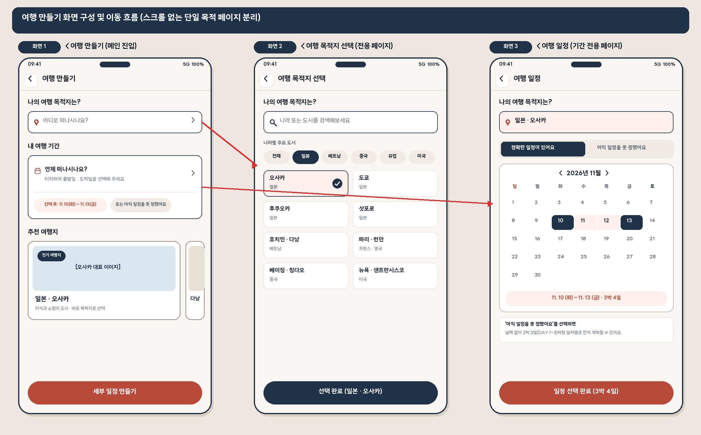
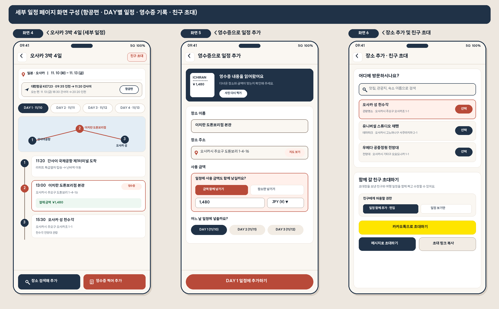

# 여행 계획(여행 만들기 · 세부 일정) 화면 설계 규격

- **적용 경로**:
  - **여행 만들기 (진입 허브 · 목적지 선택 · 기간 선택)**: `apps/mobile/src/app/new-trip.tsx` (`/new-trip`)
  - **세부 일정 페이지**: `apps/mobile/src/app/trips/[id].tsx` (`/trips/[id]`)
  - **동행 초대**: `apps/mobile/src/app/invite.tsx` (`/invite`)
- **연관 기능 규격**: [MVP 기능 규격](<../../01. 서비스기획/01. 기능정의/MVP_기능규격.md>)
- **디자인 공통 기준**: [디자인 시스템](<../00. 공통규격/디자인시스템.md>), [design-tokens.json](<../00. 공통규격/design-tokens.json>), [헤더·GNB 규격](<../00. 공통규격/헤더GNB_규격.md>)

---

## 1. 핵심 UX 및 텍스트(Copywriting) 원칙

1. **한 화면 = 하나의 목적 (스크롤 없는 깔끔한 화면 분리)**:
   - 처음 진입했을 때 검색 결과, 도시 목록, 달력을 한 화면에 길게 늘어놓지 않습니다.
   - **`< 여행 만들기`** 메인 화면에서는 현재 선택 상태와 추천 여행지만 한눈에 보여주고, **목적지 칸을 누르면 `< 여행 목적지 선택` 페이지**, **기간 칸을 누르면 `< 여행 일정` 페이지**로 각각 깔끔하게 이동합니다.
2. **철저한 이용자(사용자) 중심 문구 작성**:
   - 화면 내 모든 문구는 개발자/시스템 자랑(`"구글 연동"`, `"OCR 자동 추출"`, `"가계부 연동 ON"`, `"바이럴 딥링크"` 등)을 일절 배제하고, **사용자가 지금 해야 할 행동과 얻을 결과**(`"나의 여행 목적지는?"`, `"어디로 떠나시나요?"`, `"언제 떠나시나요?"`, `"세부 일정 만들기"`, `"일정에 사용 금액도 함께 남길까요?"`)로만 작성합니다.

---

## 2. [1단계] 여행 만들기 화면 구성 및 이동 흐름 (`/new-trip`)

### 2.1 [화면 1] `< 여행 만들기` (메인 진입 화면 — 스크롤 없음)

- **진입 방식**:
  1. 홈(`/`)에서 만들기 버튼 클릭 → 목적지·기간이 비어 있는 상태로 진입.
  2. 홈(`/`)에서 특정 나라·도시 클릭 또는 하단 `추천 여행지` 카드 클릭 → `나의 여행 목적지는?` 칸에 해당 여행지가 채워진 상태로 표시.
- **레이아웃 구성 (위 → 아래, 한 화면 고정)**:
  1. **상단 헤더**: `< 여행 만들기`
  2. **`나의 여행 목적지는?`**:
     - 단일 선택 박스 (`"어디로 떠나시나요?"`, 높이 `56dp`).
     - **터치 시**: **`[화면 2] < 여행 목적지 선택`** 페이지로 이동합니다.
  3. **`내 여행 기간`**:
     - 기간 요약 카드 (`"언제 떠나시나요?"` / 선택 후 `"11.10(화) ~ 11.13(금) · 3박 4일"` 또는 `"아직 일정을 못 정했어요"`).
     - **터치 시**: **`[화면 3] < 여행 일정`** 페이지로 이동합니다.
  4. **`추천 여행지`**:
     - 가로 스와이프 카드로 대표 추천 여행지(오사카, 다낭 등)를 보여주며, 우측에 다음 카드 일부(Peek)를 노출해 가로 스크롤이 가능함을 직관적으로 알립니다.
  5. **하단 고정 버튼**: **`[세부 일정 만들기]`** (`52dp+`, 라운드 필 버튼)
     - 목적지와 기간이 결정되면 활성화되며, 터치 시 세부 일정 페이지(`/trips/[id]`)로 이동합니다.

### 2.2 [화면 2] `< 여행 목적지 선택` (목적지 전용 페이지)

- **진입**: `< 여행 만들기`에서 `나의 여행 목적지는?` 박스를 터치했을 때 진입합니다.
- **레이아웃 구성**:
  1. **상단 헤더**: `< 여행 목적지 선택`
  2. **`나의 여행 목적지는?` 검색창**: `"나라 또는 도시를 검색해보세요"`
  3. **나라별 주요 도시 필터 칩**: `[전체]`, `[일본]`, `[베트남]`, `[중국]`, `[유럽]`, `[미국]` 등 나라를 누르면 해당 나라의 대도시를 보여주고, 도시(오사카, 호치민, 파리, 런던, 베이징, 칭다오, 뉴욕, 샌프란시스코 등)를 바로 검색·선택하면 소속 나라가 함께 확정됩니다.
  4. **하단 고정 버튼**: **`[선택 완료]`** → 선택된 목적지를 반영하고 `< 여행 만들기` 화면으로 돌아갑니다.

### 2.3 [화면 3] `< 여행 일정` (기간 선택 전용 페이지)

- **진입**: `< 여행 만들기`에서 `내 여행 기간` 박스를 터치했을 때 진입합니다.
- **레이아웃 구성**:
  1. **상단 헤더**: `< 여행 일정`
  2. **상단 확인 바**: `나의 여행 목적지는?` → 선택한 목적지(`일본 · 오사카`) 표시.
  3. **일정 확정 여부 탭**:
     - **`[정확한 일정이 있어요]`**: 월간 달력에서 출발일~도착일을 터치하여 선택합니다.
     - **`[아직 일정을 못 정했어요]`**: 날짜 없이 예정 일수(예: `2박 3일 / DAY 1~3`)만 먼저 정해 일차별로 계획할 수 있게 합니다.
  4. **하단 고정 버튼**: **`[일정 선택 완료]`** → 선택된 기간을 반영하고 `< 여행 만들기` 화면으로 돌아갑니다.

---

## 3. [2단계] 세부 일정 페이지 화면 구성 (`/trips/[id]`)

`< 여행 만들기` 하단의 **`[세부 일정 만들기]`** 버튼을 누르면 진입하는 페이지입니다.

### 3.1 [화면 4] 세부 일정 메인 화면 (`< 오사카 3박 4일`)

1. **상단 헤더**: `< 오사카 3박 4일` + 우측 **`[친구 초대]`** 버튼.
2. **여행 요약 & 항공편 영역**:
   - 목적지·기간 표시 아래에 항공편 카드(`[항공편]` 버튼으로 가는 편·오는 편 등록/수정)를 배치합니다.
3. **일차 탭 & 동선 미니맵 & 타임라인**:
   - `DAY 1`, `DAY 2`, `DAY 3` 탭을 누르면 해당 일차의 지도 동선(`1` → `2` → `3`)과 시간순 방문 일정만 깔끔하게 보여줍니다.
4. **하단 고정 2대 추가 버튼**:
   - 좌측 **`[장소 검색해 추가]`** / 우측 **`[영수증 찍어 추가]`**

### 3.2 [화면 5] `< 영수증으로 일정 추가` (전용 화면)

- 여행 도중이나 여행 후 찍은 영수증으로 방문 일정을 남기는 화면입니다.
- 사용자 친화적인 문구로 딱 3가지 항목만 확인받습니다:
  1. **`장소 이름`**: 영수증에서 읽은 상호명 표시 및 직접 수정 가능.
  2. **`장소 주소`**: 주소 표시 및 `[지도 보기]` 확인.
  3. **`사용 금액`**: `"일정에 사용 금액도 함께 남길까요?"` → **`[금액 함께 남기기]`** / **`[장소만 남기기]`** 선택 및 금액·통화 입력.
- 하단 **`[DAY N 일정에 추가하기]`** 클릭 시 해당 일차 타임라인에 즉시 반영됩니다.

### 3.3 [화면 6] `< 장소 추가 · 친구 초대` (전용 화면)

1. **장소 검색해 추가**:
   - `"어디에 방문하시나요?"` 검색창에 맛집·관광지·숙소 이름을 검색하고 `[선택]`을 눌러 해당 `DAY`에 바로 추가합니다.
2. **함께 갈 친구 초대하기 (Share)**:
   - **친구에게 허용할 권한**: **`[일정 함께 추가 · 편집]`**(기본 선택) / **`[일정 보기만]`**
   - **초대 수단**: **`[카카오톡으로 초대하기]`**, **`[메시지로 초대하기]`**, **`[초대 링크 복사]`** 버튼을 통해 친구가 링크를 누르면 우리 앱의 이 여행 페이지로 바로 들어와 함께 일정을 짤 수 있습니다.
