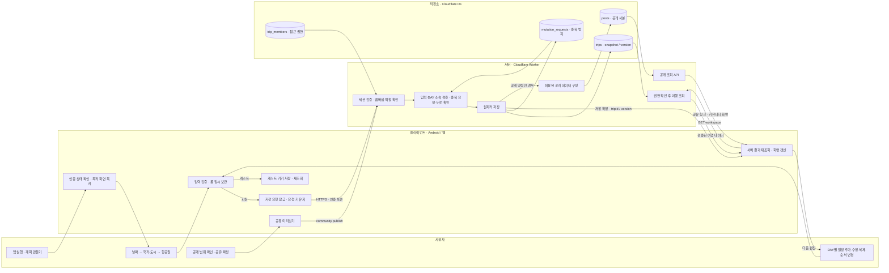
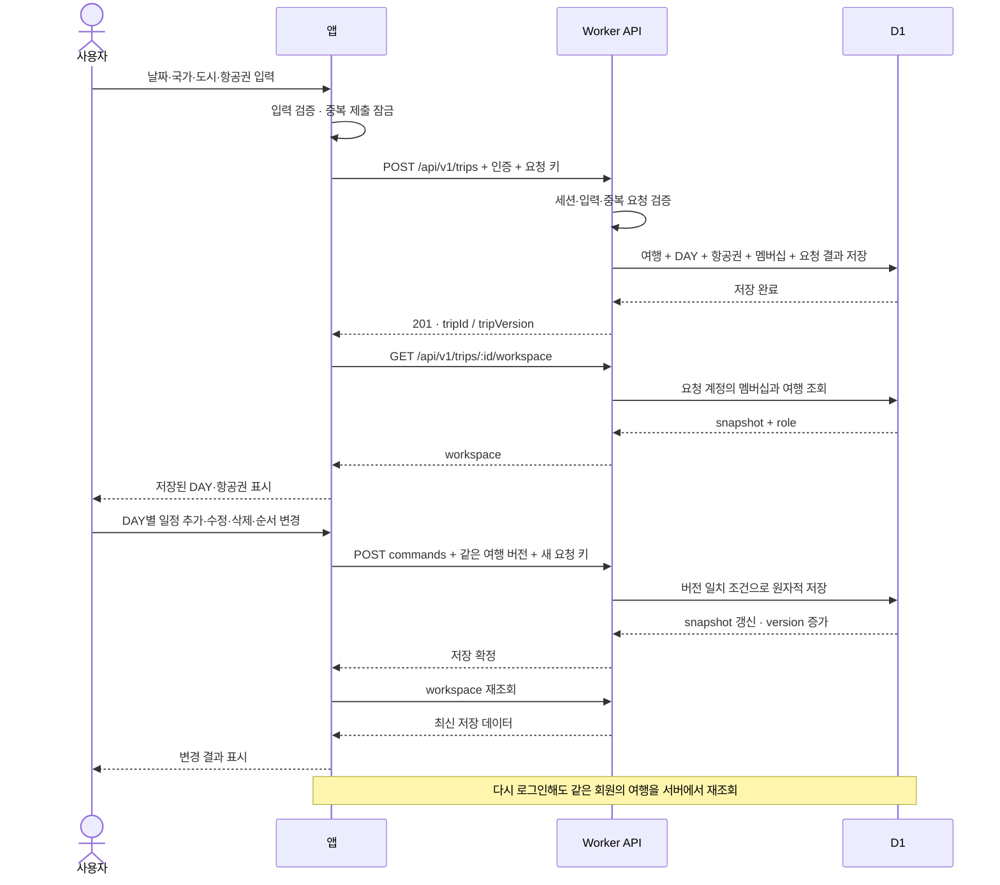
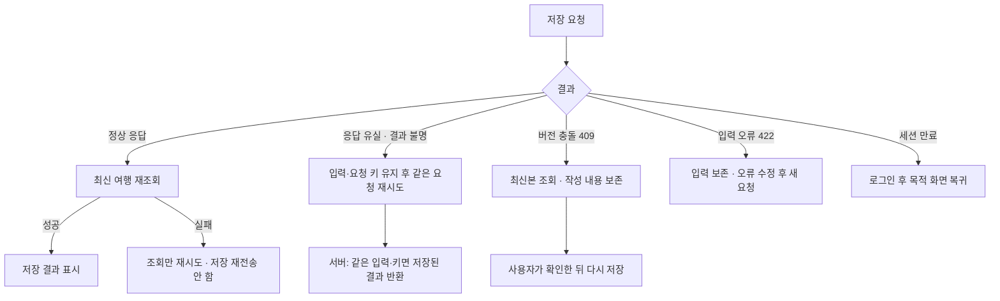

# TripPrint 사용자·클라이언트·서버 데이터 흐름

작성일: 2026-10-21 · 기준: V11 여행계획 등록, 커밋 `f551398`

[흐름도 열기](<00. 데이터흐름/index.html>)

이 문서는 현재 구현한 저장 경로를 설명한다. 회원 여행은 Cloudflare Worker API를 거쳐 Cloudflare D1에 저장한다. 게스트 여행은 기기에 저장한다. 기존 `../02. 데이터정의/데이터_저장규칙.md`의 Supabase 정규화 모델은 과거 제안이며, 아래 D1 구조와 구분해야 한다. 진행 중인 다른 채팅의 미커밋 화면 개편은 V11 검증 결과에 포함하지 않는다.

## 1. 사용자부터 DB까지

항공권 입력은 구매한 항공편을 여행에 등록하는 기능이다. 항공권 구매·결제 흐름은 아니다. 직접 입력할 수 있으므로 항공편 조회 성공을 저장 조건으로 삼지 않는다. 항공권 입력을 건너뛰는 기존 경로도 유지한다.

## 2. 여행 생성·수정·재조회 순서

| 사용자 행동    | 클라이언트가 전달하는 데이터                | API / 명령                         | 실제 저장·조회                                    |
| -------------- | ------------------------------------------- | ---------------------------------- | ------------------------------------------------- |
| 여행 만들기    | 제목, 기간, 국가·도시, 시간대, 통화, 항공편 | `POST /api/v1/trips`               | `trips` 생성, `trip_members` 등록, 요청 결과 기록 |
| 내 여행 열기   | 인증, 여행 ID                               | `GET /api/v1/trips/:id/workspace`  | 멤버십 확인 후 `trips.snapshot` 조회              |
| 일정 추가·편집 | DAY ID, 일정 ID, 시간·장소 등 입력          | `schedule.save`                    | 새 일정 생성 / 기존 일정 ID 유지                  |
| 일정 삭제      | 일정 ID                                     | `schedule.delete`                  | 지정 일정 제거, 다른 DAY 기록 유지                |
| 일정 순서 변경 | 선택 DAY의 전체 일정 ID 순서                | `schedule.reorder`                 | 중복·누락·다른 DAY 포함을 검사한 뒤 순서 저장     |
| 내 여행 목록   | 인증                                        | `GET /api/v1/trips`                | 참여한 여행 목록 조회                             |
| 계획 공유      | 여행 버전과 공개 설정                       | `community.publish` → commands API | 허용한 데이터로 `posts` 공개 사본 생성·갱신       |
| 공유 링크 열기 | 공개 게시 ID                                | `GET /public/community/:postId`    | 공개 사본 조회. 비공개 회원 토큰을 보내지 않음    |

명령 URL은 `POST /api/v1/trips/:id/commands`다. 생성 요청은 `Idempotency-Key`, 수정 명령은 여기에 `If-Match: "trip:<tripId>:<version>"`을 함께 보낸다.

## 3. 데이터는 어디에 남는가

| 위치                                  | 보관 데이터                                         | 역할과 경계                                                                                 |
| ------------------------------------- | --------------------------------------------------- | ------------------------------------------------------------------------------------------- |
| 앱 폼 메모리                          | 아직 확정하지 않은 입력                             | 편집 초안. 앱 강제 종료 후 복원을 보장하는 영구 저장으로 설명하지 않음                      |
| 계정별 조회 캐시                      | 서버에서 조회한 여행                                | 화면 표시 속도를 위한 사본. 서버 DB 대신 저장 성공을 판정하지 않음                          |
| Android SecureStore / 웹 localStorage | 회원 세션 토큰                                      | 다음 인증 요청에 사용. 비밀번호·서버 비밀 키를 넣지 않음                                    |
| D1 인증 테이블                        | `user`, `session`, `account` 등                     | 서버가 로그인·세션을 검증                                                                   |
| D1 `trips`                            | `id`, `owner_id`, `version`, `snapshot`, `last_key` | `snapshot` JSON 안에 여행·DAY·일정·항공편 등 보관. DAY별 별도 정규화 테이블로 설명하지 않음 |
| D1 `trip_members`                     | `trip_id`, `user_id`, `role`                        | 요청 계정이 조회·편집할 수 있는지 결정                                                      |
| D1 `mutation_requests`                | 계정, 요청 키, 입력 해시, 결과                      | 재시도 중 같은 작업이 중복 적용되는 것을 방지                                               |
| D1 `posts`                            | 공개용 계획 사본                                    | 공유 확정 시 생성. 여행 생성만으로 자동 공개하지 않음                                       |
| Android 기기 문서 폴더                | `tripprint-guest-<guest UUID>.json`                 | 게스트 여행·요청 결과. 임시 파일 쓰기 후 기존 파일 교체                                     |
| 웹 localStorage                       | `tripprint-guest-<guest UUID>`                      | 웹 게스트 기록. 계정별 키 분리                                                              |

게스트의 여행 저장·편집은 기기 안에서 처리한다. 장소 검색·공개 계획 조회 등 다른 기능에는 네트워크 요청이 있을 수 있다. 회원 로그인만으로 게스트 여행이 서버에 자동 이전된다고 안내하지 않는다.

## 4. 실패·재시도 경로

- 같은 요청 키로 다른 입력을 보내면 `REQUEST_KEY_REUSED`로 거절한다.
- 서버는 `trips.version`이 요청 버전과 같을 때만 갱신한다. 다른 동행자의 변경을 덮어쓰지 않는다.
- 계정이나 대상 여행이 바뀐 뒤 늦게 도착한 결과는 현재 화면에 적용하지 않는다.
- 회원 여행의 오프라인 영구 전송 대기열은 이 흐름에 포함하지 않는다.

## 5. 공유·외부 서비스 경계

여행 원본 → 공개 범위 선택 → 미리보기 → 공유 확정 → 공개 사본 → 커뮤니티·공유 링크 순서다. 공개 화면은 개인 여행 원본 전체를 받지 않는다. 비공개 메모·예약 정보·동행자 개인정보·영수증 원본 등을 공개 데이터에 섞지 않도록 공개 계약으로 제한한다.

Google 장소 검색·사진 조회는 서버 API를 거친다. Google Places 서버 키는 앱으로 보내지 않는다. 지도 표시용 Android SDK 키는 별도 제한을 적용하는 클라이언트 설정이다. 항공편 조회는 입력을 돕는 외부 요청이며 여행 DB의 저장 성공과 구분한다. 사진·영수증 원본은 별도 파일 저장소(R2), 연결 정보는 서버 데이터로 관리하며, 이 문서의 V11 여행 생성·DAY 편집 검증 범위에는 파일 업로드·OCR를 포함하지 않는다.

## 6. 검증 수준과 코드 근거

이 문서는 새 검수 실행 결과가 아니라 기존 구현과 V11 검증 기록을 연결한 흐름도다.

| 확인 범위                              | 근거·상태                                                                             |
| -------------------------------------- | ------------------------------------------------------------------------------------- |
| 브라우저 → 실제 로컬 Worker → D1       | 생성·항공권·DAY 편집·재로그인·재조회 통과. 로컬 D1 원문과 API 데이터 일치             |
| staging 회원 API                       | 저장·재로그인·재조회 34개 HTTP 요청 성공. 이 V11 시나리오에서는 공개 글을 만들지 않음 |
| 원격 D1 SQL 직접 대조                  | Cloudflare 접근 권한 오류 7403으로 미확인. API 재조회 성공과 구분                     |
| Google 실제 로그인 / Android 기기 인수 | 사용자의 내부 테스트 대상. 완료로 표시하지 않음                                       |
| 공유 경로                              | 현재 코드 계약 확인. 이 문서 작성 중 신규 공유·등록·배포를 실행하지 않음              |

주요 소스:

- 입력: `apps/mobile/src/features/workspace/TripPlanningFlow.tsx`, `TripFields.tsx`, `tripCreation.ts`
- 저장·갱신: `apps/mobile/src/features/workspace/workspaceFormActions.ts`, `workspaceSaveSession.ts`, `tripQueries.ts`
- 요청: `packages/api-client/src/foundation.ts`, `workspace.ts`
- 인증·API: `apps/mobile/src/services/cloudAuth.ts`, `apps/mobile/src/features/workspace/service.ts`, `apps/api/src/features/auth/cloudAuth.ts`, `apps/api/src/features/trips/workspace.ts`
- D1 읽기·쓰기: `apps/api/src/features/trips/cloudRpc.ts`, `cloudStore.ts`
- 게스트: `apps/mobile/src/services/guestWorkspaceClient.ts`, `guestWorkspaceStorage.ts`
- 데이터 명세: `docs/03. 개발/02. 데이터정의/DB_객체사전.txt`
- 실행 증거: `docs/05. 검수/02. 검수보고/v11_여행계획등록검수.txt`, `outputs/planning-v11/live-evidence.json`, `outputs/planning-v11/final/db-evidence.json`

앱 화면·공통 헤더·GNB·DB 스키마는 변경하지 않았다. Android 빌드도 실행하지 않았다.
