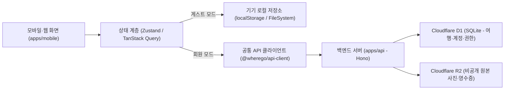

# 데이터 흐름도 (DFD)

이 문서는 게스트 모드(기기 저장소)와 회원 모드(Cloudflare D1·R2) 사이의 데이터 흐름과 저장 경계를 정의합니다.

---

## 1. 전체 데이터 흐름

---

## 2. 저장소별 역할과 일관성 규칙

1. **게스트 로컬 데이터 (`Local`)**:
   - 로그인하지 않은 사용자의 여행·일정·사진은 이 기기에만 저장됩니다.
   - 소셜 로그인 직후 기기 기록을 서버로 자동 덮어쓰지 않으며, 사용자가 명시적으로 가져오기를 선택한 여행만 서버로 병합합니다.
2. **회원 여행 스냅샷 (`D1 trips.snapshot`)**:
   - 정식 여행의 일차(`days`), 일정(`itinerary`), 지출(`expenses`), 영수증(`receipts`), 미디어 메타데이터(`media`), 체크리스트(`checklists`)는 `trips.snapshot` JSON과 권한 테이블(`trip_members`)에 `D1.batch`로 원자적 저장합니다.
   - 모든 변경 명령은 `version`(CAS)과 `(actor_id, request_key)` 멱등성 테이블(`mutation_requests`)을 통해 중복 실행을 차단합니다.
3. **비공개 미디어 및 공개 사본 분리 (`R2` / `posts`)**:
   - 원본 사진과 영수증 바이너리는 비공개 R2(`uploads`)에 보관하며 서명된 경로 또는 권한 검증을 거쳐서만 조회합니다.
   - 발자국 공개 게시물(`posts.snapshot`)은 소유자가 공개 허용한 일정·사진·총액 요약만 별도 사본으로 저장하며, 영수증 원본·품목·개인 메모는 포함하지 않습니다.
