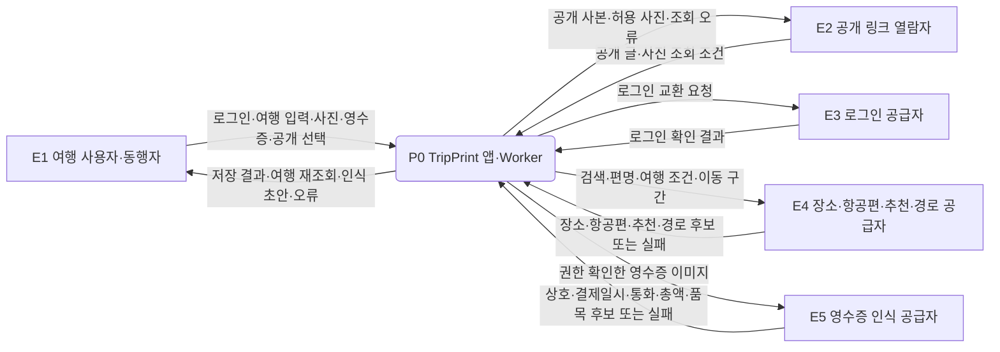
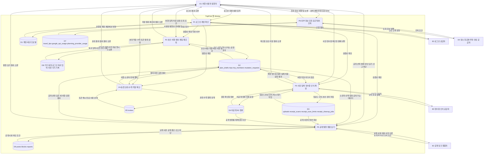
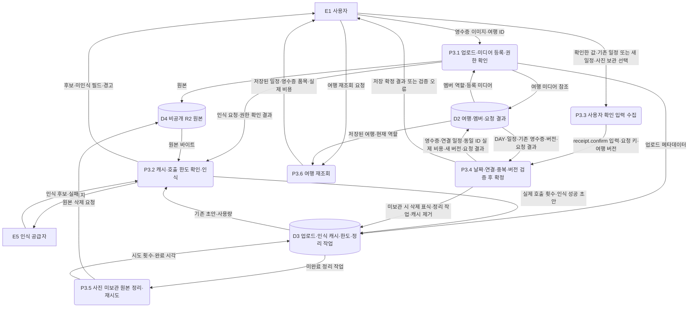

# TripPrint 데이터 흐름도와 저장 구조

상태: 현행 코드 대조 / 확인일: 2026-11-02 / 범위: 작업 트리의 앱·Worker·D1·R2 계약

여행 기본 정보를 입력하고 로그인한 뒤 초안이나 여행으로 저장합니다. 여행 안에서는 일정·영수증·비용을 연결하고, 소유자가 확인한 내용만 공개합니다. 이 문서는 그 과정에서 어떤 데이터가 어디로 이동하고 어디에 남는지 설명합니다.

기준 버전은 `d481938`에 기존 미커밋 변경을 포함한 작업 트리입니다. `0010_home_server_data.sql`과 홈 서버 저장 코드도 포함합니다. 코드와 SQL을 읽어 정리했으며 원격 DB 반영·배포·실제 사용자 조작을 이번에 검증한 것은 아닙니다. 과거 여행 생성 검수는 [V11 기록](v11_데이터흐름.md)에서 확인합니다.

## 1. 읽는 순서와 경계

DFD(Data Flow Diagram)는 **데이터가 오가는 과정**을 나타내는 그림입니다. 아래 Level 0은 서비스 전체, Level 1은 기능별 처리, Level 2는 영수증 처리를 보여줍니다. 화면 이동도와 DB 관계도는 별도 주제입니다.

- 사각형 `E`는 사용자나 외부 공급자입니다. 둥근 상자 `P`는 앱 또는 서버의 처리입니다. 원통 `D`는 저장소이며 화살표 이름은 전달 데이터입니다.
- 서비스 경계에는 앱과 Worker가 함께 들어갑니다. 사용자→DB, 외부 공급자→DB, 저장소→저장소로 직접 연결하지 않고 처리 과정을 거칩니다.
- [DB·객체 사전](<../02. 데이터정의/DB_객체사전.txt>)의 `[현행 안내 / 2026-11-02]`에서 물리 테이블과 컬럼을 찾습니다. `snapshot`은 한 시점의 여행 내용을 담은 JSON 문서입니다.
- [핵심 정책](<../../01. 서비스기획/01. 기능정의/핵심정책_확정사항.md>)은 사용자 승인 기준입니다. 정책과 코드가 다른 부분은 6절에 적었습니다.

## 2. Level 0 — 서비스 전체

외부 조회 결과는 입력을 돕는 후보입니다. 조회 성공이 여행 저장 성공을 뜻하지 않습니다. 인식 공급자는 실제 배포 설정에 따라 달라지며, 이미지 인식과 텍스트 OCR 경로가 코드에 있습니다. 사용자가 확인하기 전에는 일정·비용으로 확정하지 않습니다.

## 3. Level 1 — 기능별 처리와 저장소

그림의 `D1`~`D8`은 저장소 구분 번호입니다. 제품명 Cloudflare D1과 구분합니다. `D1`~`D3`, `D5`~`D7`은 같은 D1 DB 안의 테이블 묶음이며, 실제 별도 DB 여섯 개를 뜻하지 않습니다. 계정 복구·탈퇴, 기기 언어 설정의 상세 내부 흐름은 이 그림에서 생략했습니다.

| 처리           | 주요 API·명령                                                                                                                                                       | 저장·조회 기준                                                                                                                |
| -------------- | ------------------------------------------------------------------------------------------------------------------------------------------------------------------- | ----------------------------------------------------------------------------------------------------------------------------- |
| P1 로그인·계정 | `/api/auth/*`, 소셜 인증 교환, 회원 설정                                                                                                                            | `user`, `session`, `account`, `verification`, `rateLimit`, `profiles`, `guest_links`, `oauth_handoffs`, `account_retirements` |
| P2 작성·저장   | `GET /api/v1/plan-drafts`, `PUT/DELETE /api/v1/plan-drafts/:id`, `POST /api/v1/trips`, `GET /api/v1/trips/:tripId/workspace`, `POST /api/v1/trips/:tripId/commands` | 초안은 `plan_drafts`, 정식 여행은 `trips.snapshot`. 수정 명령은 요청 키와 여행 버전 비교                                      |
| P3 영수증      | `media.register`, `POST /api/v1/trips/:tripId/receipts/ocr`, `receipt.confirm/update/delete`                                                                        | 인식 캐시와 확정 기록을 분리. 비용과 영수증은 같은 ID로 연결                                                                  |
| P4 초대        | `invite.create/revoke`, `POST /api/v1/invites/accept`                                                                                                               | 토큰은 해시로 조회. 멤버·여행·초대 사용 상태를 같은 저장 단위에서 반영                                                        |
| P5 공개·담기   | `community.publish/withdraw`, `GET /public/community/:postId`, `POST /api/v1/community/:postId/import`                                                              | 원본과 공개 사본 분리. 담기는 현재 계정 소유의 새 여행 생성                                                                   |
| P6 정보 조회   | 장소·항공편·추천·경로 API, `GET /public/travel-tips?language=ko`                                                                                                    | 공급자 조회와 여행 저장 분리. 팁이 없으면 빈 목록                                                                             |

## 4. Level 2 — 영수증을 일정·비용에 연결

인식 초안에는 `needsConfirmation: true`가 들어갑니다. 인식 실패·부분 인식은 사용자가 다시 확인할 대상으로 남깁니다. 읽지 못한 통화·날짜·메뉴를 임의로 채우지 않습니다. 결제 날짜와 선택 DAY의 날짜가 같아야 확정할 수 있습니다.

기존 일정을 선택하면 내용을 덮어쓰지 않습니다. 새 일정이 필요하면 `itinerary[]`에 항목을 추가합니다. `receipts[]`의 품목 배열 `items[]`와 `expenses[]`의 실제 지출을 함께 저장합니다. 같은 원본 미디어의 이중 확정은 거부하며, 서로 다른 사진이 같은 결제를 찍은 경우는 별도 중복 검토가 필요합니다.

`receipt.update`는 같은 영수증과 비용을 교체합니다. 원본 식별자와 사진 보관 선택은 바꾸지 않습니다. `receipt.delete`는 영수증과 같은 ID의 비용을 제거하지만 연결 일정과 보관 사진을 함께 지우지 않습니다. 사진 미보관 확정은 DB 저장과 정리 작업 등록을 먼저 끝내며 R2 삭제 실패는 재시도합니다. DB와 R2 전체가 하나의 트랜잭션인 것은 아닙니다.

## 5. 저장 결과와 실패 복구

| 상황                       | 처리 원칙·사용자가 이어서 할 일                                                                                                    |
| -------------------------- | ---------------------------------------------------------------------------------------------------------------------------------- |
| 입력 후 로그인 필요        | 로그인 전 입력을 보존해 돌아오되 로그인만으로 저장 완료로 표시하지 않음. 사용자가 저장 행동을 이어감                               |
| 초안 저장                  | 계정당 최대 5개. `revision`으로 다른 기기의 변경 확인. 생성 전 초안 버전을 대조하고 정식 생성과 초안 제거를 같은 D1 batch에서 처리 |
| 회원 여행 수정             | `Idempotency-Key`와 `If-Match: "trip:<tripId>:<version>"` 사용. 현재 버전일 때만 저장                                              |
| 저장 응답 유실             | 같은 본문·키로 결과 확인. 같은 키에 다른 본문은 `REQUEST_KEY_REUSED`                                                               |
| 버전 충돌                  | 최신 여행을 다시 조회해 작성 내용과 비교한 뒤 새 저장 시도. 서버 원본을 임의로 덮어쓰지 않음                                       |
| 저장 확정 후 재조회 실패   | 저장 실패로 단정하지 않고 조회를 재시도. 두 번째 여행·비용을 만들지 않음                                                           |
| 인식 실패·미지원 통화      | 오류·후보를 확인하고 다시 인식하거나 허용된 입력을 확인. 다른 통화로 바꾸어 성공 처리하지 않음                                     |
| 사진 미보관 원본 삭제 실패 | 확정한 기록은 유지. `receipt_cleanup_jobs`에 남은 작업을 예약 실행에서 재시도                                                      |
| 공개 열람                  | `posts.snapshot`과 허용 사진만 반환. 영수증 원본·품목·개인 메모·멤버 개인정보를 자동 공개하지 않음                                 |
| 이전 게스트·기기 초안      | 신규 회원 저장 경로와 구분해 보존. 로그인만으로 자동 이전·삭제하지 않음                                                            |

## 6. 현행 코드와 확정 정책의 차이

| 쟁점                  | 코드에서 확인한 사실                                                                               | 정책·추가 결정과 남은 확인                                                                                               |
| --------------------- | -------------------------------------------------------------------------------------------------- | ------------------------------------------------------------------------------------------------------------------------ |
| 초대 유효기간         | `workspaceModel.ts`의 기본값은 24시간                                                              | 승인 정책은 7일. 이번 문서 정리에서 코드를 변경하지 않음                                                                 |
| 기존 멤버의 초대 수락 | 수락 경로에 기존 멤버 처리와 초대 소비가 함께 존재                                                 | 승인 정책의 기존 멤버 미소비 및 동시 수락은 별도 구현·회귀 확인 필요                                                     |
| 로그인 전 저장        | 익명 세션의 정식 생성·공개 여행 담기·초안 쓰기 제한 코드가 있음. 이전 게스트 기기 저장도 남아 있음 | 기본 입력 체험과 기존 자료 보호를 포함한 전체 흐름의 실제 검증 필요                                                      |
| 실제 방문·인증 표현   | 확정 영수증은 `WorkspaceReceipt`와 일정에 연결. 별도 D1 `visits` 테이블·진위 보증 필드는 없음      | 영수증만으로 본인 방문이나 원본 진위를 보장하지 않음. 계획과 실제 방문을 구분하는 추가 모델·배지는 별도 정책과 개발 대상 |
| 결제·업로드 시각      | 업로드 메타데이터의 `created_at`과 영수증의 `date`·`transactionTime`은 별개                        | 영수증별 현지 시간대·여행 후 일괄 등록·다른 사진 중복의 수용 기준은 후속 검토에 유지                                     |
| 마이그레이션 적용     | SQL 11개를 빈 로컬 SQLite에 순서대로 적용하면 업무 테이블 24개·컬럼 131개 생성                     | 원격 D1에 0010까지 반영됐는지는 이번에 조회하지 않음. 두 `0007_` 파일은 둘 다 포함                                       |

## 7. 구현 근거

- 서버 조립·인증: `apps/api/src/app.ts`, `features/auth/cloudAuth.ts`, `features/auth/socialHandoff.ts`.
- 여행 저장: `apps/api/src/features/trips/cloudRpc.ts`, `apps/api/src/infrastructure/storage/cloudStore.ts`.
- 서버 초안·팁: `apps/api/src/features/planning/homeData.ts`.
- 영수증: `apps/api/src/features/receipts/ocr.ts`, `receiptAnalysis.ts`, `receiptCache.ts`, `receiptCleanup.ts`.
- 파일·공개 이미지: `apps/api/src/features/media/cloudMedia.ts`, `publicImage.ts`.
- 공통 객체·검증: `packages/domain/src/workspace.ts`, `packages/validation/src/workspace.ts`, `workspaceModel.ts`, `receiptDuplicates.ts`.
- 현행 SQL: `apps/api/migrations/*.sql`. 이전 백엔드와 호환 검사 자료: `supabase/migrations/*.sql`.
- 기기 기록: `apps/mobile/src/services/guestWorkspaceStorage.ts`, `apps/mobile/src/features/workspace/creationAuthHandoff.ts`, `legacyCreationDraftStorage.ts`.

문서 정리의 검사 결과는 [2026-11-02 검수 보고](<../../05. 검수/02. 검수보고/2026-11-02_DFD_DB_정리검수.md>)에 남깁니다.
